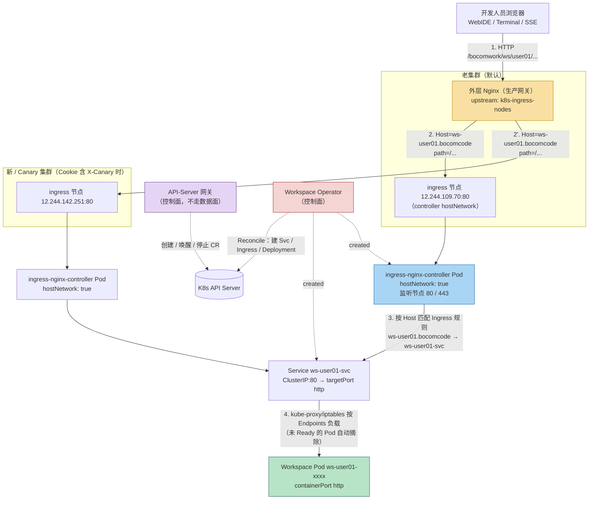
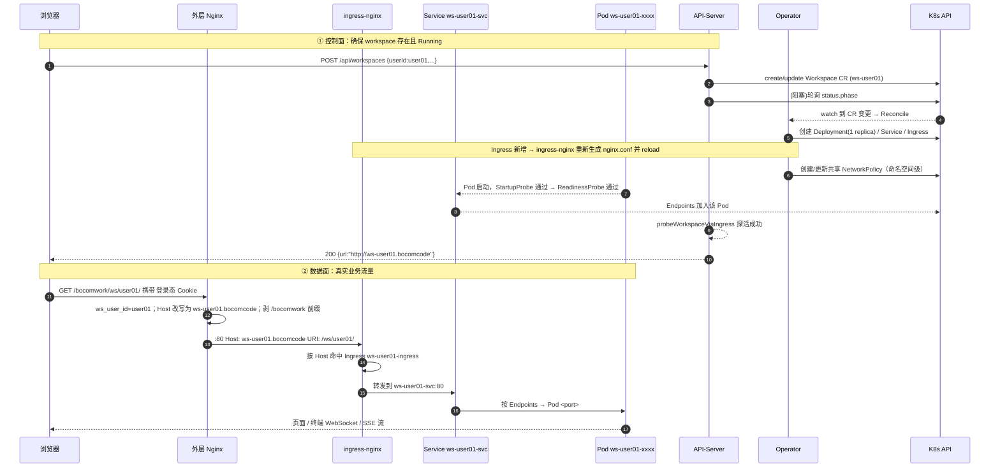
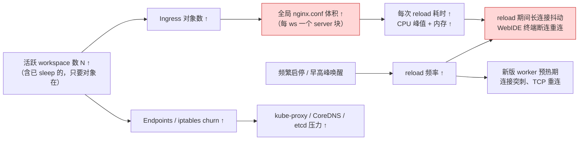
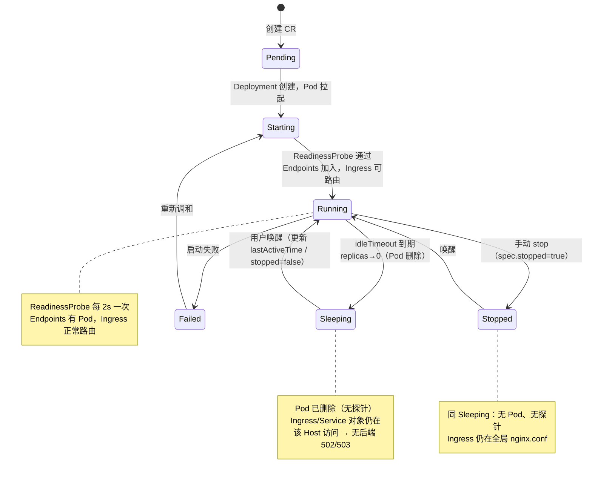

# 网络外部访问到 Agent Pod 的完整流量路径

> 本文描述**外部用户（浏览器 / WebIDE / 三方平台）如何一路访问到某个用户专属的 Agent Workspace Pod**，以及
> workspace 的 `stop` / `sleep` 语义、Ingress 在其中的作用、以及**集群规模变大、频繁启停时网络层面会产生什么压力**。
>
> 关键结论均以仓库真实实现为依据，附 `file:line` 便于核对：
> - 外层 nginx 配置：本文开头的 upstream/location 片段（生产网关，仓库外维护）
> - Ingress 控制器部署：`deploy/ingress-deploy.yaml`
> - Operator 动态创建 Service / Ingress：`internal/controller/workspace_controller.go`
> - API-Server 创建 / 唤醒 / 停止 / 探活：`cmd/api-server/main.go`
> - 规模瓶颈分析：`docs/large_scale_optimization_todo.md`

---

## 0. 一句话总览

外部请求的完整链路是：

```
浏览器
  └─(HTTP, /bocomwork/ws/<user>/...)→ 外层 Nginx（生产网关，按 Cookie oa 提取用户）
        └─(改写 Host=ws-<user>.bocomcode，剥掉 /bocomwork 前缀)→ 某台 ingress 节点 :80
              └─→ ingress-nginx-controller（hostNetwork 直接监听节点 80/443）
                    └─(按 Host 命中该 workspace 专属 Ingress)→ 该 workspace 专属 Service :80
                          └─(Endpoints 由 readiness 把关)→ 该 workspace 的 Pod :<containerPort>
```

**核心要点**：**每个 Workspace 有自己独立的 Ingress、Service**，Host 为 `<workspace名>.<WORKSPACE_DOMAIN>`
（`WORKSPACE_DOMAIN` 生产为 `bocomcode`，见 `config/manager/manager.yaml:99-100`），workspace 名固定为
`ws-<userId>`（`cmd/api-server/main.go:385`、`:438`）。外层 nginx 做的就是**把「一个按路径/用户区分的公网请求」翻译成「一个按 Host 区分的 Ingress 请求」**。

---

## 1. 分层架构与流量拓扑总图



> 注意：**控制面（API-Server / Operator）与数据面（浏览器→Pod）是两条完全独立的路径**。API-Server 只负责
> 增删改 Workspace CR 与阻塞轮询状态；真正带着用户 WebSocket/HTTP 流量到 Pod 的，是外层 nginx → Ingress → Service 这条数据面。

---

## 2. 逐跳拆解：每一层到底做了什么

### 2.1 第一跳：外层 Nginx（生产网关）

外层 nginx 有两组 upstream，对应**两套 k8s 集群（老集群 / 金丝雀新集群）**：

```nginx
upstream k8s-ingress-nodes         { server 12.244.109.70:80; }   # 老集群 ingress 节点
upstream k8s-ingress-nodes-canary  { server 12.244.142.251:80; }   # 新集群 ingress 节点
upstream workspace-server          { 12.244.109.69/70/71:30000; }  # 老集群 launcher API（NodePort 30000）
upstream workspace-server-canary   { 12.244.142.251/252/253:30000; } # 新集群 launcher API
```

它承担了四件事：

1. **身份解析（谁是当前用户）**：
   ```nginx
   map $http_referer $referer_user_id {
       "~^http://[^/]+/bocomwork/ws/([^/?]+)"  $1;   # 从 Referer 的路径里捞 userId（兜底）
       default                                  "";
   }
   map $cookie_oa $ws_user_id {
       ""      $referer_user_id;   # Cookie oa 为空 → 用 Referer 兜底
       default $cookie_oa;         # 正常情况直接用 Cookie oa
   }
   ```
   最终用户 ID 落到变量 `$ws_user_id`。**这是一个关键安全前提**：后续所有路由都以它为身份标识，缺了就 400。

2. **把「路径」翻译成「Host」（最关键的一步）**：在 `location /bocomwork/` 里
   ```nginx
   proxy_set_header Host "ws-$ws_user_id.bocomcode";   # 改写 Host，变成该用户的专属域名
   proxy_set_header OA $ws_user_id;
   proxy_set_header WorkspaceUser $ws_user_id;
   rewrite ^/bocomwork/(.*)$ /$1 break;                 # 剥掉 /bocomwork 前缀
   proxy_pass http://k8s-ingress-nodes;                 # 转给 ingress 节点
   ```
   也就是说，`http://外层入口/bocomwork/ws/user01/foo` 会被改写成对 ingress 节点的一次请求：
   `Host: ws-user01.bocomcode`、`URI: /ws/user01/foo`。**Host 里同时带上了用户身份（`ws-user01`）**，
   于是 ingress 无需再关心公网路径结构，只按 Host 找到对应 workspace 的 Ingress 即可。

3. **WebSocket / SSE 长连接支持**：
   ```nginx
   map $http_upgrade $connection_upgrade { default upgrade; '' close; }
   proxy_http_version 1.1;
   proxy_set_header Upgrade $http_upgrade;
   proxy_set_header Connection $connection_upgrade;
   proxy_set_header X-Accel-Buffering "no";
   proxy_buffering off;
   proxy_read_timeout 86400s;   # 24h，足以支撑长时间无流量的 WebSocket
   ```
   这保证 WebIDE 的终端（Terminal/Agent Socket）、流式输出（SSE）不会被缓冲或超时截断。

4. **灰度分流（金丝雀）**：只要 Cookie 里含 `X-Canary=(new|canary|true|1)`，就把流量改发到
   `k8s-ingress-nodes-canary`；否则默认老集群。`workspace-api`（launcher 控制面）同样按此规则在
   `workspace-server` / `workspace-server-canary` 之间切换。

> ⚠️ 配置细节提醒（见 §6.3）：`/bocomwork/workspace-api-canary/` 这个 `location` 在给定配置里**重复定义了两次**，
> nginx 会对重复 `location` 报 `duplicate location` 错误（同一 server 块内 location 必须唯一）。这属于配置瑕疵，
> 部署前需删掉其中一份，否则 reload 失败。

### 2.2 第二跳：ingress-nginx-controller（数据面的核心）

部署见 `deploy/ingress-deploy.yaml`，几个决定性事实：

| 事实 | 依据 | 含义 |
| :--- | :--- | :--- |
| **`hostNetwork: true`** | `deploy/ingress-deploy.yaml:449` | controller Pod 直接使用宿主机网络命名空间，**直接监听节点 80 / 443**，不经过 Service 的 NodePort 转发（Service 虽然 `type: NodePort`，但 hostNetwork 下容器端口即节点端口）。因此外层 nginx 写 `12.244.109.70:80` 是对的。 |
| `dnsPolicy: ClusterFirstWithHostNet` | `:538` | hostNetwork 下仍能解析集群内部域名。 |
| 副本数 `replicas: 2`，`podAntiAffinity` | `:416`、`:437-448` | 两个 controller 实例，尽量分散到不同节点，避免单点。 |
| 监听 `--ingress-class=nginx` | `:455` | 只处理 `ingressClassName: nginx` 的 Ingress（Operator 创建的就是这个 class，见 §2.3）。 |
| ConfigMap 高并发调优 | `deploy/ingress-deploy.yaml:317-334` | `worker-processes: auto`、`worker-connections: 65536`、`use-reuseport: true`、`upstream-keepalive-connections: 320`、`keep-alive-requests: 10000` 等，面向大量并发长连接做过优化。 |

ingress-nginx 的工作方式：它 **watch 集群里所有 `Ingress` 对象**，把它们**统一编译成一份全局 `nginx.conf`**，
然后 `nginx -s reload` 让新配置生效。**注意「全局」这个词**——这正是后文 §4 压力的根源：不是每个 Ingress
各有一份配置，而是**所有 workspace 的 Ingress 共享同一份大配置**，任何增删都会触发整份配置的重生成 + reload。

### 2.3 第三跳：Service 与「每 workspace 一个 Ingress」

Operator 在 `Reconcile` 中依次协调 PVC → Workload → Service → Ingress（`workspace_controller.go:291-314`）。其中：

- **Service**（`reconcileService`，`:1412-1476`）：`<ws>-svc`，类型 `ClusterIP`，端口 `80 → targetPort "http"`，
  按 `buildSelectorLabels`（`app=workspace, workspace=<ws>`）选中本 workspace 的 Pod。
- **Ingress**（`reconcileIngress`，`:1478-1588`）：`<ws>-ingress`，`ingressClassName: nginx`，
  **Host = `getWorkspaceHost(ws.Name)` = `<ws名>.<WORKSPACE_DOMAIN>`**（`:1483`、`:2264-2270`），
  path `/` → backend `Service: <ws>-svc:80`。
  - 附带一批 nginx 注解：`proxy-read-timeout: 86400`、`proxy-buffering: off`、`proxy-http-version: 1.1`、
    `limit-connections: 200`、`proxy-next-upstream: error timeout ... http_502 http_503` 等（`:1523-1534`），
    与外层 nginx 的长连接语义对齐。

也就是说，**一个用户 workspace 在数据面上对应「1 个 Ingress + 1 个 Service + N 个 Pod 副本」**。
Host 唯一，所以不同的 workspace 在 ingress 的同一份 nginx.conf 里，是一条条不同的 `server { server_name ws-xxx.bocomcode; }`。

### 2.4 第四跳：Service → Pod（Endpoints 与 readiness）

Service 本身只是 iptables/IPVS 规则，真正决定「后端有没有 Pod、哪个 Pod 能接流量」的是 **Endpoints**
（由 kube-proxy 维护）。而 Endpoints 里会**排除未通过 readinessProbe 的 Pod**。

Operator 给每个 workspace Pod 配了探针（`workspace_controller.go:2291-2319`）：

| 探针 | 参数 | 说明 |
| :--- | :--- | :--- |
| **StartupProbe** | Initial 1s, Timeout 3s, Period 2s, **FailureThreshold 30** | 最多容忍约 60s 启动；给 ossfs/NAS 冷启动留足时间，避免误判重启。 |
| **ReadinessProbe** | Initial 1s, Timeout 3s, Period 2s, FailureThreshold 3 | **每 2s 探一次**；连续失败 3 次（约 6s）就从 Endpoints 摘除。 |
| 探针方式 | `HealthPath` 有值 → HTTP GET `/xxx`；否则 → **TCP socket** 连 `http` 端口 | 见 `getProbeHandler`，`workspace_controller.go:2272-2289`。 |

所以流量只会打到 **Ready 的 Pod**；Pod 起来前或异常时，Service 没有可用 Endpoints，ingress 会返回 5xx
（此时注解 `proxy-next-upstream ... http_502 http_503` 会尝试重试/换后端）。

---

## 3. 时序图：一次「打开 workspace 并开始编码」的全过程



---

## 4. Ingress 在其中的作用（以及与「每 workspace 一 Ingress」的代价）

### 4.1 Ingress 到底解决了什么问题

- **第 7 层（Host/Path）路由**：把「同一个 80 端口进来的、不同 Host 的请求」分派到不同后端。
  这是四层 NodePort/LB 做不到的——外层 nginx 已把所有用户压到同一个 `12.244.109.70:80`，只有靠 **Host**
  才能区分「这是 user01 还是 user02」。
- **把「随机 IP + 随机端口」的 Pod 抽象成「稳定域名」**：Pod 重建后 IP 会变，但 `<ws>.bocomcode` 这个
  Ingress 规则不变，Service 的 Endpoints 自动更新，**使用者永远只认域名**。
- **统一承载长连接**：readiness 把非 Ready Pod 摘除；注解里的 read/send timeout 86400s、buffering off 保证
  WebSocket/SSE 不被截断。

### 4.2 关键事实：Ingress 是**每个 workspace 一份**，不是共享一份

这是理解后面「压力」问题时最重要的一点。当前实现里：

```
workspace ws-user01  →  Ingress ws-user01-ingress (server_name ws-user01.bocomcode)
workspace ws-user02  →  Ingress ws-user02-ingress (server_name ws-user02.bocomcode)
...
workspace ws-userN    →  Ingress ws-userN-ingress
```

而 ingress-nginx **把所有 Ingress 编译进同一份全局 nginx.conf**。所以：

> **N 个 workspace = 同一份 nginx.conf 里的 N 个 server 块。任何一次 workspace 的创建 / 删除 / 规格变化，
> 都会导致整份 nginx.conf 重新生成 + 全量 `reload`。**

仓库自带的分析已经点明这一点（`docs/large_scale_optimization_todo.md`）：

> 「网络与路由：每个 Workspace 独立维护 1 个 Ingress → 5,000 个 Ingress 导致 Nginx 配置文件膨胀数十 MB，
> 频繁变更引发无休止的 `nginx -s reload`，长连接（WebIDE WebSocket）频繁断连。」

---

## 5. stop / sleep 的 workspace 还会「一直被探活」吗？——探活压力精确定位

这是最容易误解的地方，必须把「几种探活」区分开。

### 5.1 先看 stop / sleep 到底做了什么

- **stop**：`stopWorkspaceHandler` 把 `spec.stopped=true`（`cmd/api-server/main.go:933`），Operator 由
  `computeDesiredReplicas`（`workspace_controller.go:1393-1410`）把 Deployment **replicas 置 0**，Phase → `Stopped`。
- **sleep**：`idleTimeout` 到期（或从未唤醒），同样 `computeDesiredReplicas` 返回 0，Phase → `Sleeping`（`:356-358`）。

**两者都会把 Pod 删掉（replicas=0）。** 但请注意，Operator **不会删除** 该 workspace 的 Ingress / Service
对象（`reconcileIngress`/`reconcileService` 在停止期间照常执行，对象保留，只是后端没有 Pod）。

### 5.2 三种「探活」的真相

| 探活类型 | 谁发起 | 对 stop/sleep 的 workspace 是否继续 | 压力性质 |
| :--- | :--- | :--- | :--- |
| **Pod 就绪探针**（readiness/startup） | **kubelet**，探测对象是 Pod | **不会**。replicas=0 → 没有 Pod → 没有容器 → 没有探针。 | 无（Pod 不存在） |
| **Ingress 健康检查** | ingress-nginx 自身 liveness/readiness，及 `nginx -s reload` | 控制器自身的探针**始终在跑**（与 workspace 数量无关），但**不针对某个 workspace Pod 探活**。 | 与 workspace 数无关，恒定 |
| **API-Server 的 Ingress 探活** | API-Server 在 create/wakeup 时 `probeWorkspaceViaIngress` 发一次 GET 打到 ingress（`:802-880`） | 只在**用户点创建/唤醒**的那次请求里探，**不会对已 sleep 的 workspace 周期探活**。 | 与「同时唤醒人数」成正比，与在线总数无关 |

**结论（针对「stop/sleep 是不是一直在探活」）：**

- 对**已经 stop / sleep（replicas=0）** 的 workspace，**没有 Pod，因此没有周期性探针**——不存在「一直在探活」。
- 真正**一直存在**的探活，是 **ingress-nginx 控制器自身** 的 liveness/readiness（`/healthz`，2 个副本、每 10s 一次，
  `deploy/ingress-deploy.yaml:478-508`），这是**常数级**开销，与 workspace 数量无关。
- **但是**——真正的隐性成本不在「探活」，而在 **Ingress 对象本身一直存在**：即使 workspace 睡了，它的
  `server_name` 仍然躺在全局 nginx.conf 里。所以「睡了」并不等于「网络层面零成本」，它只是「不产生数据面流量 + 不产生 Pod 探针」。

> 一句话：**stop/sleep 不会造成持续探活压力**；真正的持续成本是「Ingress/Service 对象数量本身」以及「每次启停触发全量 reload」。

### 5.3 那会不会「一旦唤醒就有一批并发探活」？

会，但那是**业务高峰的自然流量**，不是后台周期探活：

- 早高峰几百人同时唤醒 → API-Server 对每个唤醒请求都 `probeWorkspaceViaIngress` 反复 GET（打到 ingress 的 `/health`），
  直到 workspace Running 且探活成功才返回（`writeRunningResult`，`:785-800`）。这是**短时并发探活尖峰**，
  也是 `large_scale_optimization_todo` 里点名的「早高峰数百人并发唤醒产生海量轮询探活流量，雪崩故障」。
- 同时，**首次创建**（而非单纯唤醒）的 workspace 会新增 Ingress → 触发 §4.2 的全量 reload，**与探活叠加**，
  是早高峰最危险的组合（注意：单纯「唤醒」一个已存在的 workspace 通常不新增 Ingress，只有首次创建才新增，
  详见 §6.1）。

---

## 6. 集群变多、频繁启停带来的网络压力（重点分析）

### 6.1 「每启动 / stop / sleep 一个 workspace 都会引发网络重建吗？」——部分会

要精确区分「重建」发生在哪一层：

| 事件 | 会发生什么 | 影响范围 |
| :--- | :--- | :--- |
| workspace **新建** | Operator 创建 Service + Ingress | **全局 nginx.conf 增一条 server → reload**；同时新增对象到 apiserver/etcd |
| workspace **唤醒**（sleep→Running） | replicas 0→1，Pod 重建；Ingress/Service 已在，通常**不**新增 Ingress | 主要是 Pod 重建 + Endpoints 更新；**若 Ingress 无变化则不 reload** |
| workspace **手动 stop**（Running→Stopped，replicas 0） | Pod 删除、Endpoints 清空；**Ingress/Service 对象保留** | 不新增/删除 Ingress，通常**不**触发 reload；但数据面该 Host 变成 502/503 |
| workspace **空闲 sleep**（idleTimeout） | 同 stop（replicas→0） | 同上 |
| workspace **删除** | Ingress/Service/Deployment 级联删除 | **全局 nginx.conf 删一条 server → reload** |

所以准确的表述是：

- **「新用户/新 workspace 首次创建」和「删除 workspace」会触发 ingress 的配置重建 + reload**；
- **单纯的 stop / sleep（replicas=0）本身不改变 Ingress 对象**，所以**不直接触发 reload**，但它会**让该 Host 的后端消失**；
- 但如果 Operator 的调和因任何原因改写了 Ingress（例如注解/标签变更、或调和过程中出现 spec diff），仍可能触发 reload。

**真正的「网络重建」概念可以拆成三层**（下文 §6.2 每层都在放大）：

1. **Ingress 配置层重建**：所有 Ingress → 一份全局 nginx.conf → reload。workspace 越多，单次 reload 越慢、越大。
2. **Endpoints / iptables 层重建**：Pod 上下线导致 kube-proxy 更新 iptables/IPVS 规则，Endpoints 增删。
3. **连接层重建**：reload 期间（尤其是旧 worker 优雅退出窗口）**已建立的 WebSocket/SSE 长连接可能被中断**，前端需重连。

### 6.2 层层放大的压力模型



具体量化（结合 `docs/large_scale_optimization_todo.md` 的目标 3,000~5,000 workspace）：

- **对象数**：每个 workspace 7~9 个关联对象（Deployment/RS/Pod/Service/Ingress/NetPol/PVC…），5,000 实例 →
  **3.5 万 ~ 4.5 万个对象**，apiserver/etcd 内存与 watch 回放压力显著上升。
- **nginx.conf 体积**：数千个 `server` 块 → 配置文件可达**数十 MB**；`nginx -s reload` 要做语法解析 + 建新 worker +
  优雅关旧 worker，**单次耗时随规模线性增长**，CPU 出现尖峰。
- **reload 与长连接的冲突**：WebIDE 的终端是**长 WebSocket**（`proxy-read-timeout: 86400s`）。每次 reload，
  旧 worker 进入 `shutting down`，正在承载的长连接可能被关闭 → 前端 `onclose` → 重连 → **又打一轮 backend**。
  频繁启停时，这种「断连-重连」会放大成雪崩。
- **API-Server 探活尖峰**：一次 create/wakeup 阻塞轮询 + Ingress 探活，早高峰数百并发 → 海量短时探活。
- **kube-proxy/iptables**：Pod Endpoints 频繁增删，iptables 规则重写本身是 O(规则数) 的，大集群下变成全局抖动。

### 6.3 配置层面的两个隐患（顺带指出）

1. **`/bocomwork/workspace-api-canary/` location 重复定义两次**：nginx 会报 `duplicate location`，
   reload 直接失败（旧配置继续生效，新配置不上线）。生产上线前必须删掉一份。
2. **外层 nginx 的 upstream 只有单节点**：`k8s-ingress-nodes` 只写了 `12.244.109.70:80` 一个 server，
   `k8s-ingress-nodes-canary` 只写了 `12.244.142.251:80` 一个。而 ingress controller 本身有 2 副本（可能在不同节点）。
   **单 upstream 节点**意味着该节点故障即整条数据面入口不可用（无 health check、无多节点冗余）。
   建议把 ingress 节点做成多 server 并加 `max_fails`/`fail_timeout` 健康检查。

---

## 7. 生命周期状态与网络可见性对照



**状态 → 网络资源映射表：**

| Phase | Pod | Endpoints | Ingress/Service | 数据面 | 探针 |
| :--- | :--- | :--- | :--- | :--- | :--- |
| Pending/Starting | 正在创建 | 空 | 已创建 | 502/503 | StartupProbe 进行中 |
| Running | 有 | 有 | 已创建 | 正常 | Readiness 每 2s |
| Sleeping | 无（replicas 0） | 空 | 保留 | 502/503 | 无 |
| Stopped | 无（replicas 0） | 空 | 保留 | 502/503 | 无 |
| Failed | 视情况 | 空/部分 | 已创建 | 不稳定 | 视 Pod 状态 |

---

## 8. 优化方向（针对上述压力）

结合仓库已有 TODO 与本文分析，按性价比排序：

1. **合并 Ingress（降低对象数 / 减少 reload）**：不再「每 workspace 一个 Ingress」，改为**一个共享 Ingress + 按
   Host/Path 的规则聚合**（例如外部 nginx 直接用 Host 负载到单入口，或使用 `nginx.ingress.kubernetes.io/server-alias`）。
   从根本上把「N 份配置的反复重写」变成「一份配置、只改一条规则」。
2. **考虑用 CRD/网关类方案替代逐对象 Ingress**：如 Gateway API 的 HTTPRoute（同样需评估其配置重生成行为），
   或把路由维护下沉到外层 nginx + 服务发现，减少集群内对象 churn。
3. **控制 reload 频率**：ingress-nginx 在批量事件下可合并 reload（`--update-status`/batch 处理），并监控
   `nginx_ingress_controller_nginx_reload_errors_total`、`..._success` 与 reload 耗时。
4. **长连接 resilience**：设置合理的 `worker-shutdown-timeout`（让旧 worker 优雅退出，减少长连接被硬断），
   Worker 数按 CPU `auto`（已是现状）。
5. **减少无谓写放大**：确保 Operator 有精准 Diff（`large_scale_optimization_todo` Task 1.2 已实现），避免稳态下
   改写 Ingress 触发无意义 reload。
6. **外层 nginx 入口冗余**：upstream 增加多节点 + 健康检查，避免单 ingress 节点成为数据面单点（§6.3）。
7. **API-Server 探活与轮询节流**：唤醒探活加退避 / 缓存 / 并发上限，避免早高峰探活风暴。
8. **避免对 sleep workspace 做任何周期探活**：现状已如此（replicas=0 无 Pod）。若未来引入「预热池」，务必
   把预热与「用户真实 workspace」的探活分开，避免放大。

---

## 附录 A：关键代码 / 配置索引

| 关注点 | 位置 |
| :--- | :--- |
| Ingress 控制器部署（hostNetwork / ConfigMap / 探针） | `deploy/ingress-deploy.yaml:317-538` |
| 每 workspace 创建 Service | `internal/controller/workspace_controller.go:1412-1476` |
| 每 workspace 创建 Ingress（Host 规则 + 注解） | `internal/controller/workspace_controller.go:1478-1588` |
| Host 生成（`<ws>.<WORKSPACE_DOMAIN>`） | `internal/controller/workspace_controller.go:2264-2270` |
| 探针定义（Startup/Readiness） | `internal/controller/workspace_controller.go:2291-2319` |
| replicas 0/1 决策（stop / idle sleep） | `internal/controller/workspace_controller.go:1393-1410` |
| 共享 NetworkPolicy（出站隔离，不入站限制） | `internal/controller/workspace_controller.go:1610-1727`、`:1729-1800` |
| workspace 命名 `ws-<userId>` / API 路由 | `cmd/api-server/main.go:385,438,920-1020` |
| 创建/唤醒时 Ingress 探活 | `cmd/api-server/main.go:785-880` |
| `WORKSPACE_DOMAIN=bocomcode` | `config/manager/manager.yaml:99-100` |
| 规模瓶颈与优化待办 | `docs/large_scale_optimization_todo.md` |

## 附录 B：本文与现有文档的边界

- 本文聚焦**入站（南北向）**：外部 → Pod 的数据面路径，以及启停对 ingress 配置的影响。
- **出站（egress）** 白名单不在本文范围，见 [egress_domain_whitelist_design.md](egress_domain_whitelist_design.md)。
- 存储层（OSS/ossfs）不在本文范围，见 [oss_storage_architecture.md](oss_storage_architecture.md) 与
  [deployment_architecture.md](deployment_architecture.md)。
- 裸 Pod 承载对运维语义的影响见 [analysis/bare_pod_platform_behavior.md](analysis/bare_pod_platform_behavior.md)。

## 附录 C： nginx参考配置

```
upstream k8s-ingress-nodes {
    server 12.244.109.70:80;
}

upstream k8s-ingress-nodes-canary {
    server 12.244.142.251:80;
}

upstream workspace-server {
    server 12.244.109.69:30000;
    server 12.244.109.70:30000;
    server 12.244.109.71:30000;
}

upstream workspace-server-canary {
    server 12.244.142.251:30000;
    server 12.244.142.252:30000;
    server 12.244.142.253:30000;
}

# 1. 用户名提取：Cookie 优先，Referer 兜底原样提取
map $http_referer $referer_user_id {
    "~^http://[^/]+/bocomwork/ws/([^/?]+)"  $1;
    default                                 "";
}

map $cookie_oa $ws_user_id {
    ""      $referer_user_id;   # Cookie 为空时用 Referer 兜底
    default $cookie_oa;         # 正常情况下直接用 Cookie
}

# 动态支持 WebSockets (Terminal/Agent Socket) 与 普通 HTTP/SSE
map $http_upgrade $connection_upgrade {
    default upgrade;
    ''      close;
}

# -------------------------------------------------------------------------
# 【平台控制面 API】：创建/唤醒 Workspace 极简接口代理
# -------------------------------------------------------------------------
location /bocomwork/workspace-api/ {
    proxy_set_header Host "launcher.workspace.bocomcode";
    proxy_set_header X-Real-IP $remote_addr;
    proxy_set_header X-Forwarded-For $proxy_add_x_forwarded_for;
    # 仅通过 Cookie 中的 X-Canary 判断：命中灰度转发新集群
    if ($http_cookie ~* "X-Canary=(new|canary|true|1)") {
        rewrite ^/bocomwork/workspace-api/(.*)$ /$1 break;
        proxy_pass http://workspace-server-canary;
    }

    # 2. 默认：转发老集群
    rewrite ^/bocomwork/workspace-api/(.*)$ /$1 break;
    proxy_pass http://workspace-server;
}

location /bocomwork/workspace-api-canary/ {
    proxy_set_header Host "launcher.workspace.bocomcode";
    proxy_set_header X-Real-IP $remote_addr;
    proxy_set_header X-Forwarded-For $proxy_add_x_forwarded_for;
    
    # 2. 默认：转发老集群
    rewrite ^/bocomwork/workspace-api-canary/(.*)$ /$1 break;
    proxy_pass http://workspace-server-canary;
}
	
# -------------------------------------------------------------------------
# 【规则 2】：通用前缀拦截 (/bocomwork/...)
# -------------------------------------------------------------------------
location /bocomwork/ {
    if ($ws_user_id = "") {
        return 400 '{"error": "Missing Workspace context."}';
    }
    # 统一在 location 层设置所有代理参数与 WebSocket/SSE 长连接支持
    proxy_set_header Host "ws-$ws_user_id.bocomcode";
    proxy_set_header OA $ws_user_id;
    proxy_set_header WorkspaceUser $ws_user_id;
    proxy_set_header X-Real-IP $remote_addr;
    proxy_set_header X-Forwarded-For $proxy_add_x_forwarded_for;
    proxy_set_header X-Forwarded-Proto $scheme;
    proxy_http_version 1.1;
    proxy_set_header Upgrade $http_upgrade;
    proxy_set_header Connection $connection_upgrade;
    proxy_set_header X-Accel-Buffering "no";
    proxy_buffering off;
    proxy_cache off;
    chunked_transfer_encoding on;
    proxy_read_timeout 86400s;
    proxy_send_timeout 86400s;
    # 仅通过 Cookie 中的 X-Canary 判断：命中灰度转发新智能体集群
    if ($http_cookie ~* "X-Canary=(new|canary|true|1)") {
        rewrite ^/bocomwork/(.*)$ /$1 break;
        proxy_pass http://k8s-ingress-nodes-canary;
    }
    # 2. 默认：转发老智能体集群
    rewrite ^/bocomwork/(.*)$ /$1 break;
    proxy_pass http://k8s-ingress-nodes;
}
```