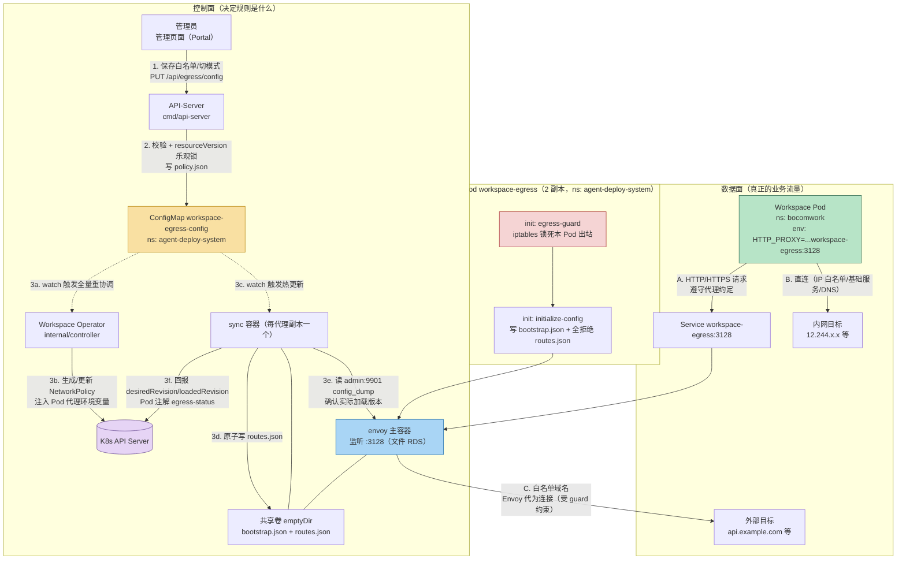
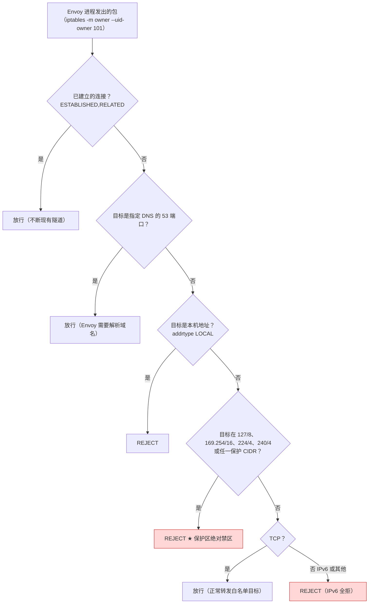
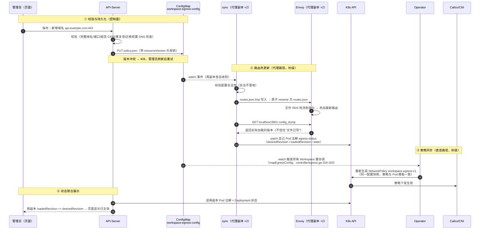
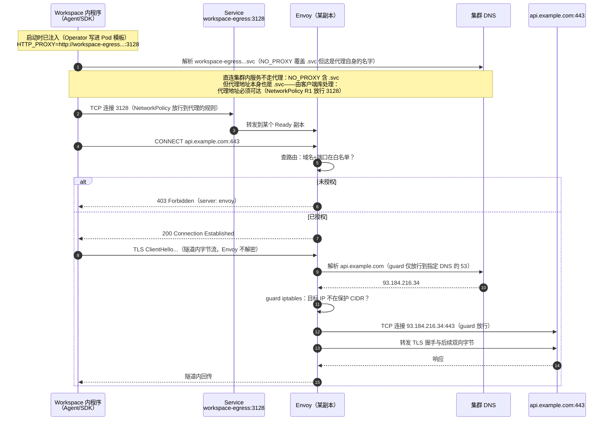
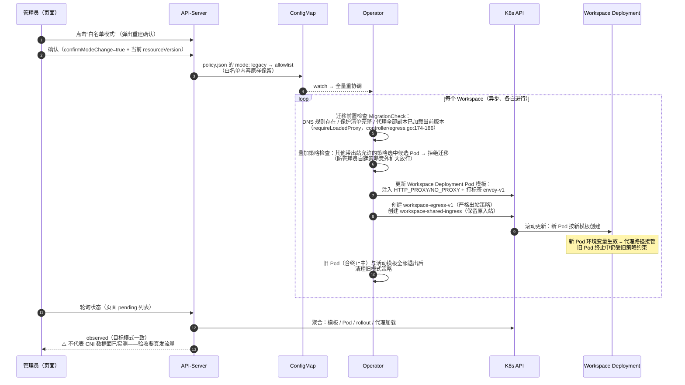
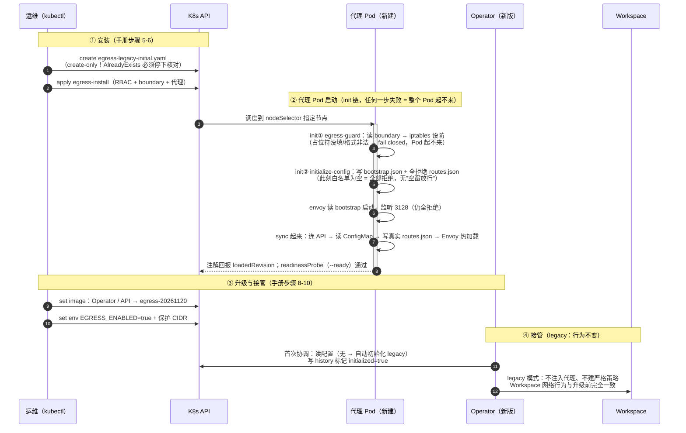

# 统一出站白名单：Workspace Pod 到外部网络的流量路径与架构

> 本文是 [network_flow_external_to_pod.md](network_flow_external_to_pod.md)（入站/南北向）的姊妹篇，描述**反方向**：
> **Agent Workspace Pod 发出的出站请求（访问外部模型 API、内网业务服务等）如何被统一出站管理所约束**——
> 白名单怎么配置、怎么生效、请求每一跳走向哪里、每个组件在什么时机做什么事。
>
> 定位：**架构评审文档**。所有关键结论均以仓库真实实现为依据，附 `file:line` 便于核对：
> - 配置模型与校验：`internal/egress/config.go`、`store.go`
> - NetworkPolicy 生成：`internal/egress/policy.go`
> - Envoy 路由与启动配置：`internal/egress/envoy.go`
> - guard iptables 规则：`internal/egress/guard.go`
> - Operator 接管与代理注入：`internal/controller/egress.go`
> - 同步器与状态回报：`cmd/egress-sync/main.go`、`internal/egress/sync.go`、`status.go`
> - 部署清单：`deploy/production-egress/egress-install.production.yaml`
>
> 投产操作步骤见 [egress-production-runbook.md](egress-production-runbook.md)；本文只讲原理，不含操作命令。

---

## 0. 一句话总览

Workspace 的每个出站请求，都会经过**两道独立防线**中的一道或两道：

```
Workspace Pod 的出站请求
  │
  ├─ 是 HTTP/HTTPS 且程序遵守代理约定 ──→ 显式正向代理（共享 Envoy）
  │     └─ HTTP_PROXY=http://workspace-egress.agent-deploy-system.svc:3128
  │         └─ 域名在白名单？→ 是：Envoy 代为转发到目标（guard 再核一次目标 IP）
  │                          → 否：Envoy 本地 403，请求出不去
  │
  └─ 其他一切流量（无视代理的程序、SSH、自定义 Socket……）
        └─ Kubernetes NetworkPolicy（Calico 执行）
              └─ 目标 IP:端口在白名单/基础服务/DNS？→ 放行
                 否则 → 数据包直接被丢弃
```

**核心设计**：K8s NetworkPolicy 只认 IP/CIDR 不认域名，Envoy 只能管遵守 HTTP_PROXY 约定的流量——
两个组件各管一半、互为补集，**任何一条单独失效都不等于放行未授权流量**（详见 §8 防线矩阵）。

---

## 1. 为什么是"两条腿"：先看问题，再看方案

### 1.1 需求

Workspace 里跑的是 Agent（可执行任意代码），必须做到：**出站只允许访问管理员配置的白名单地址，其余全部拒绝**。白名单两类条目：

| 条目类型 | 形态 | 例子 |
| :--- | :--- | :--- |
| IP/CIDR ＋ 协议 ＋ 端口 | 精确到端口的目标网段 | `12.244.130.39/32 TCP 80`（内网模型服务） |
| 完整域名 ＋ 端口 | HTTP/HTTPS 目标 | `api.openai.com:443` |

### 1.2 为什么 NetworkPolicy 一条腿不够

NetworkPolicy（由 CNI=Calico 落地为 iptables/eBPF 规则）的语义是"Pod → 某 CIDR:端口的包放行/丢弃"。
它**天生不认识域名**：域名的解析结果（IP）随时会变（CDN 调度、服务换址），不可能把域名写进 NetworkPolicy。
若靠"定期解析域名→回写 IP 规则"，解析与生效之间总有时间窗，且多 IP/换址场景下规则集不可控——方案明确否决了这条路
（`docs/egress-envoy-progress.md`："域名由 Envoy 解析，Operator 不解析业务域名生成 IP 规则"）。

### 1.3 为什么 Envoy 一条腿不够

正向代理只能约束**遵守约定的客户端**：程序启动时读 `HTTP_PROXY` 环境变量、把请求发给代理。
不遵守约定的程序（自写 Socket、SSH、某些语言运行时的网络栈）会完全无视这个变量直接发包。
所以代理必须与 NetworkPolicy 的**默认拒绝**配合：不守法流量在 NetworkPolicy 层就被丢弃。

### 1.4 结论：两条腿互补

```
域名授权  → Envoy 路由（按域名匹配，Envoy 自己解析目标）
IP 授权   → NetworkPolicy 直连规则（按 CIDR+端口精确放行）
兜底      → NetworkPolicy 默认拒绝一切未授权出站
```

一个推论（评审时经常被问）：**授权了某 IP 直连 ≠ 授权了"解析到该 IP 的域名"**。域名规则走代理、IP 规则走直连，
是两条独立授权路径，不会互相推导（防止"把大段内网加进 IP 白名单"意外放行一堆域名场景）。

---

## 2. 分层架构与流量拓扑总图



与入站文档相同的注意点：**控制面与数据面分离**。页面保存、Operator 协调、sync 热更新都不碰业务流量；
真正承载数据的只有 A/B/C 三条边。

---

## 3. 组件与职责清单

| 组件 | 位置 | 职责 | 关键实现 |
| :--- | :--- | :--- | :--- |
| **管理页面 + API** | `default/api-server` | 白名单编辑/校验/保存；模式切换（带二次确认）；状态聚合展示 | `cmd/api-server/egress.go`、`web/portal/src/components/egress-view.tsx` |
| **ConfigMap（配置存储）** | `agent-deploy-system/workspace-egress-config` | 唯一事实源：`policy.json` = 模式 + ips + domains + services | `internal/egress/store.go:20-57`（读）、`:59-88`（写，乐观锁） |
| **ConfigMap（历史标记）** | `agent-deploy-system/workspace-egress-history` | `initialized=true`；区分"从没装过"和"配置被误删"，防止误删后静默重置 | `internal/egress/store.go:91-100` |
| **ConfigMap（代理边界）** | `agent-deploy-system/workspace-egress-boundary` | 部署期参数：DNS IP + 保护 CIDR；guard 的唯一输入 | `deploy/production-egress/egress-install.production.yaml:119-126` |
| **Operator** | `agent-deploy-system/agent-deploy-controller-manager` | 读配置→生成 NetworkPolicy；allowlist 时给 Workspace Pod 注入代理环境变量；模式切换时滚动重建 Pod；清理旧策略 | `internal/controller/egress.go:26-119` |
| **代理 Deployment** | `agent-deploy-system/workspace-egress`（2 副本） | 承载 Envoy + guard + sync；Service 提供固定入口 `:3128` | `deploy/production-egress/egress-install.production.yaml:167-320` |
| **guard（init 容器）** | 代理 Pod 内 | iptables 锁死**代理自身**出站：仅放行 DNS 53 与白名单转发，禁止访问集群 Pod/Service/节点/管理网段 | `internal/egress/guard.go:12-57` |
| **initialize-config（init 容器）** | 代理 Pod 内 | Envoy 启动前生成 bootstrap.json 与**全拒绝**初始路由（fail closed） | `cmd/egress-sync/main.go:53-72`（`--init` 模式） |
| **envoy（主容器）** | 代理 Pod 内 | 正向代理本体：HTTP 正向转发 + CONNECT 隧道；文件 RDS 热加载路由 | `internal/egress/envoy.go:58`（Bootstrap）、`:16`（Routes） |
| **sync（sidecar 容器）** | 代理 Pod 内 | watch ConfigMap→原子写 routes.json→确认 Envoy 实际加载→回报状态；就绪探针 | `cmd/egress-sync/main.go:73-217`、`internal/egress/sync.go` |

> 同一个 `/egress-sync` 二进制靠参数切换三种身份：`--init`（一次性初始化）、无参数（常驻同步）、`--ready`（就绪探针），
> 见 `cmd/egress-sync/main.go:29-49`。这也是 initialize-config 与 sync 两个容器引用同一镜像的原因。

---

## 4. 逐跳拆解：三类数据路径

### 4.1 路径 A：域名 HTTP/HTTPS（代理路径，最常用）

以 Workspace 内程序调用 `https://api.example.com/v1/chat` 为例（allowlist 模式，`api.example.com:443` 已授权）：

```
① 程序启动时读到环境变量（Operator 在 Pod 创建前注入）
     HTTP_PROXY = http://workspace-egress.agent-deploy-system.svc:3128   ← internal/controller/egress.go:139
     NO_PROXY   = localhost,127.0.0.1,::1,$(WORKSPACE_POD_IP),.svc,.svc.cluster.local  ← :150

② 程序发 HTTPS 请求 → 客户端库遵守约定，不直连 api.example.com，
   而是先 TCP 连接 workspace-egress:3128（集群 Service DNS 解析到代理 Pod）

③ HTTP CONNECT 隧道建立：
   客户端 → 代理:  CONNECT api.example.com:443 HTTP/1.1
   代理查 routes.json（Envoy 内存中的路由表）：
     - 域名+端口匹配白名单 → 回 200 Connection Established，
       之后客户端在这条隧道里做 TLS 握手、发请求——Envoy 只转发字节流，不解密
     - 不匹配 → 本地回 403，连接终止。响应头带 server: envoy
                                                            ← internal/egress/envoy.go:16 Routes()

④ Envoy 自己解析 api.example.com（用 boundary 指定的 DNS，V4_ONLY）
   拿到目标 IP 后建立到目标的 TCP 连接

⑤ 最后一道检查：这个目标 IP 若落在保护 CIDR（Pod/Service/节点/管理网段）内，
   guard 的 iptables 规则直接 REJECT——域名授权不能撞内网           ← internal/egress/guard.go:43-48
```

要点：

- **CONNECT 不校验隧道内容**：授权 `api.example.com:443` = 授权到这个域名的 TLS 隧道；
  隧道里跑什么协议 Envoy 不看（也不解密）。TLS 网站身份由客户端自己校验。
- **NO_PROXY 只影响路由选择**：`.svc` 后缀和自身 Pod IP 不走代理（本地/集群内服务直连），
  但**直连仍受 NetworkPolicy 约束**——NO_PROXY 不构成任何授权（代码注释原话：`egress.go:145`）。
- 端口语义：HTTP 仅 80 端口可省略；CONNECT 必须显式指定获准端口（`docs/egress-envoy-handover.md` §2026-11-10）。

### 4.2 路径 B：IP/CIDR 直连（NetworkPolicy 路径）

以 Workspace 内程序访问 `12.244.130.39:80`（已授权 `12.244.130.39/32 TCP 80`）为例：

```
① 程序直接发起 TCP 连接（可能遵守 HTTP_PROXY 走了代理，也可能没走——都没关系）

② 若走了代理：IP/CIDR 的 TCP 规则同样生成 Envoy 路由，代理按 IP:端口匹配放行转发
   若没走代理：包从 Pod 发出，到达节点网络

③ Calico 执行 NetworkPolicy workspace-egress-v1（只选择打了迁移标签的 Pod）：
   出站规则逐条匹配（默认拒绝，白名单式）：
     R1  → 代理 Pod（ns=agent-deploy-system, app.kubernetes.io/name=workspace-egress）TCP 3128
     R2+ → 每条 IP 白名单：IPBlock CIDR（排除与保护段重叠部分）+ 协议 + 端口
     R3+ → 每条基础服务：目标 ns + Pod 选择器（强制排除 app=workspace，防 Workspace 互访）+ 端口
     R4  → DNS（迁移前置检查强制显式配置 TCP/UDP 53，见 §6.1）
                                                            ← internal/egress/policy.go:11-77
   匹配 → 放行；不匹配 → 丢包（表现：连接超时，不是 refused）
```

要点：

- **保护段重叠处理**（`policy.go:41-50`）：若某条 IP 规则的目标段**完全**落在保护 CIDR 内 → 直接报错拒绝生成
  （配置时就拦住，防管理员失手把节点网段加进白名单）；**部分**重叠 → 该规则自动加 `except` 挖掉重叠部分。
- **基础服务规则防扩大**（`policy.go:60-66`）：选择器强制 `app NotIn workspace`——
  一个 Workspace 的例外永远不能变成"Workspace 之间互通"。
- IPv6 与 UDP 的 IP 规则仅适用于直连路径；代理路径（Envoy 路由）当前仅 IPv4 TCP
  （`docs/egress-envoy-handover.md`：IPv6 新连接被 guard 拒绝）。

### 4.3 被拒绝的样子（评审时建议现场演示）

| 场景 | 现象 | 被谁挡的 |
| :--- | :--- | :--- |
| curl 未授权域名（走代理） | HTTP 403，`server: envoy` | Envoy 路由不匹配 |
| curl `--noproxy '*'` 未授权 IP（绕开代理） | 连接超时（包被丢弃） | NetworkPolicy |
| 未授权协议直连（如 SSH 未授权目标） | 连接超时 | NetworkPolicy |
| 白名单域名解析到内网 IP | 代理侧连接失败/503 | guard iptables |
| 访问节点/元数据地址（169.254.169.254） | 连接被拒 | guard iptables |

> 注意区分：**目标业务返回 403/404 ≠ 网络被阻断**（网络通了、业务拒绝你）；Envoy 的 403（看响应头）才是代理拒绝。

---

## 5. 双重防线：guard 为什么存在（防 SSRF）

**问题**：所有 Workspace 的流量都以**代理**为跳板，那么谁限制代理能连哪？
如果被入侵的 Workspace 借代理之手去连集群 DNS、kubelet API、别的 Pod、云元数据服务——
NetworkPolicy 管不到这段（Workspace→代理是合法集群内流量），Envoy 白名单也不是为拦内网设计的（管理员完全可能合法授权内网业务 IP）。

**解法**：代理 Pod 里用 guard（init 容器，root + NET_ADMIN 一次性执行 iptables）把**代理进程自己的出站**锁死。
规则翻译（只作用于 Envoy 进程，UID 101；同 Pod 的 sync 用 UID 102 不受限）：



（依据 `internal/egress/guard.go:32-55`；DNS/保护清单为空时 guard **拒绝启动**——fail closed，`guard.go:13-15`。）

**两层独立生效**：业务白名单说"想让代理去哪"，guard 说"代理无论被怎么配置、被谁欺骗都绝对不去哪"。
即使管理员失手把 `10.243.0.0/16` 写进业务白名单，或白名单域名被 DNS 污染解析到内网地址，guard 依然拦截。
这就是纵深防御（defense in depth）：**不把安全寄托在上一层永远正确**。

> 同一设计在 NetworkPolicy 生成器里也有体现（§4.2 的重叠检查）；guard 是数据面最后兜底，两者缺一不可。

---

## 6. 时序图

### 6.1 时序 A：管理员保存白名单 → 热更新生效（Pod 不重启）



关键设计：

- **原子写**：临时文件 + rename，Envoy 永远读到完整文件（`internal/egress/sync.go`，Envoy 文件 RDS 的官方要求）。
- **不伪造 loaded**：sync 必须从 Envoy admin 接口读到实际加载版本才回报——历史上曾因"资源内容去重"导致
  版本号不刷新的缺陷（r2 修复，把统一版本写进 RouteConfiguration metadata，`docs/egress-envoy-handover.md` §8）。
- **NetworkPolicy 与 Pod 模板同快照**：一次协调内策略和模板用同一份配置生成，避免并发保存产生错配
  （`internal/controller/egress.go:36-38`）。
- **已知边界**：删除规则后，**已建立的连接不保证立即断开**（guard 的 ESTABLISHED 放行 + Envoy 存活隧道），
  验收以**新连接**为准。

### 6.2 时序 B：allowlist 下 Workspace 的一次 HTTPS 请求（数据面）



（若程序**无视** HTTP_PROXY 直连 `api.example.com`：解析出的公网 IP 不在 IP 白名单 → NetworkPolicy 丢包——
这就是"绕过代理无法靠域名规则直连"的机制。）

### 6.3 时序 C：模式切换（以 legacy → allowlist 为例，会重建 Pod）



关键设计：

- **为什么必须重建 Pod**：环境变量只能随容器启动注入，运行中进程的环境改不了
  （`docs/egress-mode-design.md`"当前架构阻碍"）。这是选择"显式代理"方案（对比透明拦截）的核心代价。
- **六方向切换**（legacy↔allowlist↔unrestricted）语义见 §7 状态机。
- **期间不锁全局**：新旧 Pod 并存，各自受对应策略约束；202 响应 ≠ 全部完成。
- **切回 legacy 的撤销语义**：恢复原共享策略（放行除私网外 0/0 + 基础服务例外 + TCP/UDP 53）、
  恢复用户原环境变量、恢复 disabled 语义；等待旧 Pod 退出后清理本功能产生的策略
  （`internal/controller/egress.go:51-56`、`docs/egress-mode-design.md`）。

### 6.4 时序 D：首次部署与代理 Pod 启动（对应投产手册步骤）



（history 标记的作用：将来配置被误删时，读配置发现"标记在、配置没了"→ 明确报错要求恢复备份，
而不是当成全新环境静默重置——`internal/egress/store.go:42-48`。）

---

## 7. 三模式状态机

```mermaid
stateDiagram-v2
    [*] --> legacy: 首次安装默认初始化<br/>（或显式 create）

    state "legacy（默认）" as legacy {
        [*] : 不注入代理
        : 沿用原共享策略（放行除私网外 0/0<br/>+ 基础服务例外 + DNS 53）
        : disabled 语义保留
    }

    state "allowlist（白名单）" as allowlist {
        [*] : 注入 HTTP_PROXY → 代理管域名
        : workspace-egress-v1 严格策略管 IP
        : 覆盖历史 disabled
    }

    state "unrestricted（全开）" as unres {
        [*] : 不注入代理
        : 独立 allow-all 出站策略<br/>（标签 unrestricted-v1 隔离，不放大到旧 Pod）
        : 应急放通用
    }

    legacy --> allowlist: 页面确认切换<br/>（重建所有 Pod）
    allowlist --> legacy: 页面确认切换<br/>（撤销注入与策略）
    allowlist --> unres: 页面确认切换
    unres --> allowlist: 页面确认切换
    unres --> legacy: 页面确认切换
    legacy --> unres: 页面确认切换

    note right of allowlist
        同模式内改 IP/域名规则 = 热更新
        （Pod 不重建，见时序 A）
    end note
    note right of legacy
        撤销需等旧 Pod 全部退出
        后清理本功能策略
    end note
```

（模式语义：`docs/egress-production-runbook.md` §1.3；unrestricted 的标签隔离：
`internal/controller/egress.go:45-49`——allow-all 策略只选 `unrestricted-v1` 标签的新 Pod，不会选中旧 envoy-v1 Pod 造成叠加放行。）

---

## 8. 安全边界矩阵（评审重点：什么挡什么）

| 攻击/绕过场景 | 挡它的是 | 机制 |
| :--- | :--- | :--- |
| 程序无视 HTTP_PROXY 直连未授权公网 | NetworkPolicy | 默认拒绝，只有白名单 IP/基础服务/DNS/代理端口放行 |
| 走代理访问未授权域名 | Envoy | 路由不匹配 → 本地 403 |
| 走代理访问未授权端口（授权了 443 试 8443） | Envoy | 路由匹配含端口 |
| 白名单域名被解析到内网/受保护地址 | guard | iptables 对 Envoy 进程的目标 IP 终检 |
| 管理员失手把保护网段加进 IP 白名单 | NetworkPolicy 生成器 + guard | 配置时报错（完全重叠）/ 自动 except（部分重叠）+ 数据面兜底 |
| 被入侵的 Workspace 借代理扫集群 Pod/Service/节点/kubelet/元数据 | guard | 保护 CIDR 绝对禁区（169.254/16 等内置） |
| Workspace A 借"基础服务"规则访问 Workspace B | NetworkPolicy 生成器 | 基础服务选择器强制排除 `app=workspace` |
| 管理员自建的其他出站策略叠加扩大放行 | Operator 迁移检查 | 发现匹配候选 Pod 且带出站允许的第三方策略 → 拒绝迁移 |
| 并发编辑覆盖白名单 | API | resourceVersion 乐观锁 → 409 |
| 配置被误删后静默重置 | history 标记 | 明确报错，要求恢复备份 |
| 代理刚启动、规则未加载的空窗 | initialize-config | 初始路由为全拒绝（fail closed） |
| boundary 参数缺失/非法 | guard | 拒绝启动（fail closed） |

**明确不在防线内**（评审时主动说清，避免被误判为缺陷）：

- CONNECT 隧道内的协议与 TLS 身份不校验（不解密；授权粒度=域名+端口）。
- 已建立连接在规则删除后不保证立即断开（验收用新连接）。
- Workspace 之间的隔离由命名空间策略与选择器排除保证，但"自身 Pod IP 访问"需现场单独验证。
- DNS 换址、多 IP 场景不承诺零中断。
- 管理员在**集群层面**创建的更高层网络限制（如节点防火墙）与本功能无关，互不替代。

---

## 9. 已知限制与设计取舍备忘

| # | 限制 | 原因 / 取舍 |
| :--- | :--- | :--- |
| 1 | 只管 HTTP/HTTPS 家族的代理路径 | 显式代理的天然边界；非 HTTP 协议用 IP 直连规则覆盖 |
| 2 | 模式切换重建 Pod、连接中断 | 环境变量注入机制；曾评估透明拦截（TPROXY/SNI），因 CNI 权限与 TLS 语义复杂度放弃（`docs/egress-mode-design.md`） |
| 3 | 域名不支持通配符/URL 路径 | 授权粒度刻意收敛为完整域名+端口，避免规则爆炸与语义歧义 |
| 4 | policyState/migrationState 页面显示 unverified | 保存成功 ≠ 数据面生效；状态聚合只到"副本加载一致"，实际效果要真发流量 |
| 5 | 代理副本当前固定单节点（nodeSelector） | 离线镜像只确认该节点有；跨节点 HA 需镜像铺开（投产手册 §4.3） |
| 6 | guard 边界（DNS/保护段）变更需重启代理 Pod | init 容器一次性执行；业务规则热更新不受影响 |

---

## 附录 A：关键代码 / 配置索引

| 关注点 | 位置 |
| :--- | :--- |
| 配置结构、校验、版本 | `internal/egress/config.go` |
| ConfigMap 读写（乐观锁）、history 标记 | `internal/egress/store.go:20-100` |
| NetworkPolicy 生成（含保护段重叠处理） | `internal/egress/policy.go:11-77` |
| 迁移前置检查（DNS/保护/代理加载） | `internal/egress/preflight.go`、`internal/controller/egress.go:174-186` |
| Envoy bootstrap（文件 RDS）与路由生成 | `internal/egress/envoy.go:58`、`:16` |
| guard iptables 规则 | `internal/egress/guard.go:12-57` |
| sync 热更新、原子写、加载确认、状态回报 | `cmd/egress-sync/main.go:73-217`、`internal/egress/sync.go`、`status.go` |
| Operator 接管入口（EGRESS_ENABLED） | `internal/controller/egress.go:26-34` |
| 代理环境变量注入（HTTP_PROXY/NO_PROXY） | `internal/controller/egress.go:132-152` |
| ConfigMap 变化 → 全量重协调映射 | `internal/controller/egress.go:154-163` |
| 三模式策略生成与旧策略清理 | `internal/controller/egress.go:36-119` |
| 首次初始化（读不到配置自动 legacy） | `internal/controller/egress.go:262-272` |
| 代理 Deployment（4 容器结构、RBAC、边界） | `deploy/production-egress/egress-install.production.yaml` |
| API 接口（GET/PUT config、status） | `cmd/api-server/egress.go`、`egress_status.go` |
| 管理页面 | `web/portal/src/components/egress-view.tsx` |

## 附录 B：本文与其他文档的边界

- **入站（南北向）**：外部用户 → Pod，见 [network_flow_external_to_pod.md](network_flow_external_to_pod.md)。
- **投产操作**（备份、镜像导入、11 步执行、回退）：[egress-production-runbook.md](egress-production-runbook.md)。
- **开发过程与设计决策记录**：[egress-mode-design.md](egress-mode-design.md)（三模式设计）、
  [egress-envoy-handover.md](egress-envoy-handover.md)（架构交接与现场快照）、
  [egress-envoy-progress.md](egress-envoy-progress.md)（历史进度，部分过时）。
- **平台整体部署**（OSS 存储、Ingress、Kata）：[offline_deployment_guide.md](offline_deployment_guide.md)。
