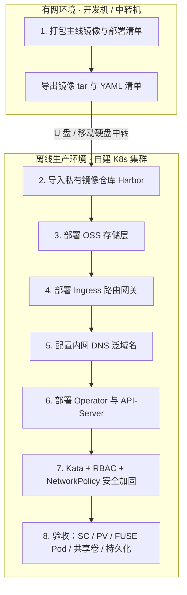

# Agent 工作空间 Operator - 离线生产环境部署手册（OSS + ossfs 1.0 主线）

本文档提供在**完全离线（Air-Gapped / 孤岛网络）**的自建 Kubernetes 集群上完成平台部署的完整指南，覆盖镜像打包、离线导入、**OSS 对象存储卷（CSI + ossfs 1.0）存储层**、Ingress 网关、内网 DNS 解析、Operator / API-Server 安装、Kata + RBAC + NetworkPolicy 三维安全加固，以及逐项验收清单。

> **存储方案结论（已定版，2026-11-04）**
>
> * 生产环境**统一使用 OSS 对象存储卷 + ossfs 1.0**（CSI `fuseType: ossfs`）作为工作空间持久化存储，**不启用 ossfs 2.0**。
> * 个人工作空间卷由 Operator 按 StorageClass `alicloud-oss` 自动创建**静态 PV**（子路径 `/workspaces/<workspace-name>`）+ RWX PVC；公共资产使用共享 PV/PVC `global-oss-share-pv` / `global-oss-share-pvc`（`path: /shared-assets`）。
> * **NAS / NFS 与 Local Path 不再是生产方案**，仅作为文末 **附录 A**（Local Path）/ **附录 B**（NAS / NFS）的备选保留；**阿里云 ACK 部署包 `deploy-ack/` 暂不启用**（**附录 C**）。
> * 唯一权威依据：[`docs/storage_plan.md`](storage_plan.md)；运行期数据链路、四组件关系与排障：[`docs/oss_storage_architecture.md`](oss_storage_architecture.md)。

---

## 方案结论与适用范围

### 结论速览

| 决策项 | 结论 |
| :--- | :--- |
| 存储介质 | OSS 对象存储（Bucket + 前缀），**不落本地盘、不挂 NAS** |
| 挂载客户端 | **ossfs 1.0**（`fuseType: ossfs`），全集群统一，不启用 ossfs 2.0 |
| 个人工作空间卷 | SC `alicloud-oss` → Operator 自动创建静态 PV `<workspace>-pv`（`path: /workspaces/<workspace-name>`）+ RWX PVC `<workspace>-pvc`，`reclaimPolicy: Retain` |
| 公共共享卷 | 静态 PV `global-oss-share-pv` + PVC `global-oss-share-pvc`（`default` 命名空间，`path: /shared-assets`），供 `spec.sharedVolumeMounts` 引用 |
| 删除 Workspace | **不删除** PV / PVC / OSS 数据，也**不清理** OSS 前缀 |
| 默认存储类 | `DEFAULT_STORAGE_CLASS` 环境变量优先，其次集群默认 SC 注解；生产应指向 `alicloud-oss` |
| 阿里云 ACK 部署包 | `deploy-ack/` **暂不启用**，仅作附录 C 参考 |
| NAS / NFS、Local Path | **附录备选**，仅用于离线演练、性能对照、存量迁移过渡或应急回退 |

### 为何选 OSS + ossfs 1.0

1. **随机写安全**：Workspace 内运行的 Agent（opencode 等）存在大量 edit、编译、`npm/pip` 安装等随机写操作。ossfs 2.0 官方明确不建议用于随机写场景，ossfs 1.0 对随机写成熟稳定，因此**统一锁定 1.0**。
2. **容量与运维成本**：OSS 容量按需扩展，无需维护 NFS 服务端或单机目录；Pod 可在任意节点漂移，不受 Local Path 节点绑定限制。
3. **与 Operator 能力匹配**：Operator 已内建 OSS 静态 PV 自动创建（`reconcilePVC`）、子路径隔离、RWX 共享与 `Retain` 保留语义，无需额外组件。
4. **共享资产复用**：公共工具包通过独立 Bucket 前缀 + RWX 共享 PVC 下发，与个人数据物理隔离。

> 历史演进、备选方案对比与迁移路径见 [`docs/storage_plan.md`](storage_plan.md) 与 [`docs/storage_migration_guide.md`](storage_migration_guide.md)；本文只描述**已定版主线**。

### ossfs 1.0 固定参数（不得与 2.0 参数混用）

| 位置 | 参数 | 说明 |
| :--- | :--- | :--- |
| `StorageClass alicloud-oss` | `fuseType: "ossfs"` | 指定 1.0 客户端；`ossfs2`、`direct` 均不使用 |
| SC / PV | `otherOpts: "-o max_stat_cache_size=100000 -o allow_other"` | 1.0 参数；`allow_other` 保证容器内非 root 用户可读写 |
| SC / PV | `url: "http://<oss-endpoint>"` | 专有云/内网 OSS 显式写协议与内网 Endpoint（不写协议会被驱动强制补 `https://`） |
| SC（按需） | `sigVersion: "v4"` + `region` | 仅当 Bucket 为公共云新建 Bucket（2025-09-01 起强制 V4）时添加；存量专有云 Bucket 保持 V1，不要加 |

> ⚠️ **禁止混用**：1.0 与 2.0 的挂载参数不兼容。在 `fuseType: ossfs` 的 SC/PV 中出现 2.0 专属参数（或反之）会导致挂载失败。

### 组件与清单对照

| 层次 | 组件 / 清单 | 职责 |
| :--- | :--- | :--- |
| CSI 控制面 | [csi-controller.yaml](../deploy/oss/csi-controller.yaml)（`csi-controller-oss`，1 副本） | Attach/Detach，在 `ack-csi-fuse` 命名空间创建/删除 FUSE Pod |
| CSI 节点面 | [csi-plugin.yaml](../deploy/oss/csi-plugin.yaml)（`csi-plugin-oss` DaemonSet） | 向 kubelet 注册驱动、NodePublish/Unpublish、bind-mount 到 Workspace Pod |
| 数据面 | FUSE Pod（每卷一个，运行 ossfs 1.0） | 真正挂载 OSS，负责缓存与上传下载 |
| 凭证 | [secret.yaml](../deploy/oss/secret.yaml)（`default/oss-secret`） | OSS AccessKey，供 SC 与 PV 的 secret 引用 |
| 个人卷 | [storageclass.yaml](../deploy/oss/storageclass.yaml)（`alicloud-oss`） | 声明 Bucket / Endpoint / ossfs 1.0 参数；Operator 据此创建静态 PV |
| 共享卷 | [shared_pv_template.yaml](../deploy/oss-public/shared_pv_template.yaml)、[shared_pvc_template.yaml](../deploy/oss-public/shared_pvc_template.yaml) | 公共资产 RWX 共享（`global-oss-share-pv` / `global-oss-share-pvc`） |

> 四个运行期组件（控制面 / 节点面 / ossfs FUSE Pod / Workspace Pod）的调用链与故障域，见 [`docs/oss_storage_architecture.md`](oss_storage_architecture.md)。

---

## 部署工作流总览



| 步骤 | 目标 | 关键产物 |
| :--- | :--- | :--- |
| 步骤 1 | 在联网环境准备镜像与清单 | `deploy/` 下的 `.tar` 与 YAML |
| 步骤 2 | 镜像入库到内网 Harbor | 全部镜像可从内网拉取 |
| 步骤 3 | 打通 OSS 存储层 | `alicloud-oss` SC、`oss-secret`、共享 PV/PVC |
| 步骤 4 | 部署入口网关 | `ingress-nginx` |
| 步骤 5 | 域名解析 | `*.yourdomain.local` A 记录 |
| 步骤 6 | 部署控制器与控制台 | CRD、Operator、API-Server |
| 步骤 7 | 加固 Agent 运行环境 | Kata RuntimeClass、RBAC 默认值、NetworkPolicy |
| 步骤 8 | 逐项验收 | 存储生效 + 安全隔离 + 数据持久化 |

---

## 步骤 1：有网环境资源打包 (开发机)

> 只有**主线必需**的镜像与清单必须打包；Local Path、NAS/NFS 的镜像属于**附录选装**，仅在需要启用附录 A / 附录 B 时才需要准备。

### 1.1 拉取与构建镜像

```bash
# 0. 创建离线资源目录（kata 为可选安全加固包）
mkdir -p ./deploy/kata

# 1. Kata Containers 静态运行环境包（可选但推荐，用于步骤 7 的内核隔离）
# 官方下载: wget -P ./deploy/kata/ https://github.com/kata-containers/kata-containers/releases/download/3.2.0/kata-static-3.2.0-amd64.tar.xz
# 加速下载: curl -Lo ./deploy/kata/kata-static-3.2.0-amd64.tar.xz https://ghfast.top/https://github.com/kata-containers/kata-containers/releases/download/3.2.0/kata-static-3.2.0-amd64.tar.xz

# 2. 【主线必需】Agent 运行镜像与 Ingress 组件
#    注意：开发机为 Mac 时必须指定 --platform linux/amd64，确保拉取 x86 镜像
docker pull --platform linux/amd64 smanx/opencode:latest
docker pull --platform linux/amd64 registry.k8s.io/ingress-nginx/controller:v1.9.4
docker pull --platform linux/amd64 registry.k8s.io/ingress-nginx/kube-webhook-certgen:v1.4.0

# 3. 【主线必需】OSS CSI 存储驱动镜像（v1.36.2 新架构 = 节点插件 + 控制器 + FUSE Pod）
#    OSS 挂载自 v1.30.4+ 起由独立的 FUSE Pod（csi-ossfs 镜像）完成，不依赖宿主机 OpenSSL 等库，
#    必须同时打包以下 4 个镜像
docker pull --platform linux/amd64 registry.cn-hangzhou.aliyuncs.com/acs/csi-plugin:v1.36.2
docker pull --platform linux/amd64 registry.k8s.io/sig-storage/csi-node-driver-registrar:v2.8.0
docker pull --platform linux/amd64 registry.k8s.io/sig-storage/csi-attacher:v4.4.3
docker pull --platform linux/amd64 registry-cn-hangzhou.ack.aliyuncs.com/acs/csi-ossfs:v1.91.11.ack.1-f3157f4

# 4. 【附录选装】仅在启用附录 A / 附录 B 时才需要
#    Local Path 本地盘镜像
docker pull --platform linux/amd64 rancher/local-path-provisioner:v0.0.30
docker pull --platform linux/amd64 rancher/library-busybox:1.31.1
#    NAS / NFS 动态存储镜像
docker pull --platform linux/amd64 registry.k8s.io/sig-storage/nfs-subdir-external-provisioner:v4.0.2

# 5. 本地构建 Operator 控制器与 API Server 镜像（针对生产 x86 架构交叉编译）
cd /path/to/agent-deploy
# 构建 Operator
docker build --platform linux/amd64 -t workspace-operator:v1.0.0 .
# 构建 API Server（控制台页面已内嵌在二进制中）
# 如修改过 web/portal/ 前端源码，请先执行 make portal 重新生成 cmd/api-server/portal.html
docker build --platform linux/amd64 -f Dockerfile.api-server -t api-server:v1.0.0 .
cd -
```

> 💡 **签名版本提醒**：阿里云 OSS 自 2025-09-01 起新建 Bucket 强制 V4 签名。若目标 Bucket 为存量专有云 Bucket（仅支持 V1），步骤 3.5 的 StorageClass 中**不要**添加 `sigVersion` / `region`；若为新建公共云 Bucket，则必须添加。

### 1.2 导出镜像与收集 YAML 部署清单

```bash
# 1. 【主线必需】导出镜像 tar
docker save smanx/opencode:latest -o ./deploy/opencode.tar
docker save registry.k8s.io/ingress-nginx/controller:v1.9.4 -o ./deploy/ingress-controller.tar
docker save registry.k8s.io/ingress-nginx/kube-webhook-certgen:v1.4.0 -o ./deploy/ingress-certgen.tar
docker save registry.cn-hangzhou.aliyuncs.com/acs/csi-plugin:v1.36.2 \
            registry.k8s.io/sig-storage/csi-node-driver-registrar:v2.8.0 \
            registry.k8s.io/sig-storage/csi-attacher:v4.4.3 \
            registry-cn-hangzhou.ack.aliyuncs.com/acs/csi-ossfs:v1.91.11.ack.1-f3157f4 \
            -o ./deploy/oss-csi-plugin.tar
docker save workspace-operator:v1.0.0 -o ./deploy/workspace-operator.tar
docker save api-server:v1.0.0 -o ./deploy/api-server.tar

# 2. 【附录选装】仅在启用附录 A / 附录 B 时导出
docker save rancher/local-path-provisioner:v0.0.30 rancher/library-busybox:1.31.1 -o ./deploy/local-path-provisioner.tar
docker save registry.k8s.io/sig-storage/nfs-subdir-external-provisioner:v4.0.2 -o ./deploy/nfs-provisioner.tar

# 3. 【主线必需】生成 Operator 一键安装包（内嵌 IMG 镜像地址）
cd /path/to/agent-deploy
GOWORK=off make build-installer IMG=workspace-operator:v1.0.0
cp dist/install.yaml ./deploy/
```

此时 `deploy` 目录即成为离线交付包。主线需要用到的清单如下（均在仓库 [deploy/](../deploy) 下）：

| 清单 | 用途 | 主线必需 |
| :--- | :--- | :--- |
| `deploy/oss/csi-plugin.yaml` | CSI 节点面 DaemonSet + RBAC + `ack-csi-fuse` 命名空间 + CSIDriver | ✅ |
| `deploy/oss/csi-controller.yaml` | CSI 控制面 Deployment（创建 FUSE Pod） | ✅ |
| `deploy/oss/secret.yaml` | `oss-secret`（AK 凭证） | ✅ |
| `deploy/oss/storageclass.yaml` | `alicloud-oss` StorageClass | ✅ |
| `deploy/oss-public/shared_pv_template.yaml`、`shared_pvc_template.yaml` | 共享 PV/PVC（`global-oss-share-pv` / `global-oss-share-pvc`） | ✅ |
| `deploy/ingress-deploy.yaml` | Ingress 控制器 | ✅ |
| `deploy/install.yaml` | CRD + Operator 一键安装包 | ✅ |
| `deploy/api-server-deploy.yaml` | API-Server / Service / Ingress | ✅ |
| `deploy/local/*` | Local Path 清单 | ❌ 附录 A 选装 |
| `deploy/nfs/*`、`deploy/nfs-public/*` | NAS / NFS 清单 | ❌ 附录 B 选装 |

---

## 步骤 2：离线导入私有镜像仓库

将整个 `deploy` 目录拷贝到离线环境的镜像节点上，导入镜像并推送（Push）到内部私有镜像仓库（如 Harbor）：

```bash
cd ./deploy

# 1. 导入镜像到本地 docker / ctr 引擎
docker load -i opencode.tar
docker load -i ingress-controller.tar
docker load -i ingress-certgen.tar
docker load -i oss-csi-plugin.tar
docker load -i workspace-operator.tar
docker load -i api-server.tar

# （附录 A / 附录 B 选装镜像）
# docker load -i local-path-provisioner.tar
# docker load -i nfs-provisioner.tar

# (若是 containerd/ctr 环境: ctr -n=k8s.io image import <filename>.tar)
```

> ⚠️ **`csi-ossfs` 的仓库路径与 Tag 不可更改**：CSI 控制器通过 `DEFAULT_REGISTRY` 环境变量把 FUSE Pod 镜像解析为 `{DEFAULT_REGISTRY}/acs/csi-ossfs:v1.91.11.ack.1-f3157f4`。推送到 Harbor 时必须保留 `acs/csi-ossfs` 目录结构与同名 Tag。

```bash
# 2. 打内网 Tag 并推送（示例 HARBOR=yourharbor.domain.com）
HARBOR=yourharbor.domain.com

docker tag smanx/opencode:latest                                            $HARBOR/library/opencode:latest
docker tag registry.k8s.io/ingress-nginx/controller:v1.9.4                  $HARBOR/ingress-nginx/controller:v1.9.4
docker tag registry.k8s.io/ingress-nginx/kube-webhook-certgen:v1.4.0        $HARBOR/ingress-nginx/kube-webhook-certgen:v1.4.0
docker tag registry.cn-hangzhou.aliyuncs.com/acs/csi-plugin:v1.36.2         $HARBOR/acs/csi-plugin:v1.36.2
docker tag registry.k8s.io/sig-storage/csi-node-driver-registrar:v2.8.0     $HARBOR/sig-storage/csi-node-driver-registrar:v2.8.0
docker tag registry.k8s.io/sig-storage/csi-attacher:v4.4.3                  $HARBOR/sig-storage/csi-attacher:v4.4.3
docker tag registry-cn-hangzhou.ack.aliyuncs.com/acs/csi-ossfs:v1.91.11.ack.1-f3157f4 \
           $HARBOR/acs/csi-ossfs:v1.91.11.ack.1-f3157f4
docker tag workspace-operator:v1.0.0                                        $HARBOR/library/workspace-operator:v1.0.0
docker tag api-server:v1.0.0                                                $HARBOR/library/api-server:v1.0.0

docker push $HARBOR/library/opencode:latest
docker push $HARBOR/ingress-nginx/controller:v1.9.4
docker push $HARBOR/ingress-nginx/kube-webhook-certgen:v1.4.0
docker push $HARBOR/acs/csi-plugin:v1.36.2
docker push $HARBOR/sig-storage/csi-node-driver-registrar:v2.8.0
docker push $HARBOR/sig-storage/csi-attacher:v4.4.3
docker push $HARBOR/acs/csi-ossfs:v1.91.11.ack.1-f3157f4
docker push $HARBOR/library/workspace-operator:v1.0.0
docker push $HARBOR/library/api-server:v1.0.0
```

---

## 步骤 3：部署 OSS 存储层（CSI + ossfs 1.0）

这是生产存储底座，**必须完整部署**。OSS 从 CSI v1.30.4 起采用新架构：挂载由控制器在目标节点创建的 **FUSE Pod**（`ack-csi-fuse` 命名空间，镜像 `csi-ossfs`）完成，宿主机只需有 `systemd`，无需安装任何 ossfs 依赖库。

### 3.1 修改清单中的镜像地址与仓库参数

部署前按内网 Harbor 地址修改两处清单（若已用 `sed` 批量替换可跳过）：

* [csi-plugin.yaml](../deploy/oss/csi-plugin.yaml)：DaemonSet 中 `csi-plugin` 与 `driver-registrar` 的 `image:` 改为内网 Harbor 地址。
* [csi-controller.yaml](../deploy/oss/csi-controller.yaml)：`csi-controller` 与 `external-oss-attacher` 的 `image:` 改为内网地址；`DEFAULT_REGISTRY` 环境变量改为 Harbor 地址（如 `yourharbor.domain.com`）。若节点上导入的 `csi-ossfs` Tag 与默认值 `v1.91.11.ack.1-f3157f4` 不同，同步修改 `OSS_FUSE_OSSFS` 环境变量的 `image-tag=` 值（与 `ctr -n k8s.io images list | grep csi-ossfs` 的输出保持一致）。

> **内网 http 环境注意**：driver 默认会给不带协议的 URL 强制拼 `https://` 前缀。如果内部 OSS/对象存储只支持 **http**（如专有云 OSS），必须：
> 1. 在 `csi-controller.yaml` 与 `csi-plugin.yaml` 中保持环境变量 `PRIVATE_CLOUD_TAG: "true"`（专有云开关，禁止 driver 改写 URL 与协议）；
> 2. StorageClass 与 PV 的 `url` 参数显式写成 `http://oss-cn-xxx.internal...`。
> 否则挂载报错 `ossfs: Failed to check bucket and directory for mount point: Unable to connect(host=https://...)`。

### 3.2 部署 CSI 节点插件（含 RBAC / 命名空间 / CSIDriver）

`csi-plugin.yaml` 同时包含 ServiceAccount、`ack-csi-fuse` 命名空间、ClusterRole/Binding、CSIDriver 与 DaemonSet，因此**必须先部署它**：

```bash
kubectl apply -f ./deploy/oss/csi-plugin.yaml
```

### 3.3 部署 CSI 控制器（FUSE Pod 创建者）

```bash
# v1.30.4+ 必须：FUSE Pod 由 ControllerPublishVolume 创建，缺了它挂载必然失败
kubectl apply -f ./deploy/oss/csi-controller.yaml
```

验证组件就绪：

```bash
kubectl get ds -n default csi-plugin-oss -o wide          # 每个节点 1 个 Pod，全部 Ready
kubectl get deploy -n default csi-controller-oss          # 1/1 Ready
kubectl get ns ack-csi-fuse                               # FUSE Pod 专用命名空间
kubectl get csidriver ossplugin.csi.alibabacloud.com -o jsonpath='{.spec.attachRequired}{"\n"}'  # 必须为 true
```

### 3.4 创建 OSS 凭证 Secret (`oss-secret`)

```yaml
apiVersion: v1
kind: Secret
metadata:
  name: oss-secret
  namespace: default              # 统一 default 命名空间，SC / PV 均引用它
type: Opaque
stringData:
  akId: "YOUR_ACCESS_KEY_ID"
  akSecret: "YOUR_ACCESS_KEY_SECRET"
```

```bash
# 先编辑 deploy/oss/secret.yaml 填入真实 AK，再执行
kubectl apply -f ./deploy/oss/secret.yaml
```

> 建议为该 AK 单独创建 RAM 用户并授予最小权限：`oss:GetObject`、`oss:PutObject`、`oss:DeleteObject`、`oss:ListObjects`、`oss:GetBucketInfo`，资源范围限定为个人 Bucket 与共享 Bucket（含 `/*`）。Kubernetes 侧权限仅限读取 `default/oss-secret`。

### 3.5 部署 StorageClass `alicloud-oss`

`alicloud-oss` 不是普通动态供给模板：Operator 检测到其 `provisioner` 为 `ossplugin.csi.alibabacloud.com` 后，会读取其中的参数**自动创建静态 PV**（子路径 `/workspaces/<workspace-name>`）并精确绑定 PVC。换 Bucket / Endpoint 只需改本文件，无需改 Operator。

```yaml
apiVersion: storage.k8s.io/v1
kind: StorageClass
metadata:
  name: alicloud-oss              # 全集群通用名称，Workspace CR 中引用它
provisioner: ossplugin.csi.alibabacloud.com
parameters:
  bucket: "your-user-workspaces-bucket"
  # 内网/专有云 OSS 显式写协议，缺省会被 driver 强制补 https://
  url: "http://oss-cn-hangzhou-internal.aliyuncs.com"
  otherOpts: "-o max_stat_cache_size=100000 -o allow_other"   # ossfs 1.0 参数
  fuseType: "ossfs"               # 1.0 客户端；不能填 ossfs2 / direct
  # 若 Bucket 为 2025-09-01 后新建的公共云 Bucket，追加以下两行（存量专有云 Bucket 不要加）：
  # sigVersion: "v4"
  # region: "cn-hangzhou"
  csi.storage.k8s.io/provisioner-secret-name: "oss-secret"
  csi.storage.k8s.io/provisioner-secret-namespace: "default"
  csi.storage.k8s.io/node-publish-secret-name: "oss-secret"
  csi.storage.k8s.io/node-publish-secret-namespace: "default"
reclaimPolicy: Retain             # 保障数据安全
allowVolumeExpansion: true
```

```bash
# 先编辑 bucket / url（及按需的 sigVersion / region），再执行
kubectl apply -f ./deploy/oss/storageclass.yaml
```

SC 参数与 Operator 自动生成 PV 的对应关系（`reconcilePVC` 的实现语义）：

| SC 参数 | 是否透传到 PV `volumeAttributes` | 缺省值（未配置时） |
| :--- | :--- | :--- |
| `bucket` | ✅ | `your-user-workspaces-bucket` |
| `url` | ✅ | `oss-cn-hangzhou-internal.aliyuncs.com` |
| `otherOpts` | ✅ | `-o max_stat_cache_size=100000 -o allow_other` |
| `fuseType` | ✅ | `ossfs` |
| `sigVersion` / `region` | ✅（仅当 SC 中显式配置） | 不写入，走 V1 签名 |
| `csi.storage.k8s.io/provisioner-secret-name` / `-namespace` | ✅（写入 PV 的 `nodePublishSecretRef` 与 `controllerPublishSecretRef`） | `oss-secret` / `default` |

### 3.6 将 `alicloud-oss` 设为集群默认存储类

Workspace CR 省略 `spec.storage.storageClass` 时，Operator 按以下顺序解析：**① `DEFAULT_STORAGE_CLASS` 环境变量 → ② 集群默认 StorageClass 注解**。生产环境建议二者之一指向 `alicloud-oss`，避免落到其他 SC。

```bash
# 方式一：把 alicloud-oss 标记为集群默认 StorageClass
# 若集群里已有其他默认 SC（如 local-path / standard），先摘掉它的默认标记
kubectl annotate storageclass <other-default-sc> storageclass.kubernetes.io/is-default-class- --overwrite
kubectl annotate storageclass alicloud-oss storageclass.kubernetes.io/is-default-class="true" --overwrite
```

```bash
# 方式二：给 controller 显式指定默认存储类（优先级高于集群默认注解）
kubectl -n agent-deploy-system set env deployment/agent-deploy-controller-manager DEFAULT_STORAGE_CLASS=alicloud-oss
```

验证（`DEFAULT` 列应为 `true`）：

```bash
kubectl get storageclass -o custom-columns=NAME:.metadata.name,PROVISIONER:.provisioner,DEFAULT:.metadata.annotations.storageclass\.kubernetes\.io/is-default-class
```

### 3.7 创建公共共享 PV 与 PVC（`global-oss-share-pv` / `global-oss-share-pvc`）

公共工具包等共享资产使用独立 Bucket 前缀，通过 RWX 静态 PV 下发：

**`deploy/oss-public/shared_pv_template.yaml`**：

```yaml
apiVersion: v1
kind: PersistentVolume
metadata:
  name: global-oss-share-pv
spec:
  capacity:
    storage: 100Gi                # 声明容量，不影响 OSS 实际无上限使用
  accessModes:
    - ReadWriteMany               # 支持多 Pod 同时读写
  persistentVolumeReclaimPolicy: Retain
  csi:
    driver: ossplugin.csi.alibabacloud.com
    volumeHandle: global-oss-share-pv-id
    nodePublishSecretRef:
      name: oss-secret
      namespace: default
    controllerPublishSecretRef:   # v1.30.4+ 必需：FUSE Pod 在 ControllerPublish 阶段创建，需要凭证
      name: oss-secret
      namespace: default
    volumeAttributes:
      bucket: "your-shared-bucket-name"
      url: "http://oss-cn-hangzhou-internal.aliyuncs.com"
      path: "/shared-assets"
      otherOpts: "-o max_stat_cache_size=100000 -o allow_other"
      fuseType: "ossfs"
```

**`deploy/oss-public/shared_pvc_template.yaml`**：

```yaml
apiVersion: v1
kind: PersistentVolumeClaim
metadata:
  name: global-oss-share-pvc     # Workspace spec.sharedVolumeMounts[].pvcName 引用此名称
  namespace: default
spec:
  accessModes:
    - ReadWriteMany
  resources:
    requests:
      storage: 100Gi
  volumeName: global-oss-share-pv # 精确绑定共享 PV
  storageClassName: ""           # 静态绑定必须留空 ""，避免动态 StorageClass 干预
```

```bash
# 先编辑 bucket / url，再执行
kubectl apply -f ./deploy/oss-public/shared_pv_template.yaml
kubectl apply -f ./deploy/oss-public/shared_pvc_template.yaml

kubectl get pv global-oss-share-pv
kubectl get pvc -n default global-oss-share-pvc   # 应为 Bound
```

### 3.8 在 Workspace CR 中引用 OSS 存储

创建 Workspace 时用 `spec.storage.storageClass: alicloud-oss` 指定个人卷，并通过 `spec.sharedVolumeMounts` 挂载公共共享卷：

```yaml
apiVersion: ai.example.com/v1alpha1
kind: Workspace
metadata:
  name: ws-alice
  namespace: default
spec:
  owner: "alice"
  runtime:
    image: "smanx/opencode:latest"
    port: 4096
    runtimeClassName: "kata"        # 可选：开启 Kata 独立内核沙箱（见步骤 7）
  storage:
    size: "10Gi"                    # PVC/PV 的声明容量，不是 OSS 上限
    storageClass: "alicloud-oss"    # 生产定版：OSS + ossfs 1.0
  sharedVolumeMounts:
    - pvcName: "global-oss-share-pvc"   # 公共共享 OSS PVC
      mountPath: "/data/oss-shared"
      readOnly: false
```

Operator 会据此自动创建以下资源（**无需手工创建**）：

| 资源 | 名称 | 关键属性 |
| :--- | :--- | :--- |
| PV | `<workspace-name>-pv`（如 `ws-alice-pv`） | `driver: ossplugin.csi.alibabacloud.com`、`volumeHandle: <pv>-handle`、`path: /workspaces/<workspace-name>`、`ReadWriteMany`、`Retain`、`storageClassName: alicloud-oss` |
| PVC | `<workspace-name>-pvc`（如 `ws-alice-pvc`） | `volumeName: ws-alice-pv`（精确绑定）、`ReadWriteMany`、`storageClassName: alicloud-oss` |
| Deployment/Pod | `<workspace-name>` | 容器内 `/workspace` 挂载该 OSS 卷的 `workspace` 子路径 |

> `sharedVolumeMounts` 中的 `pvcName` 与 Workspace 需在**同一命名空间**（共享 PVC 位于 `default`）。共享 PV 为 `ReadWriteMany`，可被多个 Workspace 同时挂载。

### 3.9 删除 Workspace 时的存储保留语义

删除 Workspace（`kubectl delete workspace` 或控制台删除）**不会**删除 PV / PVC，也**不会清理 OSS 数据**：

1. PVC 创建时不绑定 Workspace 的 Owner Reference，Kubernetes 垃圾回收器不会级联删除 PVC。
2. PVC 持续存在并保持 `Bound`，底层 PV 不会触发回收策略（且 PV 为 `Retain`）。
3. Operator **不注入删除 finalizer**，也不会清空 OSS 上 `/workspaces/<workspace-name>` 前缀，工作空间重建或数据迁移时历史数据完好无损（若对象上残留旧版本 finalizer，控制器仅移除该 finalizer，不做任何数据清理）。
4. 如需彻底清理，必须由管理员显式执行 `kubectl delete pvc <workspace>-pvc`、`kubectl delete pv <workspace>-pv`，并用 ossutil 清理对应 OSS 前缀。
5. 公共共享 PV（`global-oss-share-pv`）不属于任何 Workspace，其数据同样不受影响。

> 存量 Local Path 数据切换到 OSS 的一次性迁移步骤，见 [`docs/storage_migration_guide.md`](storage_migration_guide.md) 与 [`hack/migrate-localpath-to-oss.sh`](../hack/migrate-localpath-to-oss.sh)。

---

## 步骤 4：部署 Ingress 路由网关 (Kubeadm 集群适配)

1. **修改配置文件**：
   打开 [`deploy/ingress-deploy.yaml`](../deploy/ingress-deploy.yaml)，将所有 `image:` 字段替换为您私有镜像仓库对应的内网地址。
2. **执行基础部署**：

   ```bash
   kubectl apply -f ./deploy/ingress-deploy.yaml
   ```

3. **开启物理机 HostNetwork 模式（推荐，性能最好）**：

   ```bash
   kubectl patch deployment ingress-nginx-controller -n ingress-nginx -p '{"spec":{"template":{"spec":{"hostNetwork":true,"dnsPolicy":"ClusterFirstWithHostNet"}}}}'
   ```

4. **开启 Ingress Snippet 注解权限**：

   ```bash
   kubectl patch configmap ingress-nginx-controller -n ingress-nginx -p '{"data":{"allow-snippet-annotations":"true"}}'
   ```

---

## 步骤 5：企业内网 DNS 泛域名解析

为方便用户访问各自独立的工作空间，在内网 DNS 服务器（或局域网 CoreDNS）中配置泛域名解析（Wildcard A Record）：

```text
*.yourdomain.local    IN    A    <Ingress 物理节点 IP>
```

---

## 步骤 6：部署 Operator 与 API Server

1. **部署自定义 CRD 及 Operator 控制器**：

   ```bash
   kubectl apply -f ./deploy/install.yaml
   kubectl -n agent-deploy-system get deploy    # agent-deploy-controller-manager 应 Ready
   ```

2. **部署并启动 API Server 管理后台**：

   ```bash
   # 先按实际环境编辑 deploy/api-server-deploy.yaml：
   #   - image 改为内网 Harbor 地址
   #   - WORKSPACE_DOMAIN / WORKSPACE_BASE_URL 改为实际域名
   kubectl apply -f ./deploy/api-server-deploy.yaml
   ```

   API-Server 以 2 副本 + PDB 方式部署，通过 NodePort `30000`（`http://<节点IP>:30000`）或 Ingress 域名 `launcher.workspace.<yourdomain>` 访问。

> 如果采用步骤 3.6 的「方式二」设置默认存储类，`kubectl set env` 会触发 controller-manager 滚动重启，属正常现象。

---

## 步骤 7：Agent Sandbox 三维安全隔离配置 (Kata + RBAC + NetworkPolicy)

在运行自主型 AI Agent（如 OpenCode、Pi 等具有代码执行、系统 Shell 与网络访问能力的 Agent）时，为了彻底防范容器逃逸、内网横向移动与环境变量凭据泄露，系统已内置三维安全沙箱：

```
                Agent Sandbox
                     │
        ┌────────────┼────────────┐
        │            │            │
      Kata          RBAC       NetworkPolicy
        │            │            │
        │            │            │
   Kernel隔离     API隔离       网络隔离
        │            │            │
        └────────────┼────────────┘
                     │
                 Workspace
```

---

### 7.1 维度一：Kernel 隔离 (Kata Containers 离线部署与 containerd 配置)

适用于 Kubernetes v1.25.5 + containerd + linux/amd64 生产宿主机环境：

#### 1. 检查物理节点虚拟化支持
在所有 Worker 物理节点上检查 CPU 硬件虚拟化支持：
```bash
# 确认 CPU 开启 VT-x / AMD-V 支持 (输出大于 0 即支持)
grep -E -c '(vmx|svm)' /proc/cpuinfo

# 加载宿主机 KVM 内核模块
modprobe kvm
modprobe kvm_intel # 若为 AMD CPU 则为 modprobe kvm_amd
ls -l /dev/kvm     # 确认设备文件存在 (crw-rw---- 1 root kvm ...)
```

#### 2. 离线安装 Kata Containers 静态运行环境 (`kata-static-3.2.0-amd64.tar.xz`)

> 💡 **版本与兼容性说明**：`kata-static-3.2.0-amd64.tar.xz`（体积仅 388MB）兼容各主流企业 Linux 系统（CentOS 7/8、RHEL 7/8、Ubuntu 等，兼容 glibc 2.17+），与 K8s v1.25.5 + containerd 深度适配，且解压使用系统原生 `tar` 即可，无需额外安装其他工具。

##### 【步骤 1：解压部署到根目录】
将 `kata-static-3.2.0-amd64.tar.xz` 拷贝至目标节点，执行解压（文件会自动释放到 `/opt/kata/`）：

```bash
sudo tar -xvf kata-static-3.2.0-amd64.tar.xz -C /
```

##### 【步骤 2：配置 containerd-shim 软链接】
```bash
sudo ln -sf /opt/kata/bin/containerd-shim-kata-v2 /usr/local/bin/containerd-shim-kata-v2
```

##### 【步骤 3：执行 Kata 运行环境健康自检】
```bash
/opt/kata/bin/kata-runtime kata-check
```

**自检成功标志（标准输出）**：
```text
WARN[0000] Not running network checks as super user      arch=amd64 name=kata-runtime pid=632626 source=runtime
System is capable of running Kata Containers
System can currently create Kata Containers
```
> 📌 **输出说明**：
> * `System is capable of running Kata Containers` 和 `System can currently create Kata Containers` 表示该物理节点的 CPU 硬件虚拟化（VT-x / AMD-V）、宿主机 `/dev/kvm` 驱动以及 glibc 依赖已 **100% 就绪**！
> * 开头的 `WARN... Not running network checks as super user` 是因为未以 root 权限检查底层网桥，对实际运行没有任何影响。

##### 【步骤 4：配置 Kata 运行参数 (`/opt/kata/share/defaults/kata-containers/configuration.toml`)】
编辑 `/opt/kata/share/defaults/kata-containers/configuration.toml` 文件，在 `[hypervisor.qemu]` 段配置高性能 `virtio-fs` 与 chroot 安全沙箱参数（避开 namespace 限制并确保启动稳定）：

```toml
[hypervisor.qemu]
shared_fs = "virtio-fs"
virtio_fs_daemon = "/opt/kata/libexec/virtiofsd"

# 关键配置：指定 4 线程与 chroot 沙箱模式（避开 Linux user namespace 限制，确保 virtiofsd 稳定启动）
virtio_fs_extra_args = ["--thread-pool-size=4", "--sandbox=chroot"]

# 设为 0 或注释掉（避开 QEMU 静态版本的 DAX 内存申请冲突）
virtio_fs_cache_size = 0
```

---

#### 3. 配置 containerd (`/etc/containerd/config.toml`)
编辑 containerd 配置文件（通常位于 `/etc/containerd/config.toml`），找到原有的 `runc` 配置段，在其下方**平级对齐**注册 `kata` 运行时：

```toml
        # 1. 宿主机原有的 runc
        [plugins."io.containerd.grpc.v1.cri".containerd.runtimes.runc]
          runtime_type = "io.containerd.runc.v2"
          privileged_without_host_devices = false

        # 2. 紧随 runc 下方注册 kata 运行时（层级平级对齐）
        [plugins."io.containerd.grpc.v1.cri".containerd.runtimes.kata]
          runtime_type = "io.containerd.kata.v2"
          privileged_without_host_devices = true
          [plugins."io.containerd.grpc.v1.cri".containerd.runtimes.kata.options]
            ConfigPath = "/opt/kata/share/defaults/kata-containers/configuration.toml"
```

重启 containerd 引擎使配置生效：
```bash
sudo systemctl daemon-reload
sudo systemctl restart containerd
```

---

#### 4. 在 K8s 集群中创建 `RuntimeClass`
在 Master 节点执行，注册集群级 `kata` RuntimeClass：

```yaml
apiVersion: node.k8s.io/v1
kind: RuntimeClass
metadata:
  name: kata
handler: kata
```
```bash
kubectl apply -f - <<EOF
apiVersion: node.k8s.io/v1
kind: RuntimeClass
metadata:
  name: kata
handler: kata
EOF
```

验证 RuntimeClass 注册成功：
```bash
kubectl get runtimeclass
# 输出应包含: kata   kata   ...
```

---

### 7.2 维度二：API & 服务发现隔离 (RBAC & 环境变量阻断)

* **环境变量自动注入阻断 (`EnableServiceLinks: false`)**：
  Kubernetes 默认会在 Pod 启动时将同命名空间下**所有已存在的 Service** 注入为容器的环境变量（例如 `WS_B_SVC_SERVICE_HOST` 等）。Operator 默认在生成的 Pod 中注入 `enableServiceLinks: false`，彻底杜绝 `ws-a` 获取 `ws-b` 的服务内网 IP 与端口。
* **K8s API 凭据阻断 (`AutomountServiceAccountToken: false`)**：
  默认关闭 ServiceAccount Token 自动挂载，Agent 容器内无法获取 `/var/run/secrets/kubernetes.io/serviceaccount/token`，杜绝调用 K8s API 进行集群侦察或提权。

---

### 7.3 维度三：网络隔离 (NetworkPolicy 零信任安全网)

Operator 默认会为每个 Workspace 创建专属的 `<workspace-name>-netpol` 网络策略（仅当 `spec.networkPolicy.disabled: true` 时关闭）：
1. **入站 (Ingress) 按端口放行**：允许 Ingress Controller、节点转发及外部来源访问 Workspace 的 HTTP 端口；其他端口与 ICMP 不放行，兼容会 SNAT 或使用宿主机网络的 Ingress 实现。
2. **东西向横向阻断**：严禁 `ws-a` 与 `ws-b` 等多个 Agent Pod 之间相互直接探测与直连通信。
3. **出站安全出口 (Egress)**：
   * 允许访问集群 CoreDNS（UDP/TCP 53）进行正常域名解析；
   * Ingress 入站连接的响应回包由 NetworkPolicy 有状态连接自动放行；
   * **默认阻断内部网段**：从公网放行规则中排除 RFC1918 私网、`100.64.0.0/10` 与链路本地网段，阻止访问其他 Pod、节点、VPC 服务及云元数据；`blockedCIDRs` 可追加其他禁止网段。
   * **白名单放行 (`allowedCIDRs`)**：可在 `spec.networkPolicy.allowedCIDRs` 中添加明确放行的 IP/CIDR（如私有 LLM 网关 `10.10.20.5/32`、内网自建 GitLab `192.168.1.100/32`）。
   * **命名空间放行 (`allowedNamespaces`)**：可在 `spec.networkPolicy.allowedNamespaces` 中按「命名空间 + Pod 标签 + TCP 端口」放行集群内共享服务（如 `monitoring` 命名空间的 OpenTelemetry Collector `4318` 端口）。规则按标签匹配而非裸 IP，目标 Pod 重调度换 IP 后依然生效。
   * **全局放行 (`NETPOL_ALLOWED_NAMESPACES`)**：在 controller-manager 部署上设置该环境变量（或启动参数 `--netpol-allowed-namespaces`），即可对所有 Workspace 自动生效同样的命名空间放行规则，无需逐个修改 Workspace CR；该全局规则与 CR 级 `allowedNamespaces` 合并去重。

> **CNI 插件要求**：确保集群 CNI 插件支持 NetworkPolicy（如 Calico、Cilium、Kube-router 或阿里云 ACK Terway）。

---

### 7.4 在 Workspace 中启用 Kata 沙箱与自定义网络策略

在提交 Workspace CR 时，通过 `spec.runtime.runtimeClassName: "kata"` 启用 MicroVM 内核沙箱；NetworkPolicy 默认启用，也可以在 `spec.networkPolicy` 中灵活指定拦截/放行网段：

```yaml
apiVersion: ai.example.com/v1alpha1
kind: Workspace
metadata:
  name: ws-agent-secure
  namespace: default
spec:
  owner: "user-001"
  runtime:
    image: "smanx/opencode:latest"
    runtimeClassName: "kata"       # 核心参数：开启 Kata 独立内核沙箱
    cpu: "2"
    memory: "4Gi"
  storage:
    size: "10Gi"
    storageClass: "alicloud-oss"   # 生产定版：OSS + ossfs 1.0
  sharedVolumeMounts:
    - pvcName: "global-oss-share-pvc"
      mountPath: "/data/oss-shared"
      readOnly: true
  networkPolicy:
    # 追加禁止出站的网段；常用私网与链路本地网段已默认阻断
    blockedCIDRs:
      - "10.0.0.0/8"
      - "192.168.0.0/16"
    # 精准白名单放行（如公司内网私有大模型网关或内网代码库）
    allowedCIDRs:
      - "10.10.20.5/32"           # 内部 LLM Gateway
      - "192.168.1.100/32"        # 内部私有 GitLab
    # 按命名空间放行集群内共享服务（如 OTLP 上报到 monitoring 的 otel-collector）
    allowedNamespaces:
      - namespace: monitoring
        podSelector:
          app.kubernetes.io/name: otel-collector   # 与 collector Service 的 spec.selector 保持一致
        ports: [4318]
```

---

## 步骤 8：部署验证与验收

### 8.1 存储层验证（OSS + ossfs 1.0）

先创建一次 Workspace（示例 `ws-alice`，见步骤 3.8），待其 `Running` 后逐项检查：

```bash
# 1. StorageClass 生效：provisioner 必须为 ossplugin.csi.alibabacloud.com
kubectl get sc alicloud-oss -o jsonpath='{.provisioner}{"\n"}'

# 2. Operator 自动创建的静态 PV：子路径隔离 + ossfs 1.0 参数
kubectl get pv ws-alice-pv -o jsonpath='{.spec.csi.volumeAttributes}' | tr ',' '\n'
# 期望包含：path:/workspaces/ws-alice、fuseType:ossfs、otherOpts 含 max_stat_cache_size=100000 与 allow_other、bucket、url
kubectl get pv ws-alice-pv -o jsonpath='{.spec.csi.volumeAttributes.fuseType}{"\n"}'   # 必须输出 ossfs
kubectl get pv ws-alice-pv -o jsonpath='{.spec.csi.volumeAttributes.path}{"\n"}'       # 必须输出 /workspaces/ws-alice
kubectl get pv ws-alice-pv -o jsonpath='{.spec.accessModes}{" "}{.spec.persistentVolumeReclaimPolicy}{"\n"}'  # [ReadWriteMany] Retain

# 3. PVC Bound 且精确绑定到自动创建的 PV
kubectl get pvc ws-alice-pvc -n default          # STATUS=Bound，VOLUME=ws-alice-pv

# 4. FUSE Pod：每个卷一个，运行在 ack-csi-fuse 命名空间
kubectl -n ack-csi-fuse get pods -o wide         # 对应 ws-alice 的 FUSE Pod 必须 Running
kubectl -n ack-csi-fuse get pods -o jsonpath='{range .items[*]}{.metadata.name}{"\t"}{.status.phase}{"\n"}{end}'

# 5. CSI 组件健康
kubectl get ds -n default csi-plugin-oss -o wide
kubectl get deploy -n default csi-controller-oss

# 6. 共享 PVC 可读（共享 PV 为 RWX，path=/shared-assets）
kubectl get pvc -n default global-oss-share-pvc  # Bound，VOLUME=global-oss-share-pv
kubectl exec -it <workspace-pod-name> -n default -- ls -l /data/oss-shared
kubectl exec -it <workspace-pod-name> -n default -- cat /data/oss-shared/<任一共享文件>
```

### 8.2 平台运行验证

1. 打开浏览器访问 API Server Launcher 管理页面（`http://<节点IP>:30000` 或 Ingress 域名）。
2. 创建或启动一个工作空间，观察 Pod 启动日志，确认 Workspace 进入 `Running`。
3. 确认 Ingress 与 NetworkPolicy 已创建：

   ```bash
   kubectl get ingress -n default
   kubectl get netpol -n default
   ```

### 8.3 安全隔离验证

```bash
# 1. 验证独立 Guest OS 内核 (Kata Pod 的内核版本与宿主机独立)
kubectl exec -it <workspace-pod-name> -- uname -r

# 2. 验证环境变量隔离 (确认不再包含其他 Workspace 的 SERVICE_HOST/PORT 变量)
kubectl exec -it <workspace-pod-name> -- env | grep _SERVICE_

# 3. 验证 API Token 阻断 (确认不存在 SA token 挂载)
kubectl exec -it <workspace-pod-name> -- ls /var/run/secrets/kubernetes.io/serviceaccount

# 4. 验证云元数据与内网拦截 (请求 169.254.169.254 与内网 IP 将被丢弃超时)
kubectl exec -it <workspace-pod-name> -- curl --connect-timeout 2 http://169.254.169.254/latest/meta-data/
```

### 8.4 数据持久化验证（停止 / 唤醒）

```bash
# 1. 写入文件并落盘（ossfs 为异步上传，建议 sync）
kubectl exec -it <workspace-pod-name> -- sh -c 'echo persist-check > /workspace/persist-check.txt; sync'

# 2. 停止工作空间（也可在控制台点击“关闭”）
kubectl patch workspace ws-alice --type merge -p '{"spec":{"stopped":true}}'
kubectl get pods -n default -l workspace=ws-alice   # Pod 应被删除（Pod 标签 app=workspace, workspace=<name>）
kubectl -n ack-csi-fuse get pods                  # 该卷的 FUSE Pod 随之删除

# 3. 确认 PVC / PV 仍存在且 Bound
kubectl get pvc ws-alice-pvc -n default
kubectl get pv ws-alice-pv

# 4. 重新唤醒后读取文件
kubectl patch workspace ws-alice --type merge -p '{"spec":{"stopped":false}}'
kubectl exec -it <new-workspace-pod-name> -- cat /workspace/persist-check.txt   # 内容应为 persist-check

# 5.（可选）从 OSS 侧确认对象已上传
ossutil ls oss://your-user-workspaces-bucket/workspaces/ws-alice/
```

> 写入与上传是异步的：大文件或仍在持有 fd 时立即停止工作空间，尾部数据有丢失风险，详见 [`docs/oss_storage_architecture.md`](oss_storage_architecture.md) 第 5 节。

### 8.5 验收清单

| # | 检查项 | 验证方式 | 通过标准 |
| :--- | :--- | :--- | :--- |
| 1 | `alicloud-oss` StorageClass 生效 | `kubectl get sc alicloud-oss -o jsonpath='{.provisioner}'` | `ossplugin.csi.alibabacloud.com` |
| 2 | PV 使用 ossfs 1.0 | `kubectl get pv <ws>-pv -o jsonpath='{.spec.csi.volumeAttributes.fuseType}'` | `ossfs`（不得为 `ossfs2` / `direct`） |
| 3 | ossfs 1.0 参数正确 | 同上看 `volumeAttributes.otherOpts` | 含 `max_stat_cache_size=100000` 与 `allow_other`，不含 2.0 参数 |
| 4 | PV 子路径隔离 | `... volumeAttributes.path` | `/workspaces/<workspace-name>` |
| 5 | PVC Bound 且精确绑定 | `kubectl get pvc <ws>-pvc -n <ns>` | `Bound` 且 `VOLUME=<ws>-pv` |
| 6 | FUSE Pod Running | `kubectl -n ack-csi-fuse get pods` | 每个卷一个，`Running` |
| 7 | CSI 组件就绪 | `kubectl get ds csi-plugin-oss` / `kubectl get deploy csi-controller-oss` | 节点全 Ready；控制器 1/1 |
| 8 | CSIDriver 需 Attach | `kubectl get csidriver ossplugin.csi.alibabacloud.com -o jsonpath='{.spec.attachRequired}'` | `true` |
| 9 | 共享 PVC 可读 | `kubectl get pvc global-oss-share-pvc` + 容器内 `ls /data/oss-shared` | `Bound`，目录可读 |
| 10 | 停止 / 唤醒数据仍在 | 8.4 流程 | 文件内容一致 |
| 11 | 删除 Workspace 不删存储 | `kubectl delete ws <ws>` 后查 PV/PVC | PV/PVC 仍存在，OSS 前缀与对象仍在 |
| 12 | 安全隔离生效 | 8.3 四项检查 | 内核独立、无 `_SERVICE_` 变量、无 SA token、元数据请求超时 |

---

## 故障排查速查

| 现象 | 可能原因 | 处理 |
| :--- | :--- | :--- |
| `Unable to connect(host=https://...)` | Endpoint/协议错误，内网 OSS 被强制 https | 检查 `url` 是否显式带 `http://`，并确认 `PRIVATE_CLOUD_TAG: "true"` |
| `AccessDenied` | AK 无权限 | 检查 `oss-secret` 与 RAM 授权 |
| `SignatureDoesNotMatch` | 签名版本 / Region 不匹配 | 新建 Bucket 需 `sigVersion: v4` + `region` |
| 挂载失败，参数报错 | `fuseType` 与 `otherOpts` 混用（1.0 / 2.0） | 统一 ossfs 1.0 参数 |
| `ack-csi-fuse` 下无 FUSE Pod | 缺少 `csi-controller-oss` | 部署 [csi-controller.yaml](../deploy/oss/csi-controller.yaml) |
| Pod 卡 `ContainerCreating` | Node Plugin 未注册 / Attach 失败 | 查看 `driver-registrar` 与 `csi-plugin` 容器日志 |
| Pod 卡 `Terminating` | NodeUnpublish 失败 | 查看节点插件日志与节点 mount 状态 |

> 更完整的四组件排障路径（日志、FUSE Pod、挂载目录）见 [`docs/oss_storage_architecture.md`](oss_storage_architecture.md) 第 4、6 节。

---

## 附录 A：Local Path 本地物理盘方案（备选）

> **状态：备选，不用于生产默认存储**。仅适用于离线演练、性能对照试验与临时环境（依据 [`docs/storage_plan.md`](storage_plan.md) §3.2）。
> 本附录命令保持可用，但**不参与主线部署流程，也不在步骤 8 的验收清单中**。启用前请先确认 `alicloud-oss` 仍是集群默认 StorageClass 或 Workspace 显式指定了 `storageClass`。

### A.1 在【集群每台物理节点】上初始化目录

在集群的所有物理节点（含 Master / Worker）上运行：

```bash
# ① 个人独占存储根目录
mkdir -p /data/local-path-storage

# ② 公共工具包共享根目录及子目录
mkdir -p /data/bocomwork-share/skill
mkdir -p /data/bocomwork-share/bocomwork
mkdir -p /data/bocomwork-share/opencodedir
```

### A.2 在【Master 节点】部署 Local Path Provisioner

在仓库根目录执行（清单位于 [deploy/local](../deploy/local)）：

```bash
# 部署本地动态分配器 (包含 Master 节点污点容忍与辅助 Pod RBAC 授权)
kubectl apply -f ./deploy/local/local-path-storage.yaml

# 部署公共工具包共享 PVC
kubectl apply -f ./deploy/local/public-toolkits-pvc.yaml
```

> **注意**：如果集群所有节点均为 Master 节点，部署的 [local-path-storage.yaml](../deploy/local/local-path-storage.yaml) 中已自动包含了针对 `node-role.kubernetes.io/master` 和 `control-plane` 的 NoSchedule 容忍（Tolerations），以及创建辅助目录 Pod 的 `create`/`delete` 权限。
>
> `public-toolkits-pvc.yaml` 中的共享 PVC 声明在 `bocomwork` 命名空间（`ReadOnlyMany` + hostPath）。演练前请先 `kubectl create namespace bocomwork`，或按实际环境修改清单中的 `namespace`，否则第二条命令会失败。

### A.3 设置 `local-path` 为存储类（按需，演练环境）

```bash
# 取消其他 StorageClass 的默认标记 (若有)
kubectl annotate storageclass standard storageclass.kubernetes.io/is-default-class- --overwrite

# 将 local-path 设置为集群默认存储类
kubectl annotate storageclass local-path storageclass.kubernetes.io/is-default-class="true" --overwrite
```

> ⚠️ 在生产集群中**不要**执行 A.3：把默认 SC 切到 `local-path` 会让未显式指定 `storageClass` 的 Workspace 落到节点本地盘。演练结束后请把 `alicloud-oss` 重新标记为默认 SC，并清理 `local-path` 的默认注解。

---

## 附录 B：NAS/NFS 网络共享方案（备选）

> **状态：备选，不用于新建生产 Workspace 的默认存储**。仅用于存量数据迁移过渡期或 OSS 不可用时的应急回退（依据 [`docs/storage_plan.md`](storage_plan.md) §3.2）。
> 本附录命令保持可用，但**不参与主线部署流程，也不在步骤 8 的验收清单中**。

如果在生产环境中搭建了外部 NAS 服务，或需要应急回退到 NFS：

### B.1 部署 NFS 动态卷授权 RBAC

```bash
kubectl apply -f ./deploy/nfs/rbac.yaml
```

### B.2 部署 NFS 动态卷供给器 (NFS Provisioner)

编辑 [deploy/nfs/deployment.yaml](../deploy/nfs/deployment.yaml) 文件：

* 将 `image:` 修改为您内网私有 Harbor 仓库的地址：`yourharbor.domain.com/sig-storage/nfs-subdir-external-provisioner:v4.0.2`
* 配置 `env` 环境变量中的 `NFS_SERVER`（NAS 的 IP 地址）和 `NFS_PATH`（NAS 上共享的根路径，如 `/nfs/workspaces`）。
* 执行部署：

  ```bash
  kubectl apply -f ./deploy/nfs/deployment.yaml
  ```

### B.3 部署 NFS StorageClass（按需设为默认存储类）

[deploy/nfs/class.yaml](../deploy/nfs/class.yaml) 定义了名为 `standard` 的 StorageClass：

```bash
# 部署 NFS 存储类
kubectl apply -f ./deploy/nfs/class.yaml

# 仅在应急回退场景下临时切换默认存储类
kubectl annotate storageclass local-path storageclass.kubernetes.io/is-default-class- --overwrite
kubectl annotate storageclass standard storageclass.kubernetes.io/is-default-class="true" --overwrite
```

> ⚠️ 应急回退结束后，请把 `alicloud-oss` 重新标记为默认存储类（见步骤 3.6），并摘掉 `standard` 的默认注解。

### B.4 创建 NAS 共享 PVC (针对公共工具包)

如果在 NAS 架构下需要挂载公共共享资源：

```bash
# 部署基于 NFS 的共享 PV 和 PVC 模板
kubectl apply -f ./deploy/nfs-public/shared_pv_template.yaml
kubectl apply -f ./deploy/nfs-public/shared_pvc_template.yaml
```

---

## 附录 C：阿里云 ACK 部署包（暂不启用）

> **状态：暂不启用**（依据 [`docs/storage_plan.md`](storage_plan.md) §3.1）。

* **现状**：`deploy-ack/` 目录与 YAML 保留在仓库中，**当前生产部署不引用、不执行**，CI 也不涉及。
* **原因**：当前交付环境为自建/离线 Kubernetes 集群，不走 ACK 托管组件（托管 CSI、Nginx Ingress、SLB、ACR）。
* **何时重新启用**：确定上 ACK 时另行评审；启用前必须先校正该目录中的过时描述——尤其"删除 Workspace 会清理 OSS 前缀"与当前代码不一致（Operator 删除 Workspace 时**不清理** PV/PVC/OSS 数据，仅移除旧版遗留 finalizer）。
* **本手册不提供 ACK 部署命令**；如确需参考，请阅读该目录说明文档：[`deploy-ack/README.md`](../deploy-ack/README.md)。

ACK 环境的差异点（托管 CSI / Ingress 无需自行部署）在该 README 中有完整描述，但与本文主线流程**互斥**，同一集群不要同时执行两套存储清单。

---

## 相关文档

| 文档 | 定位 |
| :--- | :--- |
| [`docs/storage_plan.md`](storage_plan.md) | 存储方案**定版结论**（唯一权威来源） |
| [`docs/oss_storage_architecture.md`](oss_storage_architecture.md) | OSS 运行期数据链路、四组件关系与排障 |
| [`docs/deployment_architecture.md`](deployment_architecture.md) | 系统部署架构与组件职责 |
| [`docs/workspace_user_manual.md`](workspace_user_manual.md) | Workspace CR 参数手册（`storageClass` / `sharedVolumeMounts`） |
| [`docs/storage_migration_guide.md`](storage_migration_guide.md) | 存量数据迁移到 OSS（附录 A 为旧的 Local Path → NAS 迁移） |
| [`README.md`](../README.md) | 仓库总览与快速入门 |
| [`deploy-ack/README.md`](../deploy-ack/README.md) | 阿里云 ACK 部署包（暂不启用） |

---

## 变更记录

| 日期 | 说明 |
| :--- | :--- |
| 2026-11-04 | 重构为 OSS + ossfs 1.0 主线：删除"三方案可选"选型引导与对比表，改为「方案结论 + 为何选 OSS + ossfs 1.0」；步骤线性重排为 1–8；Local Path 移入附录 A、NAS/NFS 移入附录 B、ACK 部署包移入附录 C（暂不启用）；新增 SC/PV/FUSE Pod/共享卷/持久化的验收清单 |
