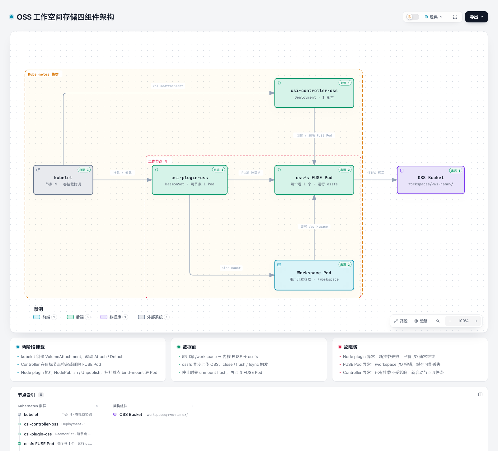

# OSS 存储方案：同步机制、四组件关系与 Node Plugin 详解

> 适用版本：本文基于 `agent-deploy` 仓库 commit `574f1cf639d99698b4c8751c9b569478dc40af15` 的代码与清单整理。
> 涵盖内容：OSS 数据写入链路、`csi-controller-oss` / `csi-plugin-oss` / `ossfs FUSE Pod` / `Workspace Pod` 四组件关系、Node Plugin 职责、关闭工作空间对同步的影响，以及排障命令。

> **方案定位（定版）**：OSS 对象存储卷 + **ossfs 1.0**（`fuseType: ossfs`）是当前**唯一生产方案**，本文描述其运行期实现。阿里云 ACK 部署包（`deploy-ack/`）暂不启用，NAS/NFS 与 Local Path 已降级为附录备选；结论见 [storage_plan.md](storage_plan.md)。

---

## 0. 结论速览

| 问题 | 结论 |
|---|---|
| 哪个服务把数据同步到 OSS？ | **没有独立的同步服务**。数据通过 OSS CSI 插件挂载的 **ossfs FUSE 文件系统**直接写入 OSS Bucket |
| 写完立即关闭工作空间会丢数据吗？ | **不是必丢，但有窗口**。正常保存/关闭文件后风险很低；程序仍持有 fd、未 flush，或大文件正在上传时立即关闭，可能丢尾部数据 |
| “关闭工作空间”做了什么？ | API 将 `spec.stopped=true`，Controller 把 Deployment 副本数缩到 0，删除 Pod；PVC/PV 保留，OSS 数据不删除 |
| 四组件分别是什么？ | `csi-controller-oss`（控制面）、`csi-plugin-oss`（节点面）、`ossfs FUSE Pod`（数据面客户端）、`Workspace Pod`（数据消费者） |
| `csi-plugin-oss` 做什么？ | 向 kubelet 注册驱动、执行 NodePublish/Unpublish 等节点侧 CSI RPC、把 FUSE 挂载点 bind-mount 进 Workspace Pod；**不跑 ossfs、不直接连 OSS** |
| 为什么关闭有风险？ | Pod 的 `terminationGracePeriodSeconds` 只有 **2 秒**，且没有 preStop flush 钩子；ossfs 是异步上传 |

---

## 1. 架构总览



- 交互式版本：[oss-csi-architecture.html](oss-csi-architecture.html)
- 图表源文件（Archify candidate）：[`../.archify/architecture-oss-csi-20261103-150236/candidate.json`](../.archify/architecture-oss-csi-20261103-150236/candidate.json)

图中包含四个核心组件，以及两个理解调用链所必需的角色：

| 角色 | 说明 |
|---|---|
| `csi-controller-oss` | CSI 控制面 Deployment，负责 Attach/Detach 与 FUSE Pod 生命周期 |
| `csi-plugin-oss` | CSI 节点面 DaemonSet，每节点一个，负责驱动注册与节点侧挂载操作 |
| `ossfs FUSE Pod` | 每个卷一个，运行 **ossfs 1.0** 客户端，真正挂载 OSS 并上传/下载数据 |
| `Workspace Pod` | 用户开发容器，消费 `/workspace` 挂载点 |
| `kubelet` | 协调 Attach/Publish 流程，调用节点插件 |
| `OSS Bucket` | 数据最终落点，路径前缀 `workspaces/<ws-name>/` |

---

## 2. 哪个服务把数据同步到 OSS？

### 2.1 没有“同步服务”

OSS 方案不是“先写本地，再由某个服务 rsync 到 OSS”，而是：

```
Workspace Pod 写 /workspace
  → 内核 FUSE
  → ossfs（运行在 FUSE Pod 内）
  → OSS Bucket 的 workspaces/<ws-name>/...
```

应用写入时，数据经 FUSE 进入 ossfs；ossfs 在本地缓存后异步上传 OSS。**运行时不依赖任何额外的同步进程或定时任务。**

### 2.2 参与数据链路的组件

| 组件 | 是否在数据路径上 | 作用 |
|---|---|---|
| `csi-controller-oss` | 否 | 创建/删除 FUSE Pod、处理 Attach/Detach |
| `csi-plugin-oss` | 否（只做挂载接线） | 把 FUSE 挂载点 bind-mount 进 Pod |
| `ossfs FUSE Pod` | **是** | 运行 ossfs，负责缓存、上传、下载 |
| `Workspace Pod` | **是**（发起方） | 应用读写 `/workspace` |
| Operator | 否 | 创建 PV/PVC、Deployment |

### 2.3 容易误认的“同步脚本”

`hack/migrate-localpath-to-oss.sh` **只是一次性迁移工具**：把 Local Path 上已有的 Workspace 目录用 `ossutil` 上传到 OSS，用于切换存储底座。它不参与运行时同步，也不会在用户写文件时自动执行。

对应清单与代码：

- OSS StorageClass：`deploy/oss/storageclass.yaml:1-32`（`provisioner: ossplugin.csi.alibabacloud.com`）
- Operator 创建静态 PV，子路径 `/workspaces/<ws-name>`：`internal/controller/workspace_controller.go:504-599`，其中 `subPath` 在 `:549`
- 容器内 `/workspace` 挂载：`internal/controller/workspace_controller.go:968-1001`

---

## 3. 四个组件的关系

### 3.1 组件职责

| 组件 | 类型 / 位置 | 职责 | 生命周期 |
|---|---|---|---|
| `csi-controller-oss` | Deployment，1 副本，`default` 命名空间 | CSI 控制面：处理 Attach/Detach、扩容协调，**创建/删除 FUSE Pod** | 集群级常驻 |
| `csi-plugin-oss` | DaemonSet，**每个节点 1 个**，`default` 命名空间 | CSI 节点面：向 kubelet 注册驱动、执行 NodeStage/NodePublish/NodeUnpublish、bind-mount | 节点级常驻 |
| ossfs（FUSE Pod） | Pod，**每个卷 1 个**，`ack-csi-fuse` 命名空间 | 数据面客户端：运行 **ossfs 1.0**，挂载 Bucket 子路径，负责读写和上传 | 跟随卷的 attach/detach |
| `Workspace Pod` | 用户工作空间 Pod | 数据消费者：只看到 `/workspace`、`/data` 等挂载点，**不直接连 OSS** | 跟随 Workspace 启停 |

一句话概括：

> **Controller 搭台/拆台，Node Plugin 把台子接进 Pod，FUSE Pod 里的 ossfs 搬数据，Workspace Pod 只管用。**

### 3.2 启动 / 唤醒链路

```
Operator 创建静态 PV ws-<id>-pv (path=/workspaces/ws-<id>) + PVC
        ↓
Workspace Pod 被调度到节点 N
        ↓
kubelet 发起 Attach → 生成 VolumeAttachment
        ↓
external-oss-attacher → csi-controller-oss 的 ControllerPublishVolume
        ↓
Controller 在节点 N 的 ack-csi-fuse 命名空间创建 FUSE Pod
        ↓
FUSE Pod 内 ossfs 挂载 bucket:/workspaces/ws-<id> 到宿主机 /run/fuse.ossfs/...
        ↓
kubelet → 节点 N 上的 csi-plugin-oss 执行 NodePublishVolume
        ↓
把 FUSE 挂载点 bind-mount 到 /var/lib/kubelet/pods/<uid>/volumes/...
        ↓
容器内出现 /workspace（subPath=workspace）
        ↓
应用写文件 → 内核 FUSE → ossfs → OSS
```

关键证据：

- `CSIDriver.attachRequired: true`：`deploy/oss/csi-plugin.yaml:87-96`
- Controller 与 external-attacher：`deploy/oss/csi-controller.yaml:11-76`
- FUSE Pod 由 `ControllerPublishVolume` 创建：`deploy/oss/csi-controller.yaml:1-10`
- 节点插件与 `/run/fuse.ossfs` 目录：`deploy/oss/csi-plugin.yaml:159-209`
- Operator 建 PV、子路径：`internal/controller/workspace_controller.go:504-599`
- 容器内 `/workspace` 挂载：`internal/controller/workspace_controller.go:968-1001`

### 3.3 停止 / 关闭链路

```
spec.stopped=true → Deployment replicas=0 → Pod 删除
        ↓
kubelet 调用 csi-plugin-oss NodeUnpublishVolume（unmount bind mount，ossfs flush）
        ↓
VolumeAttachment 删除 → Controller ControllerUnpublishVolume
        ↓
删除该卷对应的 FUSE Pod
        ↓
PVC/PV 保留（reclaimPolicy: Retain），OSS 数据不动
```

对应实现：

- 前端调用停止接口：`web/portal/src/lib/api.ts:84-86`、`web/portal/src/store.ts:539-546`
- API 设置 `spec.stopped = true`：`cmd/api-server/main.go:903-948`，其中 `:931`
- 副本数计算：`internal/controller/workspace_controller.go:1298-1318`，`Stopped=true → 0` 在 `:1304`
- 删除 Workspace 不清理 PV/PVC：`internal/controller/workspace_controller.go:164-169`

### 3.4 故障域

| 故障 | 影响 |
|---|---|
| `csi-plugin-oss` 某节点异常 | 该节点上新 Pod 的卷无法 NodePublish → 卡在 `ContainerCreating`；删除中的 Pod 可能卡在 `Terminating`；容量统计缺失。**已挂载的 I/O 通常继续**，因为数据路径是内核 FUSE ↔ FUSE Pod |
| FUSE Pod 异常 | 对应 Workspace 的 `/workspace` 出现 I/O 错误，直到 Controller 重建 FUSE Pod；ossfs 本地缓存可能丢失 |
| `csi-controller-oss` 异常 | 已有挂载不受影响；新 Workspace 无法 attach/启动，已停止 Workspace 的 FUSE Pod 也无法及时回收。当前清单为 **1 副本**，生产建议至少 2 副本 + leader election |
| `Workspace Pod` 异常 | 只影响自身，底层 FUSE 与 OSS 数据不受影响 |

### 3.5 容易混淆的点

1. **没有单独的 “ossfs 服务”**：ossfs 不是 Deployment/DaemonSet，而是 Controller 为**每个卷**拉起的 FUSE Pod（一个 Workspace 一个）。
2. **`csi-plugin-oss` 和 `csi-controller-oss` 不跑 ossfs**：它们只处理 CSI 协议，新架构下 ossfs 客户端在 FUSE Pod 里。
3. **Operator 不走动态供应**：Workspace 的 PV 由 Operator 自己创建为静态 PV，`subPath` 固定为 `/workspaces/<ws-name>`；`csi-controller` 主要参与 Attach/Detach 与 FUSE Pod 管理。
4. **一个节点上所有 Workspace 共享一个 `csi-plugin-oss` Pod**；每个 Workspace 独立的是 FUSE Pod。

---

## 4. Node Plugin（csi-plugin-oss）详解

### 4.1 一句话定位

`csi-plugin-oss` 是 OSS CSI 驱动的“节点侧执行者”：在每个节点常驻，向 kubelet 注册驱动，并在 Pod 挂载/卸载时执行节点本地的 mount、bind-mount、unmount、容量统计等操作。**它不运行 ossfs，也不直接读写 OSS 数据。**

### 4.2 向 kubelet 注册 CSI 驱动

DaemonSet 里有两个容器（`deploy/oss/csi-plugin.yaml:118-179`）：

| 容器 | 作用 |
|---|---|
| `driver-registrar` | 把 `csi.sock` 注册到 kubelet 的插件注册目录 |
| `csi-plugin` | 真正提供 CSI Node Service 的实现 |

关键参数：

- `--kubelet-registration-path=/var/lib/kubelet/csi-plugins/ossplugin.csi.alibabacloud.com/csi.sock`（`:124`）
- `--run-node-service=true`、`--run-controller-service=false`（`:141-142`）：**只跑节点服务**，控制面在 `csi-controller-oss` 里

注册成功后，kubelet 才知道“本节点存在 `ossplugin.csi.alibabacloud.com` 驱动”，后续才能把卷挂载请求发给它。注册目录通过 hostPath `/var/lib/kubelet/plugins_registry` 暴露（`:181-185`）。

### 4.3 执行 CSI Node Service 的 RPC

| RPC | 作用 |
|---|---|
| `NodeGetInfo` | 返回节点 ID（`--nodeid=$(KUBE_NODE_NAME)`），供调度/拓扑使用 |
| `NodeStageVolume`（若驱动声明） | 准备全局挂载点 / staging 目录 |
| `NodePublishVolume` | **把 FUSE 挂载点 bind-mount 到 kubelet 的 Pod 卷目录**，最终让容器看到 `/workspace` |
| `NodeUnpublishVolume` | Pod 删除时 unmount bind mount，触发 ossfs flush/close |
| `NodeUnstageVolume` | 清理 staging / global mount 目录 |
| `NodeGetVolumeStats` | 上报容量、使用量、inode，供 kubelet 指标和驱逐使用 |
| `NodeExpandVolume` | 处理 PVC 扩容（StorageClass `allowVolumeExpansion: true`） |
| `NodeGetCapabilities` | 声明驱动支持哪些节点能力（如 STAGE_UNSTAGE、EXPAND、GET_VOLUME_STATS） |

新架构下的分工（`deploy/oss/csi-controller.yaml:1-10`）：

```
真正的 OSS 挂载：FUSE Pod 里的 ossfs 完成
    ↓ 挂到宿主机 /run/fuse.ossfs/...
NodePublishVolume：csi-plugin-oss 把该挂载点 bind-mount 进 Pod 卷目录
    ↓
容器内 /workspace 可用
```

所以 **Node Plugin 是“把 FUSE Pod 已经做好的挂载接进业务 Pod”的那一步**，不是“连 OSS 的那一步”。

### 4.4 为什么必须每节点一个

- kubelet 只能调用**本机**的 CSI Unix socket，Node Plugin 必须和 kubelet 同节点。
- DaemonSet + `tolerations: Exists`（`deploy/oss/csi-plugin.yaml:115-116`）保证所有节点（包括带污点的节点）都有一个。
- **一个节点上的所有 Workspace 共享这一个 DaemonSet Pod**；每个 Workspace 一个的是 FUSE Pod，不是 Node Plugin。

### 4.5 宿主集成细节

为了执行挂载，它需要很高权限（`deploy/oss/csi-plugin.yaml:130-179`）：

| 配置 | 原因 |
|---|---|
| `privileged: true` | 需要执行 mount/umount、操作 `/dev`、`/sys` |
| `hostPID: true`、`hostNetwork: true` | 与宿主机进程/网络命名空间协同 |
| `/var/lib/kubelet` + `Bidirectional` | 把挂载传播给 kubelet 管理的 Pod 卷目录 |
| `/run/fuse.ossfs` + `Bidirectional` | 访问 FUSE Pod 的 globalmount/socket 目录 |
| `/dev`、`/sys` | 设备与内核文件系统操作 |
| `/host`（挂 `/`） | 读取宿主 `/etc/mime.types`、写入 `/var/run/ossfs` metrics |
| `/var/log` | 与 ossfs 日志/排障相关 |

`Bidirectional` 是关键：FUSE Pod 在宿主机 `/run/fuse.ossfs` 下创建的挂载，必须能传播到 kubelet 的挂载命名空间，Node Plugin 才能把它 bind 到 Pod 里。

### 4.6 它“不负责”什么

| 组件 | 负责 | 不负责 |
|---|---|---|
| `csi-controller-oss` | Attach/Detach、创建/删除 FUSE Pod、扩容协调 | 不执行节点本地 mount |
| **`csi-plugin-oss`** | **驱动注册、NodePublish/Unpublish、节点 mount、stats** | **不跑 ossfs、不连 OSS、不建 PV/PVC** |
| `ossfs FUSE Pod` | 真正的 OSS 挂载、缓存、上传/下载 | 不负责把挂载接进业务 Pod |
| `Workspace Pod` | 消费 `/workspace` 挂载点 | 不接触 CSI/OSS |

特别强调：**Node Plugin 不向 OSS 发起 HTTP 请求，也不持有 AK 做数据读写**；数据面完全在 FUSE Pod 的 ossfs 里。

### 4.7 故障影响

| 情况 | 影响 |
|---|---|
| 某节点 Node Plugin 挂掉 | 该节点上新 Pod 的卷无法 NodePublish → 卡在 `ContainerCreating`；删除中的 Pod 可能因 NodeUnpublish 失败卡在 `Terminating`；volume stats 缺失 |
| 已挂载的 Pod | **I/O 通常继续**，因为内核 FUSE 直接连 FUSE Pod，Node Plugin 不在数据路径上 |
| Node Plugin 重启 | 重新注册驱动；已有挂载不受影响；需要清理残留 mount 目录 |
| 滚动升级 DaemonSet | 该节点短时间内新的挂载可能失败，已运行的 Workspace 不受影响 |

### 4.8 验证命令

```bash
# DaemonSet 每个节点都应 Ready
kubectl -n default get ds csi-plugin-oss -o wide
kubectl -n default get pods -l app=csi-plugin-oss -o wide

# 注册日志
kubectl -n default logs <pod> -c driver-registrar

# 节点服务日志（挂载失败时看这里）
kubectl -n default logs <pod> -c csi-plugin

# 节点上确认注册文件
ls /var/lib/kubelet/plugins_registry | grep oss
```

---

## 5. 写完立即关闭工作空间，会影响同步吗？

### 5.1 “关闭工作空间”实际做了什么

1. 前端调用 `POST /api/workspaces/stop`（`web/portal/src/lib/api.ts:84-86`）
2. API-Server 把 `spec.stopped = true`（`cmd/api-server/main.go:931`）
3. Controller 的 `computeDesiredReplicas` 返回 0（`internal/controller/workspace_controller.go:1298-1307`）
4. Deployment 缩容到 0，Pod 被删除
5. PVC/PV 是 `Retain`，**不会删数据**

关键点：Pod 的 **`terminationGracePeriodSeconds` 只有 2 秒**（`internal/controller/workspace_controller.go:1143`、`:1209-1210`），而且**没有 preStop 钩子、没有 `sync`/fsync 动作**。2 秒后容器收到 SIGKILL。

### 5.2 ossfs 的写入/上传语义

ossfs 是 FUSE 文件系统，**写入是异步的**：

- 应用 `write()` 先进入本地缓存
- 文件 `close` / `flush` / `fsync` 时触发上传
- 上传本身也需要时间，大文件尤其明显

因此，“写完”和“已经到 OSS”不是同一时刻。

### 5.3 风险矩阵

| 场景 | 风险 | 原因 |
|---|---|---|
| 编辑器正常保存（文件已 close） | 低 | ossfs 在 close 时触发上传；Pod 删除时先 unmount flush |
| 程序仍持有 fd / 没有 flush | 中高 | 2 秒宽限后 SIGKILL，用户态缓冲可能丢失 |
| 正在复制大文件 / 编译产物还在写 | 中高 | 异步上传未完成就被中断，尾部可能缺失 |
| FUSE Pod 在缓存上传完成前被回收 | 中高 | 缓存中的数据丢失 |
| 已正常保存，停完立刻重新唤醒 | 低 | 数据在 OSS；元数据缓存可能短暂显示旧 stat，不是数据丢失 |

补充：

- `max_stat_cache_size=100000` 会缓存元数据，重新挂载后可能短暂看到旧 stat，这不是数据丢失。
- FUSE Pod 独立于 Workspace Pod，停止流程先 unmount（触发 flush）再回收 FUSE Pod，未完成的上传有机会继续；但如果这个窗口被异常打断，仍有丢缓存的风险。

### 5.4 建议

**使用侧：**

1. 写完确认保存/关闭文件后再点“关闭工作空间”。
2. 大文件、批量写入后，在工作空间里执行一次 `sync`，等几秒再停止。
3. 用 `ossutil ls oss://<bucket>/workspaces/<ws-name>/` 确认文件已上传后再删除/重建。

**平台侧（想彻底消除窗口）：**

1. 把 `TerminationGracePeriodSeconds` 从 2 调大（如 10~30），给 ossfs 留出 flush 时间。
2. 增加 preStop hook 执行 `sync -f /workspace`（或 `sync`），覆盖多数场景。
3. 停止前等待 ossfs 上传队列清空（需在 FUSE Pod 侧实现，当前代码没有）。
4. 避免在停止后立即清理节点缓存或强制删除 FUSE Pod。

### 5.5 idleTimeout 自动休眠也是同一条路径

`idleTimeout` 到期后，Controller 同样通过 `computeDesiredReplicas` 把副本数缩到 0（`internal/controller/workspace_controller.go:1298-1318`），走的是和手动停止相同的终止流程，因此有相同的 flush 窗口。

注意：`idleTimeout` **不是**“检测用户停止操作后的闲置”，而是“自 `lastActiveTime` 起的最大运行窗口”；`lastActiveTime` 不会因业务 HTTP 流量自动刷新（见 `docs/workspace_user_manual.md:48`）。

---

## 6. 排障与验证

### 6.1 基础检查

```bash
# 节点插件：每个节点 1 个，全部 Ready
kubectl -n default get ds csi-plugin-oss -o wide
kubectl -n default get pods -l app=csi-plugin-oss -o wide

# 控制面：1 副本 Ready
kubectl -n default get deploy csi-controller-oss

# 每个卷一个 FUSE Pod
kubectl -n ack-csi-fuse get pods -o wide

# PV 的 OSS 参数（bucket / path / fuseType / sigVersion）
kubectl get pv ws-<id>-pv -o jsonpath='{.spec.csi.volumeAttributes}' | tr ',' '\n'

# PVC 是否 Bound
kubectl get pvc ws-<id>-pvc -n <namespace>

# 写入 → 停止 → 唤醒 → 文件仍在
kubectl exec -it <ws-pod> -- sh -c 'echo ok > /workspace/check.txt; sync'
kubectl get workspace ws-<id> -o jsonpath='{.status.phase}'
```

### 6.2 常见错误

| 现象 | 可能原因 | 处理 |
|---|---|---|
| `Unable to connect(host=https://...)` | Endpoint/协议错误；内网 OSS 被强制 https | 检查 `url` 是否显式带 `http://`，并确认 `PRIVATE_CLOUD_TAG: "true"` |
| `AccessDenied` | AK 无权限 | 检查 `oss-secret` 与 RAM 授权 |
| `SignatureDoesNotMatch` | 签名版本/Region 不匹配 | 新建 Bucket 使用 `sigVersion: v4` + `region` |
| 挂载失败，参数报错 | `fuseType` 与 `otherOpts` 混用 | `ossfs` 与 `ossfs2` 的挂载参数不能混用 |
| FUSE Pod 未创建 | 缺少 `csi-controller-oss` | 部署 `deploy/oss/csi-controller.yaml` |
| Pod 卡 `ContainerCreating` | Node Plugin 未注册/Attach 失败 | 看 `driver-registrar` 与 `csi-plugin` 日志 |
| Pod 卡 `Terminating` | NodeUnpublish 失败 | 看节点插件日志与节点 mount 状态 |

更多部署细节见：

- [`docs/offline_deployment_guide.md`](offline_deployment_guide.md)（主线：OSS + ossfs 1.0）
- [`docs/storage_plan.md`](storage_plan.md)（存储方案定版结论）
- [`deploy-ack/README.md`](../deploy-ack/README.md)（**附录 C：ACK 部署包，暂不启用**）
- [`docs/storage_migration_guide.md`](storage_migration_guide.md)

---

## 7. 代码与清单索引

| 主题 | 文件 / 位置 |
|---|---|
| OSS StorageClass | `deploy/oss/storageclass.yaml:1-32` |
| CSI 节点插件 DaemonSet | `deploy/oss/csi-plugin.yaml:98-209` |
| CSIDriver（attachRequired） | `deploy/oss/csi-plugin.yaml:87-96` |
| driver-registrar | `deploy/oss/csi-plugin.yaml:118-125` |
| csi-plugin 节点服务参数 | `deploy/oss/csi-plugin.yaml:130-143` |
| 宿主挂载与传播 | `deploy/oss/csi-plugin.yaml:159-179` |
| CSI 控制面 Deployment | `deploy/oss/csi-controller.yaml:11-76` |
| FUSE Pod 创建流程说明 | `deploy/oss/csi-controller.yaml:1-10` |
| external-attacher | `deploy/oss/csi-controller.yaml:64-76` |
| Operator 创建 OSS PV/PVC | `internal/controller/workspace_controller.go:504-599` |
| PV 子路径 `/workspaces/<ws>` | `internal/controller/workspace_controller.go:549` |
| 容器 `/workspace` 挂载 | `internal/controller/workspace_controller.go:968-1001` |
| 副本数计算（Stopped/IdleTimeout） | `internal/controller/workspace_controller.go:1298-1318` |
| 2 秒终止宽限 | `internal/controller/workspace_controller.go:1143`、`:1209-1210` |
| 删除 Workspace 不清理 PV/PVC | `internal/controller/workspace_controller.go:164-169` |
| 停止接口 | `cmd/api-server/main.go:903-948` |
| 前端停止调用 | `web/portal/src/lib/api.ts:84-86`、`web/portal/src/store.ts:539-546` |
| Workspace 用户手册（Stopped/IdleTimeout） | `docs/workspace_user_manual.md:48`、`:168` |
| OSS 迁移脚本（一次性） | `hack/migrate-localpath-to-oss.sh` |

---

## 8. 图表产物

| 产物 | 路径 |
|---|---|
| 架构图 PNG（本文嵌入） | [`docs/oss-csi-architecture.png`](oss-csi-architecture.png) |
| 交互式 HTML | [`docs/oss-csi-architecture.html`](oss-csi-architecture.html) |
| Archify 图表源 | [`../.archify/architecture-oss-csi-20261103-150236/candidate.json`](../.archify/architecture-oss-csi-20261103-150236/candidate.json) |
| 校验回执 | [`../.archify/architecture-oss-csi-20261103-150236/oss-csi-architecture.finalize.json`](../.archify/architecture-oss-csi-20261103-150236/oss-csi-architecture.finalize.json) |

图表校验：`validate` / `deliver` / `check` / `browser-check` 全部通过；未做人工视觉审查。

---

## 变更记录

| 日期 | 说明 |
|---|---|
| 2026-11-03 | 初版：整理 OSS 同步机制、四组件关系、Node Plugin 详解与关闭工作空间影响 |
| 2026-11-04 | 补充方案定位：OSS + ossfs 1.0 为唯一生产方案；ACK 部署包暂不启用；NAS/Local 降为附录 |
