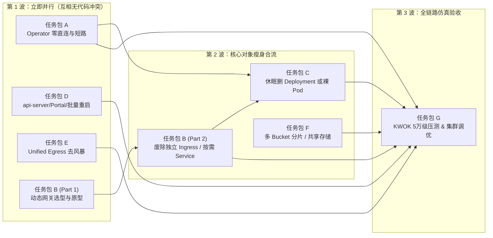

# 5万+ 存量 & 2,000~5,000 并发在线 Workspace 系统改造执行方案

> **适用读者**：项目负责人及后续负责具体编码实施的 AI 智能体（Agent）。  
> **目标规模**：集群存量 `50,000+` Workspace（约 `45,000~48,000` 处于 `Sleeping` / `Stopped` 状态），同时在线 `2,000~5,000` 个 `Running` Workspace，早高峰瞬时并发创建 / 唤醒请求 `500~1,000` 次。

---

## 一、目标规模与核心数学约束（为什么不能靠简单调参硬扛 5 万+）

在 `1,000` 规模下只需调大内存/QPS、裁剪 Informer 缓存即可过关；但上升到 **`50,000+` 存量 + `2,000~5,000` 同时在线** 时，Kubernetes 原生资源模型、网络、存储与控制面存在多条**物理级硬天花板**，必须从架构与代码层同步改造。

### 1. 当前模型在 5 万+ 规模下的硬天花板

| 瓶颈维度 | 当前代码/配置现状 | 5 万存量 + 2,000~5,000 在线下的量化后果 |
| :--- | :--- | :--- |
| **etcd / K8s 对象爆炸** | 1 个 Workspace 常驻 8~10 个持久化对象（Workspace CR + Deployment + 1~3 RS + Service + EndpointSlice + Ingress + PVC + PV） | 50,000 存量 ≈ **400,000 ~ 500,000 个 K8s 对象**，直接击穿单集群 etcd 容量（默认 2GiB~8GiB）、APIServer Watch 缓存内存与 `kube-controller-manager` GC 吞吐 |
| **Service ClusterIP 池枯竭** | [workspace_controller.go](../internal/controller/workspace_controller.go#L1468-L1534) 为每个 Workspace 永久保留 1 个 `ClusterIP` Service | 标准 `/16` Service CIDR 仅有 **65,534 个 IP**；50,000 个常驻 Service（即使 4.5 万个是 0 副本休眠态）直接耗尽集群 ClusterIP 池，其他服务无法创建 |
| **Ingress-Nginx 配置膨胀与 OOM** | [workspace_controller.go](../internal/controller/workspace_controller.go#L1536-L1647) 独立创建 `<wsName>-ingress` 且 `proxy-read-timeout: 86400`；[ingress-deploy.yaml](../deploy/ingress-deploy.yaml#L416-L515) 仅 2 副本 × 2Gi | 50,000 个独立 Ingress 生成上百 MB `nginx.conf`；频繁新建/变更触发连续 `nginx -s reload`，2,000~5,000 条长连接（WebIDE/WebSocket/SSE）无法及时排空，老 Worker 堆积必 OOM 并引发全员断连 |
| **Controller 冷启动直连 APIServer 点读风暴** | [cmd/main.go](../cmd/main.go#L213-L218) 禁用 SC/PV/PVC 缓存；每次 Reconcile 对休眠对象也发约 5 次 uncached Get/List | 控制器重启/切主时，50,000 实例全量入队 = **250,000+ 次 APIServer 直连请求**；按 300 QPS 限流需排队 **14 分钟以上**，期间创建/唤醒大面积 504 |
| **API-Server 内存、带宽与同步阻塞** | [cmd/api-server/main.go](../cmd/api-server/main.go#L707-L914) 同步 30s 轮询 + 探活未 drain Body 导致无法复用 TCP；[workspace_cache.go](../cmd/api-server/workspace_cache.go#L178-L235) 全量重建并 `Marshal` `allJSON`；[batch_restart.go](../cmd/api-server/batch_restart.go#L33) 硬上限 5,000 | 5 万条 `allJSON` 约 **12~15 MB**，500ms 频繁重建制造每秒数十 MB GC 垃圾；前端每 30s 拉全量；早高峰并发唤醒堆积长连接与 `TIME_WAIT`；`batch-restart` 截断 5,000 且超 ConfigMap `1MiB` 限制直接失败 |
| **OSS + ossfs 1.0 存储与 Pod 翻倍** | [workspace_controller.go](../internal/controller/workspace_controller.go#L585-L689) 单 OSS Bucket + 每卷 1 个伴生 FUSE Pod；[L2503-L2515](../internal/controller/workspace_controller.go#L2503-L2515) ReadinessProbe 2s 周期 | 2,000~5,000 在线 = **4,000~10,000 运行中 Pod**；单 OSS Bucket 极易触发 `503 SlowDown`；50,000 静默 PV + 50,000 PVC = 100,000 存储对象永久滞留 etcd |
| **Unified Egress（若启用 `EGRESS_ENABLED=true`）** | [egress.go](../internal/controller/egress.go#L154-L258) 每次 Reconcile 两次全命名空间 DeepCopy List、每次必发 `RememberConfiguration` Create、配置变更全员入队；[egress_status.go](../cmd/api-server/egress_status.go#L80-L138) 每 5s 直连 APIServer 全量拉 3 张表；Envoy 仅 2 副本 × 512Mi | 30 并发下瞬间呈 $O(N^2)$ 打爆控制器与 API-Server 内存；2 副本 512Mi Envoy 单点且无法承载 5,000 在线代理流量 |

### 2. 改造前后 K8s 资源对象规模对比（50,000 存量 + 5,000 在线）

| 资源类型 | 改造前对象数 | 改造后对象数（目标） | 核心瘦身手段 |
| :--- | :---: | :---: | :--- |
| `Workspace` (CR) | 50,000 | 50,000 | 核心元数据保留（或按多集群水平分片） |
| `Ingress` | 50,000 | **1**（泛域名/统一网关） | 任务包 B：废除单 Workspace 独立 Ingress |
| `Service` + `EndpointSlice` | 100,000 | **0**（直连 PodIP）或 **10,000**（仅活跃态按需保留） | 任务包 B：动态网关直连 PodIP，或休眠态回收 Service |
| `Deployment` + `ReplicaSet` | 100,000 ~ 150,000 | **0**（裸 Pod）或 **5,000**（休眠删除 Deployment） | 任务包 C：休眠回收计算对象 / 裸 Pod 编排 |
| `Pod`（含 FUSE Pod） | 4,000 ~ 10,000 | **2,000 ~ 5,000**（JuiceFS/CPFS 下无需伴生 FUSE Pod） | 任务包 F：共享存储取代单卷 FUSE Pod |
| `PV` + `PVC` | 100,000 | **16 ~ 32**（共享分片 PVC）或 **仅活跃态按需绑定** | 任务包 F：多 Bucket 分片共享 PVC / 长期休眠回收 PV&PVC |
| **合计 K8s 对象数** | **400,000 ~ 500,000** | **55,000 ~ 65,000（降幅 85%+）** | 控制面与 etcd 压力降至可长期稳定运行区间 |

---

## 二、可并行指派给智能体的任务包（Task Packages）

以下拆分 **7 个边界清晰的工程任务包（A ~ G）**，可直接作为独立 Prompt/工单分派给不同智能体实施。

---

### 任务包 A（P0 · 可立即独立并行）：Operator 零直连读、休眠短路与内存/探针调优

- **目标与边界**：在不改变外部资源模型的前提下，消除稳态和冷启动期间对 APIServer 的无谓直连请求、削减 Informer 内存并修复群体唤醒/删除时的放大效应。
- **涉及文件与核心符号**：
  - [cmd/main.go](../cmd/main.go) (`newCacheOptions`, `stripDeploymentForCache`, `Client.Cache.DisableFor`)
  - [internal/controller/workspace_controller.go](../internal/controller/workspace_controller.go) (`reconcile`, `reconcilePVC`, `reconcileDeployment`, `resolveRunAsUser`, `volumeBlocksRunAsUser`, `maybeDeleteSharedNetworkPolicy`, `syncActiveInstances`, `getReadinessProbe`, `workspaceRevisionHistoryLimit`)
  - [internal/controller/metrics.go](../internal/controller/metrics.go) (`workspacePhaseTracker`)
- **详细实现设计**：
  1. **恢复 `StorageClass` 缓存**：从 [cmd/main.go](../cmd/main.go#L213-L218) 的 `DisableFor` 中移除 `&storagev1.StorageClass{}`（集群级仅数个对象，内存忽略不计），彻底消灭每轮 50,000 次直连 `StorageClass` Get/List。
  2. **裁剪 `Pod` Informer 缓存对象**：在 `newCacheOptions()` 中为 `&corev1.Pod{}` 增加 `Transform: stripPodForCache`，仅保留 `ObjectMeta`（清除 `ManagedFields` 与非必要大 Annotations）、`Status.Phase`、`Status.PodIP`、`Status.StartTime`、`DeletionTimestamp` 和标签，剥离 `Spec` 与冗长 `ContainerStatuses`。
  3. **休眠 / 停止态（`desiredReplicas == 0`）稳态短路**：在 `reconcile` 中，若目标应为 `0` 副本，且缓存中的 Deployment 已是 `0` 副本（或已删除）、`ws.Status.Phase` 已收敛为 `WorkspaceSleeping` / `WorkspaceStopped`、且 `ws.Status.PVCName != ""`（以及非禁用模式下 `Endpoint` 已存在），**直接短路跳过 `reconcilePVC` / `reconcileService` / `reconcileIngress`**，做到 **0 次 APIServer 直连调用**。
  4. **Deployment `spec-hash` 缓存比对免直连读**：
     - 生成期望 PodSpec/DeploymentSpec 时计算确定性 SHA-256 存入 Deployment annotation `ai.example.com/spec-hash`；
     - 在 `stripDeploymentForCache` 中保留 `d.Annotations["ai.example.com/spec-hash"]`；
     - `reconcileDeployment` 优先读**缓存中**的 Deployment，若 `Replicas == desiredReplicas`、`Generation` 正常且 `spec-hash` 匹配，直接返回无需调用 `r.uncachedReader().Get`；仅在 hash 不一致或副本数需变更时才回源拉取完整 Deployment 更新。
  5. **消除 `resolveRunAsUser` 重复 PVC Get**：将 `reconcilePVC` 内已读到的 `*corev1.PersistentVolumeClaim` 直接返回或传入 `reconcileDeployment -> resolveRunAsUser -> volumeBlocksRunAsUser`，避免同一轮 Reconcile 重复查询同一 PVC。
  6. **修复 `maybeDeleteSharedNetworkPolicy` 批量删除 $O(D \times N)$ 扫描**：删除路径禁止在每次删除时全量 DeepCopy 50,000 个 Workspace；改为优先检查本地 `workspacePhases` 计数，或 `r.List(ctx, wsList, client.InNamespace(namespace), client.Limit(2))`（需确认 `controller-runtime` 缓存 List 或结合内存索引判空）。
  7. **降低 `syncActiveInstances` 全量深拷贝频率**：默认同步周期从 `1m` 放宽至 `10m~15m`，或在 `Workspace` Informer 层挂轻量计数逻辑，避免每分钟 DeepCopy 50,000 个完整 CR。
  8. **缩减 RS 历史与探针/休眠防抖**：
     - `workspaceRevisionHistoryLimit` 从 `2` 降为 `0` 或 `1`（Recreate 策略无需保留多代旧 RS，5 万存量立省 5~10 万对象）；
     - `getReadinessProbe` 从 `PeriodSeconds: 2` 放宽至 `PeriodSeconds: 10, TimeoutSeconds: 5, FailureThreshold: 3`（启动速度已由 `StartupProbe` 的 `2s` 保障）；
     - `IdleTimeout` 的 `nextRequeue` 增加 `0~30s` 基于 `ws.Name` 哈希的确定性抖动（jitter），防止早高峰群体启动后同时到期引发集中缩容惊群。
- **注意事项**：
  - 修改 `stripDeploymentForCache` 后务必验证 `d.Annotations` 只保留白名单 key（如 `ai.example.com/spec-hash`），防止引入大体积 `kubectl.kubernetes.io/last-applied-configuration` 导致内存反弹。
  - `spec-hash` 必须覆盖所有影响 Pod 模板的字段（含 `DefaultRunAsUser`、Egress 模式开关、Env、VolumeMounts、Probes、SecurityContext）。
- **验收标准**：
  - `make manifests generate fmt vet && make test` 全部通过；
  - 新增单测覆盖：`spec-hash` 一致时 zero uncached Get、休眠稳态零外部读取、`resolveRunAsUser` 不重复 Get PVC、`IdleTimeout` jitter 有界。
- **前置依赖**：无。

---

### 任务包 B（P0 · 可立即独立并行）：废除单 Workspace 独立 Ingress + 按需/去 Service 化（路由层重构）

- **目标与边界**：彻底消除单 Workspace 独立 Ingress 引发的 `nginx.conf` 膨胀与 `nginx -s reload` OOM；解除 50,000 Service 耗尽 `/16` ClusterIP 池的死结。
- **涉及文件与组件**：
  - [internal/controller/workspace_controller.go](../internal/controller/workspace_controller.go) (`reconcileIngress`, `reconcileService`, `reconcile`)
  - [cmd/main.go](../cmd/main.go)（新增开关参数）
  - [config/samples/workspace-unified-api-ingress.yaml](../config/samples/workspace-unified-api-ingress.yaml)
  - [deploy/ingress-deploy.yaml](../deploy/ingress-deploy.yaml)
  - 新增统一网关配置或轻量路由服务（如 `cmd/workspace-gateway/` 或 OpenResty 动态路由模板）
- **详细实现设计**：
  1. **废除单 Workspace 独立 Ingress（落地 Task 1.4）**：
     - 增加控制器参数 `--disable-per-workspace-ingress`（及对应 env `DISABLE_PER_WORKSPACE_INGRESS`，默认新模式建议开启）；
     - 开启后 `reconcileIngress` 不再创建/更新 `<wsName>-ingress`，直接按规则计算 `endpoint` 写入 `ws.Status.Endpoint`；
     - 增加低速、限流（如令牌桶每秒删 20~50 个）的存量 `<wsName>-ingress` 清理逻辑或一次性迁移脚本，防止瞬间删除 5 万个 Ingress 打爆 Ingress Controller 与 APIServer。
  2. **部署集群级统一动态网关（二选一）**：
     - **网关方案 B1（Go/Envoy 轻量动态网关，推荐，零 reload 且不依赖 Service）**：独立部署 3~6 副本轻量 Go 反向代理（或 Envoy xDS 控制面），通过 Watch `Workspace` + `Pod` 缓存建立 `(namespace, wsName / host / cookie) -> (PodIP:targetPort)` 内存路由表，前端入口仅保留 **1 个泛域名 Ingress**（`*.workspace.domain` + 路径入口 `/bocomwork/ws/<user>`）转发给该网关服务，彻底免去 Nginx reload 与 Service 解析。
     - **网关方案 B2（OpenResty / Ingress-Nginx Lua 动态 upstream）**：保留单一泛域名 Ingress，利用 OpenResty/Lua `balancer_by_lua_block` 根据请求 `Host` 或 `X-User` / Cookie 动态解析上游（兼容现有 [workspace-unified-api-ingress.yaml](../config/samples/workspace-unified-api-ingress.yaml) 思路，但需去除对静态 `proxy_upstream_name` 依赖动态 Endpoint 列表的限制）。
  3. **解决 50,000 Service 耗尽 `/16` ClusterIP 池**：
     - 若采用**网关方案 B1（直连 PodIP）**：在 Controller 中增加 `--disable-per-workspace-service`，**彻底停止创建单 Workspace Service**，全集群 Service + EndpointSlice 减少 100,000 个！
     - 若仍需保留 K8s Service（如过渡期或走方案 B2）：修改 `reconcileService`，**仅在 `desiredReplicas > 0` 时创建 Service，进入 `Sleeping/Stopped` 时主动删除 Service**（或统一使用 `ClusterIP: None` Headless Service 不消耗 ClusterIP）。这样常驻 ClusterIP 从 50,000 降至最多 5,000。
  4. **入口基础设施调优**：
     - [deploy/ingress-deploy.yaml](../deploy/ingress-deploy.yaml) 扩容至 `4~6` 副本，配置 `worker-shutdown-timeout` 避免长连接无限制拖死老 Worker；
     - 集群层面确认 `kube-proxy` 运行在 **IPVS** 或 **Cilium eBPF** 模式（若仍为 iptables 必须先行切换）。
- **注意事项**：
  - 注意检查 `api-server` 中 [probeWorkspaceViaIngress](../cmd/api-server/main.go#L813-L873) 的探活 URL 必须与统一网关路由规则完全匹配（包含 `bocomwork` 场景和普通泛域名场景）。
- **验收标准**：
  - 创建/唤醒/休眠/删除 1,000 个 Workspace 期间，`ingress-nginx` reload 次数 = `0`；
  - WebSocket / WebIDE 长连接在并发新建其他 Workspace 期间不断连；
  - 50,000 存量 + 5,000 在线下，集群 ClusterIP 使用量 ≤ 5,500（或为 0）。
- **前置依赖**：路由方案确定（B1 或 B2）；彻底取消 Service 需配合 B1 或任务包 C 记录 `Status.PodIP`。

---

### 任务包 C（P0 · 依赖任务包 B 路由方案确认）：休眠回收计算对象 / 裸 Pod 编排

- **目标与边界**：消除 45,000+ 个休眠中 Workspace 在 etcd 里滞留的 `Deployment` 和 `ReplicaSet`（共计 90,000~140,000 个无效控制面对象），以及 `kube-controller-manager` Deployment/RS 控制循环的无效内存开销。
- **涉及文件与核心符号**：
  - [internal/controller/workspace_controller.go](../internal/controller/workspace_controller.go) (`reconcileDeployment`, `SetupWithManager`, `deploymentPredicate`)
  - [api/v1alpha1/workspace_types.go](../api/v1alpha1/workspace_types.go) (`WorkspaceStatus` 可选补充 `PodIP` 字段)
  - 参考现有评估文档：[bare_pod_orchestration_evaluation.md](./bare_pod_orchestration_evaluation.md)
- **详细实现设计（二选一，建议先落地 C1 或直接一步到位 C2）**：
  - **方案 C1（低风险，休眠回收 Deployment）**：
    - 在 `reconcileDeployment` 中，当 `desiredReplicas == 0` 时，不保留 `Replicas=0` 的空 Deployment，而是直接 `Delete` `<wsName>-deploy`（K8s GC 自动清理其关联的所有 `ReplicaSet`）；
    - 注意保留 `ws.Status.RunAsUser`（仅在 Deployment 存在时更新，Deletion/Sleeping 后不清空），确保监控与迁移进度状态不丢失；
    - 唤醒时直接根据 `ws.Spec` 重建 Deployment。
  - **方案 C2（彻底轻量化，裸 Pod 编排）**：
    - 移除 `Deployment` 和 `ReplicaSet` 两层封装，Controller 直接 `Owns(&corev1.Pod{})`；
    - 在线时创建一个带 OwnerReference 的单 Pod（Pod 命名可基于 PodTemplate hash 或固定 `<wsName>-pod` 在重建前先删旧再建），并把 `pod.Status.PodIP` 同步写入 `ws.Status.PodIP`（供任务包 B 的 B1 网关直接转发）；
    - 休眠/停止时直接删除 Pod；若容器意外退出（`PodSucceeded` / `PodFailed`）由 Controller Watch 事件触发重建。
- **注意事项**：
  - 若采用方案 C2，需要同步检查 `api-server` 中 [egress_status.go](../cmd/api-server/egress_status.go) 和 RBAC（[config/rbac/role.yaml](../config/rbac/role.yaml) 需通过 `make manifests` 重新生成，确保包含 Pods `create/delete/patch` 权限）。
  - 方案 C1/C2 切换涉及存量平滑迁移：Controller 需兼容清理旧 `<wsName>-deploy`。
- **验收标准**：
  - 50,000 存量 + 5,000 在线时，全集群 `Deployment + ReplicaSet` 总数从 `100,000+` 降至 `≤ 5,000`（C1）或 `0`（C2）；
  - 唤醒、休眠、配置变更重建、意外崩溃自愈全流程通过集成测试（`make test`）。
- **前置依赖**：若选择方案 C2 并取消 Service，需与任务包 B 协同。

---

### 任务包 D（P0 · 可立即独立并行）：`api-server` 与 Portal 5 万级性能优化与 `batch-restart` 重构

- **目标与边界**：解决 `api-server` 在 50,000 存量下 Informer 重建 GC 抖动、前端全量拉取慢、早高峰并发唤醒阻塞及连接泄漏、`batch-restart` 硬截断 5,000 且撞破 ConfigMap `1MiB` 上限的问题。
- **涉及文件与核心符号**：
  - [cmd/api-server/main.go](../cmd/api-server/main.go) (`probeHTTPClient`, `doSingleProbe`, `pollWorkspaceRunning`, `getWorkspaceHandler`, `updateExistingWorkspace`, `wakeupWorkspaceHandler`, `listWorkspacesHandler`)
  - [cmd/api-server/workspace_cache.go](../cmd/api-server/workspace_cache.go) (`startWorkspaceCache`, `upsert`, `buildSnapshot`, `matchOffsets`)
  - [cmd/api-server/batch_restart.go](../cmd/api-server/batch_restart.go) (`batchMaxItems`, `saveBatchDoc`, `batchTick`, `enumerateBatchTargets`)
  - [web/portal/src/lib/api.ts](../web/portal/src/lib/api.ts), [web/portal/src/store.ts](../web/portal/src/store.ts), [web/portal/src/components/directory/directory-view.tsx](../web/portal/src/components/directory/directory-view.tsx)
  - [deploy/api-server-deploy.yaml](../deploy/api-server-deploy.yaml)
- **详细实现设计**：
  1. **立即修复探活连接泄漏与超时兜底 Bug**：
     - 为 `probeHTTPClient` 配置独立 `http.Transport`（`MaxIdleConns: 500`, `MaxIdleConnsPerHost: 200`, `IdleConnTimeout: 90s`）；
     - `doSingleProbe` 在 `resp.Body.Close()` 前执行 `_, _ = io.Copy(io.Discard, io.LimitReader(resp.Body, 64<<10))`，确保 TCP 连接可复用；
     - 修正 `pollWorkspaceRunning` 超时分支：直连兜底应传 `wc = nil`（绕过可能滞后的本地缓存直连 APIServer 确认一次）。
  2. **唤醒 / 创建接口异步化（落地 Task 4.1，兼容旧版）**：
     - 对 `POST /api/workspaces` 与 `POST /api/workspaces/wakeup` 支持异步模式（如 `?async=true` 或请求体字段/新版本路径）：写入 CR（含合并 Spec 与 `Status.LastActiveTime`）后立即返回 `202 Accepted`（携带当前 `phase` 和预期 `url`）；
     - 新增轻量单实例状态查询或 SSE 流推送（复用 `workspaceCache` 通知机制，**零 APIServer 轮询开销**）；
     - 合并 `updateExistingWorkspace` 与 `wakeupWorkspaceHandler` 中多余的 Get 往返，`getWorkspaceHandler`（非返回全量 spec 的场景）优先读取本地 cache。
  3. **`workspaceCache` 5 万级内存与 CPU 改造**：
     - `startWorkspaceCache` 增加 `DefaultTransform` 剥离 `managedFields` 等大字段，`SyncPeriod` 从 `1m` 放宽到 `15m`；
     - `upsert` 比较投影后的 `workspaceItem` 与 `pending[key]` 旧值是否完全一致，**无实质变化直接 return 不调度 `rebuild`**（彻底消除 `15m` resync 引发的无效重建）；
     - **废除 `buildSnapshot` 每次全量 `json.Marshal(snap.all)`**（50,000 条 15MB 每 500ms 序列化一次会制造严重 GC 压力），仅在非分页旧接口首次被请求时按 `snap` 懒序列化一次或彻底下线无分页接口；
     - 在 `matchOffsets` / `workspaceSnapshot` 中新增 `phase`（`running`/`idle`/`failed`）与 `search` 关键词服务端过滤，并新增 `GET /api/workspaces/stats?namespace=xxx` 聚合统计接口（重建快照时预计算各 namespace 下的 `running/idle/failed/total`，请求时 O(1) 返回）；
     - HTTP Router 外层挂载 `gzip` 响应压缩中间件。
  4. **Portal 前端改造（[directory-view.tsx](../web/portal/src/components/directory/directory-view.tsx) 等）**：
     - 目录页改为**纯服务端分页**：请求 `GET /api/workspaces?namespace=...&page=...&pageSize=50&filter=...&search=...` + `GET /api/workspaces/stats?namespace=...`，前端内存只保留当前页 50 条（不再驻留 5 万条数组和 30 秒拉取 15MB 数据）；
     - 将表格中每秒更新一次“已运行时间”的单元格拆分为独立的 `<RunningDuration>` 子组件，把每秒 `setNow` 的重渲染范围锁定到单个文本节点，去掉大表格的 `motion.tr layout` 布局计算。
  5. **`batch-restart` 解除 5,000 截断与 `1MiB` ConfigMap 上限**：
     - 取消 `batchMaxItems = 5000` 硬截断；
     - 废弃将 50,000 个 `batchItem` 明文塞入单个 `api-server-batch-restart` ConfigMap 的存储方式：
       - **方案 D1（无外部依赖）**：主控 ConfigMap 只存任务配置、游标索引、聚合计数（`Total/Pending/Submitted/Running/Stopped/Failed/Skipped`）和最近 50 条失败样例；全量任务项列表用 **gzip 压缩存入 `ConfigMap.BinaryData`**（50,000 个精简 item 经 gzip 后约 200~400 KB，远低于 1MiB；若超 800KB 自动按每片 20,000 条拆分为分片 ConfigMap）；
       - **方案 D2（推荐如集群已有 Redis/DB）**：任务明细存 Redis / PostgreSQL，ConfigMap 仅做轻量分布式锁与状态摘要；
     - `batchTick` 内批次提交从单 goroutine 串行改为有限并发 worker 池（如 `10~20` 并发 + `50 QPS` 限速器），防止 `batchSize=200` 时单轮 tick 耗时超 `batchStaleThreshold(90s)` 被误判失联。
  6. **`api-server` 部署扩容**：[deploy/api-server-deploy.yaml](../deploy/api-server-deploy.yaml) 调整为 `3~4` 副本，单副本 `requests: 500m/1Gi, limits: 4C/4Gi`，注入 `GOMEMLIMIT=3200MiB`；运行 `make portal` 重新打包 `cmd/api-server/portal.html`。
- **验收标准**：
  - 50,000 条模拟数据下：`GET /api/workspaces?page=1&pageSize=50` P99 < 20ms，连续压测 5 万次堆内存无明显上涨；
  - `make portal` 构建成功且通过 `go test ./cmd/api-server/...`；
  - `batch-restart` 单测验证 50,000 目标创建、tick 推进与 gzip/分片持久化不会触及 1MiB 报错；
  - 500 并发探测压测下 TCP 连接复用率 > 95%，无 `TIME_WAIT` 暴涨。
- **前置依赖**：无。

---

### 任务包 E（P0/P1 · 可立即独立并行，启用 Unified Egress 前必做）：Unified Egress 去 O(N²) 风暴与代理扩容

- **目标与边界**：彻底消除开启 `EGRESS_ENABLED=true` 时的 $O(N^2)$ 内存拷贝、全员 5 万入队风暴与 `/api/egress/status` 打爆 APIServer 的隐患，并将 Envoy 代理数据面升级至可承载 2,000~5,000 在线水平扩展架构。
- **涉及文件与核心符号**：
  - [internal/controller/egress.go](../internal/controller/egress.go) (`cleanupUnusedEgressPolicies`, `prepareEgressConfig`, `mapEgressConfig`, `requireLoadedProxy`, `readOrInitializeEgress`)
  - [internal/controller/workspace_controller.go](../internal/controller/workspace_controller.go) (`sharedNetpolPredicate`, `mapNetworkPolicyToWorkspaces`, `reconcileNetworkPolicy`)
  - [internal/egress/store.go](../internal/egress/store.go) (`RememberConfiguration`)
  - [internal/egress/envoy.go](../internal/egress/envoy.go) (`Bootstrap`)
  - [cmd/api-server/egress_status.go](../cmd/api-server/egress_status.go) (`egressStatusHandler`, `observeEgressMigration`)
  - [deploy/production-egress/egress-install.production.yaml](../deploy/production-egress/egress-install.production.yaml)
- **详细实现设计**：
  1. **命名空间级 Egress 策略管理从单 Workspace Reconcile 剥离**：
     - 抽出独立的 `EgressPolicyReconciler`（低并发，按 Namespace 维度调谐），统一负责 `ensureSharedNetworkPolicy`、`upsertEgressPolicy`（`workspace-egress-v1` / `workspace-egress-unrestricted` / `workspace-shared-ingress`）和 `cleanupUnusedEgressPolicies`；
     - 单个 `WorkspaceReconciler` 只读取本地缓存的当前 Egress 模式，决定 Pod 模板标签和代理环境变量，**绝不在 30 并发的 Workspace Worker 里全命名空间 List Pod/Deployment**。
  2. **消除无条件写操作与直连点读**：
     - `egress.RememberConfiguration` 先通过缓存读取 `HistoryConfigMapName` 是否存在，存在则直接返回 `nil`（杜绝每次 Reconcile 发 `POST Create`）；
     - `requireLoadedProxy` 为代理就绪校验增加进程内 `2~5s` TTL 缓存，或用局部 Informer Watch `egress.Namespace()` 下的 `workspace-egress` Pod/Deployment。
  3. **阻止 50,000 全员入队风暴**：
     - `mapEgressConfig` 维护上一次已生效的 `Mode`：仅增删 `IPs`/`Domains`/`Services` 白名单（同模式变更）时，只唤醒 `EgressPolicyReconciler` 更新命名空间级 NetworkPolicy，**入队 0 个 Workspace**（Envoy 由 `egress-sync` 热加载 `routes.json`）；
     - 仅当发生跨模式切换（如 `legacy <-> allowlist <-> unrestricted`）时才需要滚动重建活跃 Workspace，且必须通过分批限流队列（如每秒放行 50~100 个活跃 Workspace，跳过 Sleeping/Stopped）避免瞬间 50,000 入队；
     - `mapNetworkPolicyToWorkspaces` 即使在 Unified Egress 开启时，也只入队 `EgressPolicyReconciler` 或单个代表 Workspace。
  4. **彻底重构 `/api/egress/status`（[egress_status.go](../cmd/api-server/egress_status.go)）**：
     - 禁止 HTTP 请求路径直连 APIServer 全量 List；
     - 在 `api-server` 后台起异步聚合协程（每 `10s` 更新一次内存快照），复用 `workspaceCache` + 轻量裁剪的 `Deployment`/`Pod` Informer，将 `Workspace × Deployment` 嵌套循环改为 `map[string]DeploymentSummary` 的 $O(1)$ 查找，只保留前 N 条（如 100 条）`pendingWorkspaces` 样本供前端展示。
  5. **Envoy 代理数据面高可用扩容**：
     - 移除 [egress-install.production.yaml](../deploy/production-egress/egress-install.production.yaml#L184-L185) 中的单节点 `nodeSelector`；
     - 改为多节点反亲和 + HPA（基线 `4~6` 副本，上限 `12+` 副本，单副本 `4C / 2~4Gi`，`--concurrency 4`）；
     - [envoy.go](../internal/egress/envoy.go#L59) 的 `max_hosts` 从 `1024` 提升至 `8192`~`16384`，并确保 `egress-sync` 上报注解和探针频率在多副本下可控。
- **验收标准**：
  - 同模式下增删 100 条域名/IP 白名单，Workspace Reconcile 触发数 = `0`；
  - `10` 个前端页面并发轮询 `/api/egress/status`，对 K8s APIServer 产生的 List 请求 = `0`；
  - `go test ./internal/egress/... ./internal/controller/... ./cmd/api-server/...` 全过。
- **前置依赖**：无。

---

### 任务包 F（P1 · 基础设施与存储架构）：5 万存量存储瘦身 + 多 Bucket 分片 / 分布式存储升级

- **目标与边界**：解决 50,000 静默 `PV + PVC`（100,000 个 etcd 对象）、2,000~5,000 在线产生 2,000~5,000 伴生 FUSE Pod 翻倍消耗节点资源、以及单 OSS Bucket QPS 限流（`503 SlowDown`）三大问题。
- **涉及文件与位置**：
  - [internal/controller/workspace_controller.go](../internal/controller/workspace_controller.go) (`reconcilePVC`)
  - [deploy/oss/](../deploy/oss/)
  - [storage_plan.md](./storage_plan.md)
- **详细实现设计**：
  1. **多 OSS Bucket 水平分片（必做）**：
     - 在 Operator 配置分片 StorageClass / Bucket 列表（如 `alicloud-oss-shard-0` ~ `shard-15`，对应 8~16 个独立 OSS Bucket）；
     - 创建新 Workspace 时按 `fnv32a(ws.Name) % shardCount` 选择分片，并将选定的 `StorageClass` 持久化写回或通过现有 `PVC.Spec.StorageClassName` 固定（**确保存量老 Workspace 永远留在原 Bucket，不发生路径漂移**）；
     - 将 2,000~5,000 在线容器的文件元数据 / 读写 QPS 均摊到 16 个 Bucket，单 Bucket 并发压力下降 94%。
  2. **解决 100,000 PV/PVC 对象滞留与 FUSE Pod 翻倍（演进二选一）**：
     - **方案 F1（长期架构，推荐）：引入 JuiceFS（或全托管分布式文件存储如阿里云 CPFS / NAS 极速型）**
       - 每个 Bucket 分片仅创建 **1 个集群共享 PVC/PV**（共 `8~16` 个），所有 Workspace Pod 挂载对应分片的共享 PVC 并设置 `SubPath: "workspaces/" + ws.Name`；
       - JuiceFS 使用节点级共享 FUSE 客户端 + 节点本地 NVMe SSD Cache 加速 `node_modules` / `pip` / `git` 随机读写；
       - **效果**：etcd 中 PV+PVC 对象从 **100,000 个骤降至 16~32 个**；彻底消灭 **2,000~5,000 个伴生 ossfs FUSE Pod**。
     - **方案 F2（沿用 ossfs 1.0 CSI 的过渡方案）：长期休眠态 PVC/PV 自动回收 + 节点 2× 容量预留**
       - 因为 OSS PV 配置了 `PersistentVolumeReclaimPolicy: Retain` 且路径固定为 `/workspaces/<wsName>`，删除长期未活跃（如连续休眠 > 7~14 天）的 Workspace 的 PVC 与 PV **不会丢失 OSS 上的任何用户文件**；
       - 后台低频清理任务按阈值回收长眠 PVC/PV，把常驻 PV/PVC 从 100,000 压回到 `5,000~15,000`；用户再次唤醒时 `reconcilePVC` 自动按同名重构 PV/PVC 并挂载原 OSS 目录；
       - 集群节点 Pod 配额与 CNI Pod IP 池必须按 `2 × 最大在线 Workspace 数`（即 **10,000+ Pods**）预先扩容。
- **注意事项**：
  - 采用 F2 回收长眠 PVC/PV 时，必须确保只回收 `Status.Phase == Sleeping/Stopped`、部署副本已归 0 且无 Pod 处于 `Terminating` 的实例，并做好并发锁避免刚删 PVC 用户同时点唤醒的竞态。
- **验收标准**：
  - 新建 Workspace 按哈希均衡分布到多个 Bucket/StorageClass，老 Workspace 重启/唤醒后原挂载路径和 Bucket 不变；
  - 存储控制面对象数量满足目标约束（F1 ≤ 32，F2 ≤ 15,000）。
- **前置依赖**：需业务确认采用 F1（引入新存储组件）还是 F2（沿用 ossfs 1.0 过渡）。

---

### 任务包 G（P2 · 容量底座与压测验收）：集群基线调优、多集群分片架构与 KWOK 5 万级压测

- **目标与边界**：夯实底层 Kubernetes 集群在 5 万存量 + 5,000 在线下的基础设施基线，设计突破单集群天花板的多集群分片入口，并建立可重复运行的 50,000 规模自动化仿真压测。
- **详细实施内容**：
  1. **单集群容量与内核基线核对清单**：
     - **etcd**：`--quota-backend-bytes=8589934592`（8GiB）、独立高性能 NVMe SSD、开启定时压缩（`auto-compaction`）与离线碎片整理；
     - **kube-apiserver**：3 节点 HA，调大 `--max-requests-inflight=1600`、`--max-mutating-requests-inflight=800` 及 APF `PriorityLevelConfiguration`；
     - **网络平面**：强制 `kube-proxy` 使用 **IPVS** 或 **Cilium eBPF Host-Routing**；校验 Pod CIDR（建议 `/14` 或多个节点 `/23`）和 Service CIDR（不采取直连 PodIP 前需确保扩容或按任务包 B 压缩）；
     - **核心组件资源**：`controller-manager` 至少 `2~4C / 4Gi`（`GOMEMLIMIT=3200MiB`），`api-server` 3~4 副本 × `4C / 4Gi`。
  2. **多集群水平扩展设计（突破 5 万~10 万+ 终极保险）**：
     - 在 `api-server` 或其前置路由层引入**集群注册表与租户/用户哈希路由**（例如按 `hash(userId) % clusterCount` 映射到 2~3 个独立 K8s 集群），`api-server` 聚合多个集群的 Informer `workspaceCache` 视图，统一对外提供管理台与唤醒入口，单集群始终控制在 2~3 万存量以内，彻底消除单集群边界风险。
  3. **KWOK 50,000 规模仿真压测套件（落地 Task 5.1）**：
     - 在独立测试集群用 KWOK 模拟 `200` 个虚拟节点、`50,000` 个 Workspace CR 及 `5,000` 个并行 Running 虚拟 Pod；
     - **必测基线**：
       1. Operator 冷启动与 Leader Failover 收敛时间 `< 30s`，常驻 RSS `< 1.5GiB`，无 OOM/Throttling；
       2. 稳态 50,000 实例运行 30 分钟，Operator 对 APIServer 的 Write QPS = `0`，Read QPS `< 5`；
       3. 模拟 500 并发早高峰唤醒：异步接口 P99 `< 100ms`，探活无端口/连接耗尽，Gateway/Ingress 零掉线；
       4. 模拟 50,000 目标 `batch-restart` 启动、推进 1,000 个目标、中断停止，ConfigMap 大小及任务状态均正常。
- **前置依赖**：任务包 A、B、C、D、E（若开启 Egress）完成后进行全链路合流压测。

---

## 三、任务包依赖关系与智能体并行指派策略

### 智能体指派清单表

| 指派批次 | 智能体角色 / 任务包 | 独占修改目录（避免合并冲突） | 预估风险 |
| :--- | :--- | :--- | :--- |
| **第 1 波（同时派 4 个）** | Agent-1：任务包 A | `cmd/main.go`、`internal/controller/workspace_controller.go`（非 Ingress/Egress 部分）、`internal/controller/metrics.go` | 低 |
| **第 1 波（同时派 4 个）** | Agent-2：任务包 D | `cmd/api-server/`（除 `egress_status.go`）、`web/portal/`、`deploy/api-server-deploy.yaml` | 低 |
| **第 1 波（同时派 4 个）** | Agent-3：任务包 E | `internal/controller/egress.go`、`internal/egress/`、`cmd/api-server/egress_status.go`、`deploy/production-egress/` | 中（涉及部分 `workspace_controller.go` hook 点，与 Agent-1 约定接口即可） |
| **第 1 波（同时派 4 个）** | Agent-4：任务包 B（原型） | 新增统一网关目录或 Ingress 配置、`deploy/ingress-deploy.yaml` | 中 |
| **第 2 波（核心重构）** | Agent-5：任务包 B 收口 + C | `internal/controller/workspace_controller.go`、`api/v1alpha1/`、`config/rbac/` | 高（核心生命周期变动，需做灰度开关兼容存量） |
| **第 2 波（并行）** | Agent-6：任务包 F | `internal/controller/workspace_controller.go`（`reconcilePVC`）、`deploy/oss/`、`docs/storage_plan.md` | 中（需与运维确认存储选型） |
| **第 3 波（整体验收）** | Agent-7：任务包 G | `test/`、`deploy/` 压测脚本与基线配置 | 低 |
