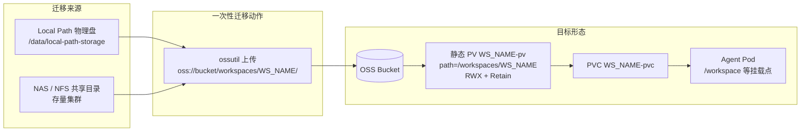
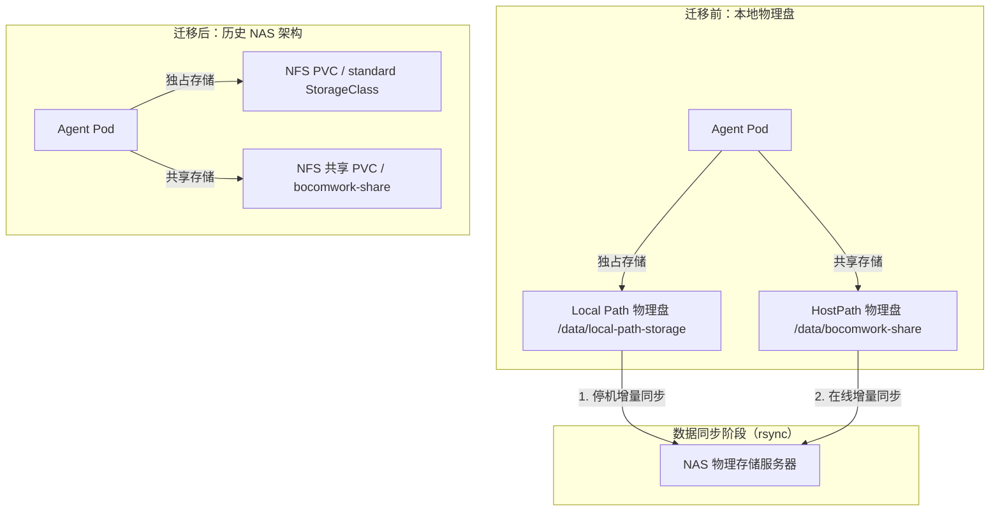

# Agent 工作空间存储迁移指南：迁移到 OSS 对象存储卷（ossfs 1.0）

> **范围与结论**
>
> - **权威结论**：存储方案的唯一定版结论见 [storage_plan.md](storage_plan.md)。本文只回答"存量数据怎么搬到 OSS"，与 storage_plan.md 冲突时以 storage_plan.md 为准。
> - **迁移主线**：全部生产集群统一迁移到 **OSS 对象存储卷 + ossfs 1.0**，目标 StorageClass 固定为 `alicloud-oss`（`fuseType: ossfs`）。
> - **覆盖两条来源**：Local Path（本地物理盘）→ OSS 见第 3 章；NAS/NFS → OSS 见第 4 章；公共工具包共享卷见第 5 章。
> - **已废弃**：原「Local Path → NAS/NFS」迁移方案不再作为生产落地路径，**NAS/NFS 仅作为迁移来源，不再作为迁移目标**；其完整历史步骤归档在文末附录 A，仅供存量集群追溯与应急参考。
> - **不在本文范围**：阿里云 ACK 部署包 `deploy-ack/`（暂不启用，见 [storage_plan.md](storage_plan.md) §3.1）、ossfs 2.0（不使用，SC 中 `fuseType` 只允许 `ossfs`）。

---

## 1. 迁移总览

### 1.1 迁移后的目标形态



迁移的关键约定（由 Operator 实现，见 `internal/controller/workspace_controller.go` 的 `reconcilePVC`）：

1. Operator 为每个 Workspace 自动创建**静态 OSS PV**：名称 `<workspace>-pv`，`path=/workspaces/<workspace-name>`，`ReadWriteMany`，`reclaimPolicy: Retain`；随后创建 PVC `<workspace>-pvc`，通过 `volumeName` 精确绑定该 PV。
2. 因此迁移**不需要手写 PV/PVC**，只需要把数据放进 OSS 的 `workspaces/<workspace-name>/` 前缀下。
3. 删除 Workspace **不会**清理 PV / PVC / OSS 数据（Operator 不注入清理 finalizer）；回收 OSS 数据必须由运维显式操作。

### 1.2 两条来源对照

| 迁移来源 | 典型场景 | 迁移工具 | 停机要求 | 章节 |
| :--- | :--- | :--- | :--- | :--- |
| Local Path 物理盘 | 早期单机部署（`deploy/local/`，数据在 `/data/local-path-storage`） | [`hack/migrate-localpath-to-oss.sh`](../hack/migrate-localpath-to-oss.sh)（封装 ossutil） | 停止目标 Workspace 后再传 | 第 3 章 |
| NAS / NFS 共享存储 | 存量集群曾用 `deploy/nfs/` 或外挂 NAS | `ossutil cp -r`，或脚本 `--root` 指向 NAS 挂载目录 | 停止目标 Workspace 后再传 | 第 4 章 |
| 公共工具包共享卷 | 原 `bocomwork-share` / `bocomwork-local-share` | `ossutil cp -r` 到 `global-oss-share-pv` 的 `/shared-assets` | 低风险，可在线 | 第 5 章 |

### 1.3 迁移原则

1. **目标唯一**：只迁到 OSS + ossfs 1.0，不要迁到 NAS/NFS（NAS/NFS 只是来源）。
2. **名称不改**：Workspace 名就是 OSS 子路径，`/workspaces/<workspace-name>/` 必须与 `metadata.name` 完全一致。
3. **按 Workspace 灰度**：先迁 1 个验证，再按批（`--limit`）放量，最后全量。
4. **先校验后删旧**：OSS 侧数据确认完整之前，不删除旧 PVC，也不删除本地/NAS 上的原始目录。
5. **随时可退**：切换前保留一份旧数据副本（详见 6.4 回滚）。

---

## 2. 迁移前置条件

### 2.1 集群侧：OSS CSI 与 `alicloud-oss` 就绪

```bash
# 目标 StorageClass 存在且参数正确（bucket / url / otherOpts / fuseType）
kubectl get sc alicloud-oss -o yaml

# 控制面 1 副本、节点插件每节点 1 个
kubectl -n default get deploy csi-controller-oss
kubectl -n default get ds csi-plugin-oss

# OSS 凭证 Secret（迁移用的 AK 与它不要求相同，但必须能读写同一个 Bucket/前缀）
kubectl -n default get secret oss-secret
```

`alicloud-oss` 的 ossfs 1.0 固定参数（与 [storage_plan.md](storage_plan.md) §2.1 一致，**不得混用 2.0 参数**）：

| 位置 | 参数 | 说明 |
| :--- | :--- | :--- |
| `StorageClass alicloud-oss` | `fuseType: "ossfs"` | 指定 1.0 客户端；`ossfs2`、`direct` 均不使用 |
| SC / PV | `otherOpts: "-o max_stat_cache_size=100000 -o allow_other"` | 1.0 参数；`allow_other` 保证容器内非 root 用户可读写 |
| SC / PV | `url: "http://<oss-endpoint>"` | 专有云/内网 OSS 显式写协议与内网 Endpoint（不写协议会被驱动强制补 `https://`） |
| SC（按需） | `sigVersion: "v4"` + `region` | 仅当 Bucket 为公共云新建 Bucket（2025-09-01 起强制 V4）时添加；存量专有云 Bucket 保持 V1，不要加 |

> ⚠️ 在 `fuseType: ossfs` 的 SC/PV 中出现 2.0 专属参数（或反之）会导致挂载失败。

### 2.2 凭证与权限

- **PV 侧**：`default/oss-secret`（`akId` / `akSecret`）由 SC 透传到每个 OSS PV 的 `nodePublishSecretRef` / `controllerPublishSecretRef`，必须是该 Bucket 的可用 AK。
- **迁移工具侧**：`ossutil config` 配置的 AK 建议使用仅对该 Bucket 可读写、且不属于个人账号的 RAM 子账号，至少需要 `GetObject` / `PutObject` / `ListObjects`（`--force` 覆盖还需要 `DeleteObject`）。
- 迁移用的 AK 与 `oss-secret` 里的 AK 可以不同，但**必须指向同一个 Bucket**，否则新 PV 挂载后看不到数据。

### 2.3 目标一致性：Bucket / Region / Endpoint

| 项目 | 权威来源 | 迁移时必须满足 |
| :--- | :--- | :--- |
| `bucket` | `deploy/oss/storageclass.yaml` 的 `parameters.bucket` | ossutil 的 `--bucket` 必须是同一个 Bucket |
| `url` / Endpoint | SC 的 `parameters.url` | 迁移可走公网或内网 Endpoint，但 Bucket 必须一致；内网 Endpoint 显式带 `http://` |
| `sigVersion` / `region` | SC（按需） | 与实际 Bucket 的签名版本一致：存量专有云 V1 不加，公共云新建 Bucket 用 V4 |
| 前缀 | 脚本默认 `workspaces` | 保持默认，不要自行改成别的目录名 |

### 2.4 Workspace 侧准备：先停止写入

```bash
# 1) 停止 Workspace
kubectl patch workspace ws-<ID> -n <namespace> --type=merge -p '{"spec":{"stopped":true}}'

# 2) 确认副本已缩到 0、Pod 已消失（否则迁移期间仍有写入，远端内容会不一致）
kubectl get deploy -n <namespace> ws-<ID>-deploy
kubectl get pods -n <namespace> | grep ws-<ID> || echo "已停止"
```

迁移前请记录 `<namespace>` 与 `metadata.name`（即 `ws-<ID>` 全名，含可能存在的随机后缀），后续删旧 PVC、查状态都要用。

### 2.5 迁移前检查清单

1. **目标 Workspace 已停止**：副本数为 0，Pod 已不存在。
2. **Bucket / Region / Endpoint 对齐**：与 `deploy/oss/storageclass.yaml` 一致（见 2.3）。
3. **ossutil 的 AK 权限足够**：目标前缀可读、可写、可列。
4. **先迁 1 个 Workspace 验证**：单跑一个，确认数据完整后再 `--all` 或分批放量。
5. **保留原始数据**：确认 OSS 数据完整前，不要删除 `/data/local-path-storage/` 下的原目录、也不要删除 NAS 上的原目录。
6. **备份出口**：local-path 的 `teardown` 是 `rm -rf`，SC `reclaimPolicy: Delete`——删 PVC 即删物理目录。若需要保留期，**必须在删 PVC 之前**把目录另存（见 6.4）。

---

## 3. 场景一：Local Path → OSS

当来源是本地物理盘（`deploy/local/`）时，无需 rsync 与 NAS 中转，直接用 `ossutil` 把每个 Workspace 的 PVC 目录上传到对应的 OSS 前缀即可，粒度是"一个 Workspace 一次"。

脚本位置：[hack/migrate-localpath-to-oss.sh](../hack/migrate-localpath-to-oss.sh)

### 3.1 路径对应关系

| 项目 | 位置 |
| :--- | :--- |
| 本地 PVC 目录 | `/data/local-path-storage/pvc-<UID>_<namespace>_ws-<ID>-pvc/` |
| 本地数据子目录 | `workspace/` `bocomwork/` `bocomcode/` |
| OSS 目标前缀 | `oss://<bucket>/workspaces/ws-<ID>/` |
| OSS 子路径 | `oss://<bucket>/workspaces/ws-<ID>/workspace/` ... |

> `ws-<ID>` 的命名必须与 Workspace CR 的 `metadata.name` 一致，因为 Operator 为该 Workspace 自动创建的 OSS PV 使用的 `subPath` 就是 `/workspaces/<workspace-name>`（见 `internal/controller/workspace_controller.go`）。迁移时务必保持 ID 原样，不要自行改写。

### 3.2 每个 Workspace 执行的动作与同步语义

```bash
cd /data/local-path-storage/pvc-<UID>_<namespace>_ws-<ID>-pvc
ossutil cp -r -f workspace  oss://<bucket>/workspaces/ws-<ID>/workspace/
ossutil cp -r -f bocomwork oss://<bucket>/workspaces/ws-<ID>/bocomwork/
ossutil cp -r -f bocomcode oss://<bucket>/workspaces/ws-<ID>/bocomcode/
```

**同步语义（重要）**：脚本对每个 Workspace 先探测 `oss://<bucket>/workspaces/ws-<ID>/`，再决定是否上传：

| 远端状态 | 脚本行为 |
| :--- | :--- |
| **已有数据**（存在非目录对象） | **整个 Workspace 跳过**：不上传、不覆盖、不删除，日志记 `SKIP` |
| 为空 / 前缀不存在 | 正常上传，OSS 侧没有可被覆盖的数据 |
| 只剩目录占位对象（`Key` 以 `/` 结尾的 0 字节对象） | 视为空，正常上传 |
| 无法确认（`ossutil ls` 报权限、网络等异常） | 该 Workspace 判 `FAIL` 并终止，**绝不盲目上传** |

要点：

* **默认永远不会覆盖或删除 OSS 上已有的数据**；需要重传时显式加 `--force`。
* 需要重新覆盖某个 Workspace（例如上一次上传中途失败、数据不完整）时：
  ```bash
  bash hack/migrate-localpath-to-oss.sh -id <ID> --force
  ```
  `--force` 会跳过探测、直接覆盖上传该 Workspace 的三个子目录。
* 探测只看"是否有非目录对象"，**误判风险很低**；但若某个 Workspace 曾在 OSS 上被上传过一部分，之后会被整体跳过，需用 `--force` 补齐。
* 切勿给 `ossutil cp` 传 `-u/--update`：该参数会跳过"远端不旧于本地"的文件，与覆盖语义相反。

### 3.3 默认排除的目录

`bocomwork/server/skills/builtin` 里的内容**不迁移**（平台内置 skills，随镜像/部署分发，不属于工作空间数据）。

脚本不是用 `ossutil --exclude` 通配符，而是在上传前把目录树裁开：排除路径的每一层只上传"非排除"的兄弟项，被排除目录完全不列举、不上传。

```text
bocomwork/                          -> 上传 server 之外的所有项
bocomwork/server/                   -> 上传 skills 之外的所有项
bocomwork/server/skills/            -> 上传 builtin 之外的所有项
bocomwork/server/skills/builtin/    -> 完全跳过
```

这样做的好处是：不依赖 ossutil v1/v2 对 `--exclude` 通配符的匹配差异，排除规则不会"静默失效"。

相关参数：

| 用法 | 说明 |
| :--- | :--- |
| 默认 | 排除 `bocomwork/server/skills/builtin` |
| `--exclude PATH` | 追加排除，路径相对 PVC 根目录，可重复（如 `--exclude bocomwork/tmp`，也可排除单个文件） |
| `--no-exclude` | 取消所有排除，全量上传 |
| `OSS_MIGRATE_EXCLUDES="a/b,c/d"` | 环境变量方式覆盖默认排除；设为空字符串即不排除 |

日志里的大小/文件数会**扣除被排除目录**，与实际上传量一致。

> ⚠️ 排除意味着 OSS 侧没有 `builtin` 目录。Workspace 切到 OSS 存储后，需要保证启动流程（镜像内置或初始化脚本）会重新把这批内置 skills 写回 PVC，否则容器里会缺 `bocomwork/server/skills/builtin`。

### 3.4 用法

> **可以直接在数据目录里执行**，不需要记生产路径：
>
> ```bash
> cd /opt/local-path-provisioner        # 生产实际的数据目录
> bash /path/to/migrate-localpath-to-oss.sh --all --yes
> ```
>
> 未指定 `--root` 时脚本按以下顺序自动定位：当前目录含 `pvc-*_<ns>_ws-<ID>-pvc` → 用当前目录；否则用 `/data/local-path-storage`；都没有则报错并提示用 `--root`。
> `--root` 同时支持相对路径（如 `--root .`、`--root ./nodes/node1`），脚本会自己转成绝对路径。

```bash
# 先确认 ossutil 已配置 AK（建议使用仅对该 Bucket 有读写权限的 RAM 子账号）
ossutil config

# 0) 列出本地有哪些 Workspace（不需要 ossutil，不产生任何写操作）
bash hack/migrate-localpath-to-oss.sh --list

# 1) 演练：只打印将要执行的命令，不删除、不上传、不写日志
bash hack/migrate-localpath-to-oss.sh -id 9660946,08,01 --dry-run

# 2) 迁移指定 Workspace（本地不存在的 ID 自动跳过，不做任何操作）
bash hack/migrate-localpath-to-oss.sh -id 9660946,08,01

# 3) 分批迁移：每次 5 个，按 ID 排序，配合 --skip-done 断点续跑
bash hack/migrate-localpath-to-oss.sh --all --limit 5 --skip-done --yes

# 4) 全量迁移（远端已有数据的 ws 会自动跳过）
bash hack/migrate-localpath-to-oss.sh --all --yes

# 5) 某个 ws 上次上传不完整，需要覆盖重传
bash hack/migrate-localpath-to-oss.sh -id 9660946 --force --yes

# 6) ID 写在文件里，批量迁移
bash hack/migrate-localpath-to-oss.sh -f ids.txt --yes
```

ID 文件（`ids.txt`）格式很宽松：

```text
# 以 # 开头是注释，整行忽略
9660946
08
01        # 行尾注释也可以
ws-0001-pvc

13, 24, 51   # 一行写多个，逗号或空格分隔
```

* 空行、多余空格、Tab 分隔、全角逗号、Windows 换行（CRLF）、UTF-8 BOM、重复 ID 都会被自动处理；
* `ws-` 前缀、`-pvc` 后缀可写可不写；
* 也可以直接把 `ls` 的结果贴进去：`pvc-06aacd22-..._bocomwork_ws-9660946-pvc`，
  甚至整条路径 `/data/local-path-storage/pvc-..._ws-08-pvc/` 都能识别出 ID；
* 支持多个文件：`-f a.txt -f b.txt`，也支持与 `-id` 混用（取并集）；
* `-f -` 表示从标准输入读取，便于管道：`kubectl ... | bash migrate-localpath-to-oss.sh -f -`。

### 3.5 参数速查

| 参数 | 说明 |
| :--- | :--- |
| `--all` | 迁移本地全部 Workspace |
| `-id LIST` | 只迁移指定 ID，逗号或空格分隔；**不存在的 ID 直接跳过、不做任何操作** |
| `-f, --file FILE` | 从文件读取 ID（每行一个，也支持逗号/空格分隔、`#` 注释、CRLF；`-` 表示 stdin）；可与 `-id` 混用 |
| `--limit N` | 最多迁移 N 个（按 ID 排序），用于分批灰度 |
| `--list` | 仅列出本地已有的 ID 及目录 |
| `--root DIR` | local-path 数据根目录；支持相对路径。省略时自动识别（当前目录 → `/data/local-path-storage`） |
| `--bucket` / `--prefix` | OSS 目标，默认 `oss://euvduatc-oss` + `workspaces` |
| `--dirs LIST` | 需要迁移的子目录，默认 `workspace,bocomwork,bocomcode` |
| `--exclude PATH` | 额外排除某个目录/文件（相对 PVC 根目录），可重复 |
| `--no-exclude` | 取消所有排除（含默认的 `bocomwork/server/skills/builtin`），全量上传 |
| `--force` | 忽略远端已有数据，强制覆盖上传（默认：远端有数据就跳过） |
| `--ossutil-arg ARG` | 透传 ossutil 参数（如 `--ossutil-arg=--jobs=10` 提升并发） |
| `--dry-run` | 演练模式 |
| `--skip-done` | 跳过日志中已成功的工作空间 |
| `--retries N` | ossutil 失败重试次数，默认 3 |
| `-y/--yes` | 跳过交互确认（cron 等非交互场景必须加） |

### 3.6 日志与断点续跑

日志默认写在**脚本所在目录**的 `logs/oss-migrate.log`；如果该目录不可写（例如脚本放在 `/usr/local/bin`），会自动回退到 `~/.oss-migrate/oss-migrate.log` 并给出提示。用 `--log` 可显式指定，指定后若不可写会直接报错（不会悄悄换位置）。

成功的工作空间会写入 TSV 日志（默认 `hack/logs/oss-migrate.log`），列结构：

```text
time  status  workspace  local_dir  remote_prefix  dirs  size  files  note
```

* 只有 `status=OK` 才代表该 Workspace 全部子目录上传成功；`FAIL` / `SKIP` 不会被 `--skip-done` 排除，方便重跑补齐。
* 因为远端已有数据就跳过，重跑整批是安全的幂等操作；`--skip-done` 只是省掉一次远端探测请求。
* 中途中断后，用 `--all --skip-done --yes` 即可从断点继续。
* 脚本结尾会汇总成功/跳过/失败数量，并针对失败项直接给出重试命令。

---

## 4. 场景二：NAS / NFS → OSS

存量集群若曾使用 NAS/NFS（`deploy/nfs/` 动态供应，或外挂 NAS 静态 PV），数据同样是"一个 Workspace 一个 PVC 目录 + 三个子目录"的结构，只是物理位置在 NAS 上。迁移方式有两条：在 NAS 挂载点直接 `ossutil cp -r`（推荐，最直观），或用脚本的 `--root` 指向整理好的 NAS 目录（复用排除规则、日志与断点续跑）。

### 4.1 前置：定位 NAS 上的 Workspace 数据目录

1. **确认 NAS 的导出路径**：`deploy/nfs/deployment.yaml` 里的 `NFS_SERVER` / `NFS_PATH`，或静态 PV 模板中的 `spec.nfs.server` / `spec.nfs.path`。
2. **动态供应的目录名**：`nfs-subdir-external-provisioner` 默认按 `<namespace>-<pvcName>-<pvName>` 生成目录（例如 `bocomwork-ws-9660946-pvc-pvc-1a2b3c`）；以现场为准。
3. **从 K8s 反查最准确**：直接看该 Workspace 的 NFS PV 指向哪个子目录：

   ```bash
   # PVC -> PV
   kubectl get pvc ws-<ID>-pvc -n <namespace> -o jsonpath='{.spec.volumeName}'
   # PV -> NAS 子目录（形如 /<nfs-path>/<dir>）
   kubectl get pv <pv-name> -o jsonpath='{.spec.nfs.path}'
   ```

4. **在能访问 NAS 的节点/跳板机上挂载**（示例，参数与 `deploy/nfs/class.yaml` 的 `mountOptions` 保持一致）：

   ```bash
   sudo mkdir -p /mnt/nas
   sudo mount -t nfs -o nfsvers=3,nolock,tcp,noatime,noresvport <nas-server>:/<nfs-path> /mnt/nas
   ls -d /mnt/nas/*ws-<ID>*
   ```

5. **目录内部结构与 local-path 完全一致**：`workspace/`、`bocomwork/`、`bocomcode/`（容器内分别表现为 `/workspace` 等挂载点）。因此迁移脚本的 `--dirs`、`--exclude` 规则同样适用。

> NAS 的 StorageClass `standard` 带 `archiveOnDelete: "true"`：删 PVC 时目录会被归档而不是硬删除。它只是**兜底**，不能代替"先校验再删"的纪律。

### 4.2 方式一：在 NAS 挂载点直接 `ossutil cp -r`（推荐）

```bash
# 1) 停 Workspace（见 2.4），确认 Pod 已消失后再拷贝
# 2) 定位到 Workspace 的 NAS 目录
NAS_DIR=/mnt/nas/<namespace>-ws-<ID>-pvc-pvc-xxxx

# 3) 三个子目录分别上传，目标前缀必须与 Workspace 名称一致
ossutil cp -r -f "$NAS_DIR/workspace"  oss://<bucket>/workspaces/ws-<ID>/workspace/
ossutil cp -r -f "$NAS_DIR/bocomwork" oss://<bucket>/workspaces/ws-<ID>/bocomwork/
ossutil cp -r -f "$NAS_DIR/bocomcode" oss://<bucket>/workspaces/ws-<ID>/bocomcode/

# 4) 校验对象数与大小
ossutil ls oss://<bucket>/workspaces/ws-<ID>/ | tail -1
```

**排除内置 skills**：直接 `ossutil cp` 不会自动应用脚本的默认排除规则（`bocomwork/server/skills/builtin`）。三种处理方式，任选其一：

* 上传后在 OSS 侧删掉该前缀（前提：确认其内容与镜像/部署分发的一致）：
  ```bash
  ossutil rm -r oss://<bucket>/workspaces/ws-<ID>/bocomwork/server/skills/builtin/
  ```
* 迁移前用 `rsync -a --exclude 'bocomwork/server/skills/builtin'` 把目录裁到本地 staging 目录，再对 staging 目录整体 `ossutil cp -r`。
* 改用方式二（脚本），排除规则自动生效。

> `ossutil` v1/v2 对 `--exclude` 通配符的匹配语义存在差异，不建议把排除规则压在 `--exclude` 上；若要使用，务必抽样验证结果。

### 4.3 方式二：用脚本 `--root` 指向 NAS 挂载目录

脚本的数据源由 `--root` 决定，上传目标仍是 `oss://<bucket>/<prefix>/ws-<ID>/`——**来源换成 NAS 不会改变 OSS 目标路径**，`--dirs` / `--exclude` / `--force` / `--skip-done` / 日志等能力全部保留。

脚本按目录名 `<root>/pvc-*_<ns>_ws-<ID>-pvc` 识别 Workspace，因此 `--root` 指向的目录必须符合这个命名：

* **目录名已是 local-path 命名**（例如历史目录曾被拷贝成该形式）：直接指向 NAS 挂载点即可。
  ```bash
  bash hack/migrate-localpath-to-oss.sh --root /mnt/nas --list
  bash hack/migrate-localpath-to-oss.sh --root /mnt/nas -id 9660946 --dry-run
  bash hack/migrate-localpath-to-oss.sh --root /mnt/nas --all --limit 5 --skip-done --yes
  ```
* **目录名是 NAS 默认命名**（`<namespace>-<pvcName>-<pvName>`）：先建一个 staging 目录，把每个 Workspace 目录按 local-path 规则映射进去，再让脚本 `--root` 指向 staging。最稳妥的映射方式是 bind mount（也可用软链接）：
  ```bash
  mkdir -p /mnt/nas-staging/pvc-nas_bocomwork_ws-9660946-pvc
  # 逐个 Workspace 做映射：目标目录名必须满足 pvc-*_<ns>_ws-<ID>-pvc
  sudo mount --bind /mnt/nas/bocomwork-ws-9660946-pvc-pvc-1a2b3c \
       /mnt/nas-staging/pvc-nas_bocomwork_ws-9660946-pvc
  bash hack/migrate-localpath-to-oss.sh --root /mnt/nas-staging --all --yes
  ```
  脚本会用目录名里的 `_ws-<ID>-pvc` 解析 Workspace ID，**staging 名里的 ID 必须与真实 Workspace 名一致**（含随机后缀时写全）。

> 迁移完成后即可撤掉 staging 目录的 bind mount，脚本不会修改数据源。

### 4.4 关键约束：Workspace 名称不能改

OSS 侧的路径由 Operator 固定为 `/workspaces/<workspace-name>`（`internal/controller/workspace_controller.go` 的 `subPath`）。因此：

* NAS 目录名、OSS 前缀、Workspace 的 `metadata.name` 三者的 ID 部分必须完全一致，大小写与随机后缀都要原样保留；
* **不要**为了"看起来整齐"重命名目录或迁移后修改 Workspace 名称——改名后的 Workspace 会挂载到一个全新的空前缀，表现为"数据丢失"；
* 若确需改名，只能按新名称重新上传一份数据，并按新 Workspace 重建（老前缀不会自动迁移）。

---

## 5. 公共共享卷（工具包）迁移到 OSS

公共共享空间存放平台公共工具包（如 `skill`、`bocomwork`、`opencodedir`），读多写少，切换风险低。

目标形态（清单见 [shared_pv_template.yaml](../deploy/oss-public/shared_pv_template.yaml) 与 [shared_pvc_template.yaml](../deploy/oss-public/shared_pvc_template.yaml)）：

| 对象 | 名称 | 关键参数 |
| :--- | :--- | :--- |
| PV | `global-oss-share-pv` | `path: /shared-assets`，`ReadWriteMany`，`Retain`，`fuseType: ossfs` |
| PVC | `global-oss-share-pvc` | `volumeName` 精确绑定上面的 PV，`storageClassName: ""` |

### 5.1 上传工具包到 OSS 共享前缀

```bash
# 来源可以是 Local Path 的共享目录（hostPath /data/bocomwork-share）
# 也可以是 NAS 上的共享目录，任选现场可访问的路径
ossutil cp -r -f /data/bocomwork-share/ oss://<shared-bucket>/shared-assets/
```

> 共享卷与个人 workspace 卷可以放在不同 Bucket（物理隔离），前缀固定为 `/shared-assets`。

### 5.2 切换 Workspace 请求中的共享 PVC 名称

把 `spec.sharedVolumeMounts[].pvcName` 由旧的 `bocomwork-local-share`（Local Path）或 `bocomwork-share`（NAS）改为 `global-oss-share-pvc`，并保持 `mountPath` / `subPath` 不变：

```yaml
sharedVolumeMounts:
  - pvcName: "global-oss-share-pvc"
    mountPath: "/opt/bocom-defaults/skill/"
    subPath: "skill"
    readOnly: true
  - pvcName: "global-oss-share-pvc"
    mountPath: "/opt/express/bocomwork"
    subPath: "bocomwork"
    readOnly: true
  - pvcName: "global-oss-share-pvc"
    mountPath: "/opt/bocom-defaults/opencodedir/"
    subPath: "opencodedir"
    readOnly: true
```

参数语义见 [workspace_user_manual.md](workspace_user_manual.md) 的 `sharedVolumeMounts` 章节。

### 5.3 验证

重启一个 Workspace，确认共享挂载点内容正确：

```bash
kubectl exec -it <ws-pod> -n <namespace> -- ls /opt/bocom-defaults/skill/ | head
```

---

## 6. 切换、校验与回滚

### 6.1 切换默认 StorageClass 到 `alicloud-oss`

新建 Workspace 若不显式写 `spec.storage.storageClass`，Operator 按以下顺序解析默认存储类：**① 控制器容器的 `DEFAULT_STORAGE_CLASS` 环境变量；② 集群中带 `storageclass.kubernetes.io/is-default-class="true"` 注解的 SC**（见 `getDefaultStorageClass`）。仓库默认清单未设置该环境变量，因此实际生效的是集群默认 SC 注解：

```bash
# 1) 取消旧的默认标记（local-path 与 NAS 的 standard 都清掉）
kubectl annotate storageclass local-path storageclass.kubernetes.io/is-default-class- --overwrite
kubectl annotate storageclass standard storageclass.kubernetes.io/is-default-class- --overwrite

# 2) 把 alicloud-oss 设为集群默认
kubectl annotate storageclass alicloud-oss storageclass.kubernetes.io/is-default-class="true" --overwrite

# 3) 验证
kubectl get sc    # alicloud-oss 应带 (default)
```

> 若控制面 Deployment 里显式配置了 `DEFAULT_STORAGE_CLASS=local-path`（或 `standard`），注解切换不会生效，必须先修改该环境变量并重启控制器。
> 切换默认 SC 只影响**新建** Workspace；存量 Workspace 的 PVC 已存在，Operator 不会自动替换，仍需按 6.2 逐个切换。

### 6.2 把单个 Workspace 切到 OSS 底座

前提：数据已上传并通过 6.3 的校验。

```bash
NS=<namespace>
WS=ws-<ID>

# 1) 确认已停止、Pod 已消失
kubectl get deploy -n $NS $WS-deploy
kubectl get pods -n $NS | grep "$WS" || echo "已停止"

# 2) 把 CR 的存储类显式改为 alicloud-oss（存量 CR 一般显式写着 local-path/standard）
kubectl patch workspace $WS -n $NS --type=merge \
  -p '{"spec":{"storage":{"storageClass":"alicloud-oss"}}}'

# 3) 删除旧 PVC（local-path：reclaimPolicy=Delete，PV 与物理目录会被一并清理）
kubectl delete pvc $WS-pvc -n $NS

# 4) 唤醒 Workspace，触发调谐：Operator 创建 OSS 静态 PV + 精确绑定的 PVC
kubectl patch workspace $WS -n $NS --type=merge -p '{"spec":{"stopped":false}}'

# 5) 验证 PV/PVC 与挂载参数
kubectl get pv $WS-pv -o jsonpath='{.spec.csi.volumeAttributes}' | tr ',' '\n'
kubectl get pvc $WS-pvc -n $NS
kubectl -n ack-csi-fuse get pods
```

> ⚠️ 第 3 步不可逆：`deploy/local/local-path-storage.yaml` 的 `teardown` 是 `rm -rf "$VOL_DIR"`，删 PVC 后本地目录立即消失。务必先完成上传与校验；需要保留期就先另存（6.4）。
>
> 删完 PVC 后必须触发一次 Workspace 调谐（唤醒或编辑 CR）才会重建 PVC——PVC 不带 OwnerReference，Operator 不会因为 PVC 被删而自动重入。

### 6.3 校验

上传完成后、删除旧 PVC 之前，至少做两层校验：

1. **对象数量/大小比对**（注意扣除被排除目录）：

   ```bash
   # 本地（或 NAS）文件数
   find /data/local-path-storage/pvc-*_bocomwork_ws-<ID>-pvc/workspace -type f | wc -l
   # OSS 对象数
   ossutil ls oss://<bucket>/workspaces/ws-<ID>/workspace/ | tail -1
   ```

2. **实际挂载验证**（切换到 OSS 后）：

   ```bash
   # 数据在
   kubectl exec -it <ws-pod> -n <namespace> -- ls -al /workspace | head
   # 写读回环，并落盘
   kubectl exec -it <ws-pod> -n <namespace> -- sh -c 'echo ok > /workspace/.migrate-check; sync'
   # 停止 → 唤醒 → 文件仍在
   kubectl patch workspace ws-<ID> -n <namespace> --type=merge -p '{"spec":{"stopped":true}}'
   kubectl patch workspace ws-<ID> -n <namespace> --type=merge -p '{"spec":{"stopped":false}}'
   ```

> ossfs 写入是**异步上传**：`write()` 先落本地缓存，`close`/`flush`/`fsync` 才触发上传，且终止宽限期只有 2 秒。写完大文件后先 `sync` 再停止，详见 [oss_storage_architecture.md](oss_storage_architecture.md) 第 5 节。

### 6.4 回滚

| 所处阶段 | 回滚方式 | 说明 |
| :--- | :--- | :--- |
| 仅完成上传，尚未删旧 PVC | **无需回滚** | Workspace 仍挂在旧存储；撤销只需（可选）删除 OSS 前缀 |
| 已删旧 PVC（Local Path 来源） | **不可回滚到本地盘** | `teardown` 已 `rm -rf`；只能继续用 OSS，或从删除前另存的物理备份恢复 |
| 已删旧 PVC（NAS 来源） | 可按附录 A 的重建方式挂回 NAS | `archiveOnDelete: "true"` 通常保留了归档目录，仅限存量集群应急 |
| 已切到 OSS 但数据异常 | 重新上传后再唤醒 | OSS 侧可用 `--force` 覆盖补齐；不要删除 PV（`Retain` 会保留数据） |

**保留期建议**：确认 OSS 数据完整前，先做一份旧数据副本——local-path 删除 PVC 会连带删除目录，所以"保留 7 天"必须落在删 PVC **之前**：

```bash
# Local Path 来源：删 PVC 前把目录另存到备份盘/NAS
sudo cp -a /data/local-path-storage/pvc-*_bocomwork_ws-<ID>-pvc /backup/ws-<ID>/
```

### 6.5 收尾与清理

* **查询/回收 OSS 数据**：删除 Workspace 不会清理 PV/PVC/OSS 数据。确认业务下线后，按需手工删除：
  ```bash
  kubectl delete pvc ws-<ID>-pvc -n <namespace>
  kubectl delete pv ws-<ID>-pv          # Retain：PV 会先变 Released，需手工删
  ossutil rm -r oss://<bucket>/workspaces/ws-<ID>/ --force
  ```
* **旧存储组件**：集群内已无 Workspace 使用 Local Path / NAS 后，再按部署手册附录下线对应 Provisioner（`deploy/local/`、`deploy/nfs/`）。
* **共享卷**：`global-oss-share-pv` / `global-oss-share-pvc` 为 `Retain`，切换共享 PVC 后旧 PV 不会被自动清理，按需手工删除。

---

## 7. 相关文档

| 文档 | 用途 |
| :--- | :--- |
| [storage_plan.md](storage_plan.md) | 存储方案定版结论（唯一权威） |
| [oss_storage_architecture.md](oss_storage_architecture.md) | OSS 运行期数据链路、同步语义与排障 |
| [offline_deployment_guide.md](offline_deployment_guide.md) | 离线部署手册（主线 OSS；附录 A Local Path、附录 B NAS/NFS、附录 C ACK） |
| [workspace_user_manual.md](workspace_user_manual.md) | Workspace CR 参数（`storageClass`、`sharedVolumeMounts`） |
| [deployment_architecture.md](deployment_architecture.md) | 系统架构与存储层职责 |
| [../hack/migrate-localpath-to-oss.sh](../hack/migrate-localpath-to-oss.sh) | 迁移脚本（含 `--help` 完整参数） |

---

## 附录 A：Local Path → NAS/NFS 迁移（历史方案，已不再作为生产落地方案）

> ⚠️ **本附录已废弃**。存储方案定版为 OSS + ossfs 1.0（[storage_plan.md](storage_plan.md)），**NAS/NFS 不是迁移目标**。以下内容仅用于：
>
> 1. 存量集群的历史迁移追溯；
> 2. NAS 来源数据在应急回退时的挂回参考；
> 3. 理解老集群 `standard` SC 的来历。
>
> 新集群、新 Workspace 不要按本附录执行；需要迁移请回到第 3 章（Local Path → OSS）或第 4 章（NAS → OSS）。

### A.1 历史迁移架构



### A.2 准备：切换集群默认存储类到 `standard`（历史动作）

```bash
# 1. 移除 local-path 的默认存储类注解
kubectl annotate storageclass local-path storageclass.kubernetes.io/is-default-class- --overwrite

# 2. 将老的 NAS 存储类 (standard) 设置为集群默认存储类
kubectl annotate storageclass standard storageclass.kubernetes.io/is-default-class="true" --overwrite
```

*验证结果*：运行 `kubectl get sc`，确认 `standard` 带有 `(default)` 标记。

### A.3 公共共享空间迁移（工具包共享目录）

公共共享空间存储公共工具包（如 `skill`、`bocomwork`、`opencodedir`），读多写少，历史方案可秒级切换。

**步骤 1：同步本地物理盘工具包到 NAS**

```bash
# 保持文件属主 (UID/GID)、权限、时间戳不变 (-a)
rsync -avzP /data/bocomwork-share/ user@nas-server-ip:/nfs/share/bocomwork-share/
```

**步骤 2：切换 API 请求中的共享 PVC 名称**

历史做法是把 `sharedVolumeMounts` 的 `pvcName` 由 `bocomwork-local-share` 改为 NAS 的 `bocomwork-share`：

```json
"sharedVolumeMounts": [
  {
    "pvcName": "bocomwork-share",
    "mountPath": "/opt/bocom-defaults/skill/",
    "subPath": "skill"
  },
  {
    "pvcName": "bocomwork-share",
    "mountPath": "/opt/express/bocomwork",
    "subPath": "bocomwork"
  },
  {
    "pvcName": "bocomwork-share",
    "mountPath": "/opt/bocom-defaults/opencodedir/",
    "subPath": "opencodedir"
  }
]
```

> 现行做法见第 5 章：共享卷迁移到 `global-oss-share-pvc`。

### A.4 个人独占空间迁移（历史步骤）

每个 Workspace 拥有专属的个人目录（`/workspace` 及 `bocomwork` 等子目录）。

**步骤 1：停止目标 Workspace**

```bash
kubectl get deploy -n bocomwork ws-user01-deploy   # 确认副本已缩为 0
```

**步骤 2：定位物理机上的本地存储路径**

```bash
# 格式为: /data/local-path-storage/pvc-<UID>_<NAMESPACE>_<PVC_NAME>
ls -ld /data/local-path-storage/pvc-*_bocomwork_ws-user01-pvc
```

**步骤 3：数据同步至 NAS**

```bash
rsync -avzP /data/local-path-storage/pvc-xxx_bocomwork_ws-user01-pvc/ user@nas-server-ip:/nfs/pv-user01/
```

**步骤 4：重建 PVC 绑定至 NAS**

1. 删除旧的 `local-path` PVC：
   ```bash
   kubectl delete pvc ws-user01-pvc -n bocomwork
   ```
2. 创建绑定 NAS 的新 PVC（`storageClassName: standard`）：
   ```yaml
   apiVersion: v1
   kind: PersistentVolumeClaim
   metadata:
     name: ws-user01-pvc
     namespace: bocomwork
   spec:
     accessModes:
       - ReadWriteOnce
     storageClassName: standard # 历史方案：指向 NAS
     resources:
       requests:
         storage: 20Gi
   ```

**步骤 5：重新拉起 / 唤醒 Workspace**

通过 API 发送唤醒请求（或设置 `spec.stopped: false`），容器将挂载 NAS 上的数据。

### A.5 PV 生命周期处理（历史）

迁移过程中，老的本地 PV 按**动态分配**和**静态创建**两类分别处理：

1. **个人独占空间 PV（动态 `local-path` PV）**
   * `local-path` 动态创建的 PV 回收策略为 `Delete`。
   * 删除旧 PVC 时，K8s 会**自动删除对应的 `local-path` PV**，`teardown` 脚本同时 `rm -rf` 物理目录。
   * 因此历史做法要求先 `rsync` 完成、确认无误后再删 PVC。
   * 重建指定 `storageClassName: standard` 的 PVC 后，NAS Provisioner 会动态申请并生成新的 NAS PV。

2. **共享空间 PV（静态 `bocomwork-local-share-pv`）**
   * 该 PV 回收策略为 `Retain`（`ReadOnlyMany`，hostPath `/data/bocomwork-share`）。
   * 删除 PVC 后 PV 变为 `Released`，物理文件仍在；确认不再需要后手工 `kubectl delete pv bocomwork-local-share-pv`，磁盘目录可自行清理或留作备份。

### A.6 历史方案的安全与回滚注意事项

1. **权限一致性 (UID/GID)**：容器内通常为非 root（如 UID 1000），`rsync` 必须带 `-a`，否则会出现 `Permission Denied`。
2. **数据一致性校验**：迁移完成后用 `rsync -cn-avzP`（校验模式）做二次对比，确认无缺失与损坏。
3. **回滚**：删除本地 `local-path` 目录前，保留物理机 `/data/local-path-storage/` 中的原数据（建议 ≥7 天）；NAS 出现网络波动时可把 PVC 重新挂回本地物理盘。

---

## 变更记录

| 日期 | 说明 |
| :--- | :--- |
| 2026-11-04 | 重构：迁移主线改为「迁移到 OSS + ossfs 1.0」，覆盖 Local Path → OSS 与 NAS/NFS → OSS 两条来源；原「Local Path → NAS/NFS」方案整体降级为附录 A（历史/已废弃）；补充共享工具包迁移到 OSS、切换默认 SC、校验与回滚 |
